# Plane Radar P4

A live ADS-B aircraft radar for the **Waveshare ESP32-P4-WIFI6-Touch-LCD-3.4C**
(3.4", 800×800 round, touch) and its 4" 720×720 sibling (**-4C**). It's a
higher-resolution, touch-driven take on
[MatixYo/ESP32-Plane-Radar](https://github.com/MatixYo/ESP32-Plane-Radar).

<p align="center">
  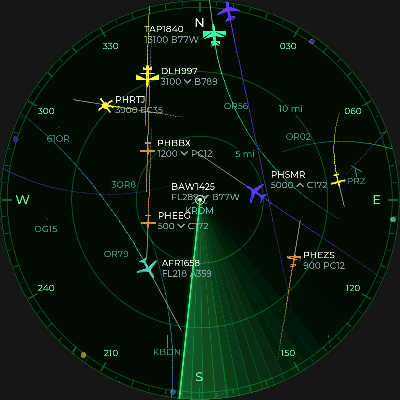
  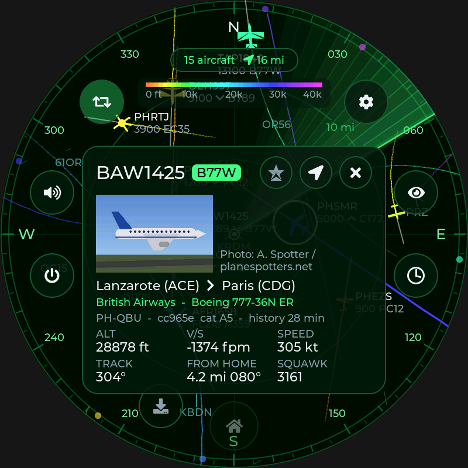
</p>

> Screenshots come from the desktop simulator in `sim/`. It runs the same UI
> code against synthetic traffic.

## Features

**Radar**
- North-up map centered on your home, with range rings in km, mi or nm and
  a compass bezel.
- Aircraft silhouettes rotated to their heading: light aircraft, airliners,
  heavies and helicopters each get their own shape. Colors can follow
  altitude (tar1090 style) or the theme.
- Labels with callsign, flight level or altitude, a climb/descent arrow and
  the aircraft type. Labels avoid each other and other aircraft.
- Trails covering the last few minutes, plus one-minute speed vectors. Motion
  is dead-reckoned between updates, so it stays smooth.
- Runways and ICAO codes for about 5,300 large and medium airports, all built
  into the firmware.
- Aircraft outside the visible area show as direction dots on the rim.
- Emergency squawks (7500/7600/7700) get a pulsing red ring.

**Touch**
- One finger pans, with momentum. Two fingers pinch-zoom around the midpoint
  between them.
- Double-tap zooms in. The **＋/−** buttons also zoom.
- **Home** button flies back to your home location and zoom.
- Tap an aircraft to open an info card: altitude, vertical speed, speed,
  track, distance and bearing from home, squawk and registration. **Follow**
  keeps that aircraft on screen.
- Long-press anywhere on the map to make that spot your home.

**Animations and sound**
- Rotating radar sweep with a fading beam. The speed is adjustable, and you
  can turn it on or off from the radar screen.
- Optional "echo" mode: aircraft fade after the beam passes and light up
  again on the next sweep.
- Smooth fly-to when going home, zooming or following.
- Sounds are generated on the device, so there are no audio files. You get a
  sonar ping on each sweep, a chime for new aircraft, a proximity alert when
  something flies low inside your alert radius, an emergency siren, and touch
  clicks. Each sound has its own switch, and there's a volume slider.

**Settings (all on the touchscreen)**
- **Wi-Fi**: scan, pick a network, enter the password on an on-screen
  keyboard (with show/hide), join hidden networks, or forget the network.
- **Location**: pick it on the map with a crosshair, type in lat/lon, or enter
  an airport code (`KJFK`, `AMS`, …). You can also set the zoom the Home
  button returns to.
- **Display**: four themes (Green phosphor, Amber, Blue, red Night mode),
  brightness, units, label detail, color mode, and toggles for trails,
  vectors, rings, runways and airport codes. Sweep settings and dim-when-idle
  live here too.
- **Sound**: master switch, volume, a switch for each sound, alert radius and
  altitude, and test buttons.
- **Traffic & data**: show ground traffic, altitude filters, the feed
  (adsb.fi, airplanes.live or adsb.lol) and the update interval.
- **About**: firmware version, IP address and signal strength, feed status,
  free memory, restart and factory reset.

On first boot the device opens Wi-Fi setup, then asks for your location. No
phone or captive portal is needed.

| | | |
|:-:|:-:|:-:|
| 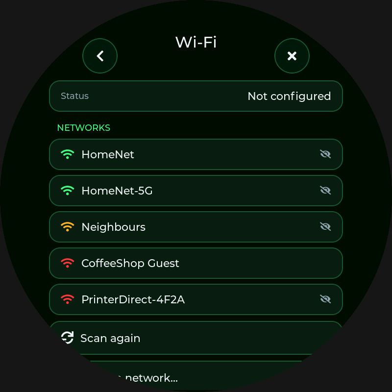 | 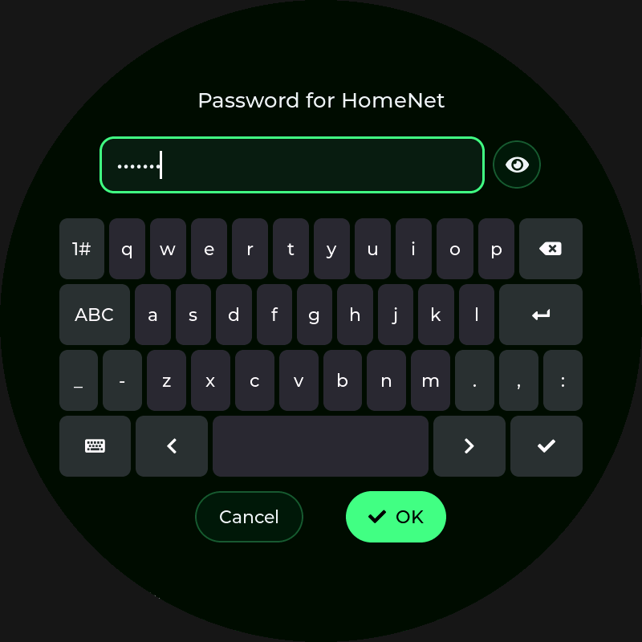 | 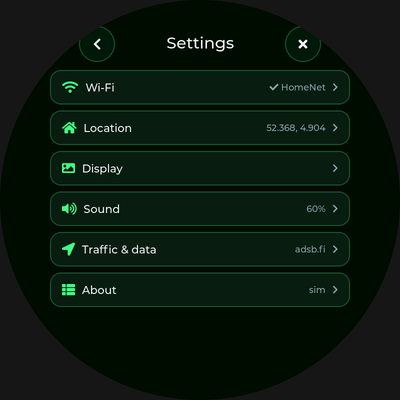 |
| 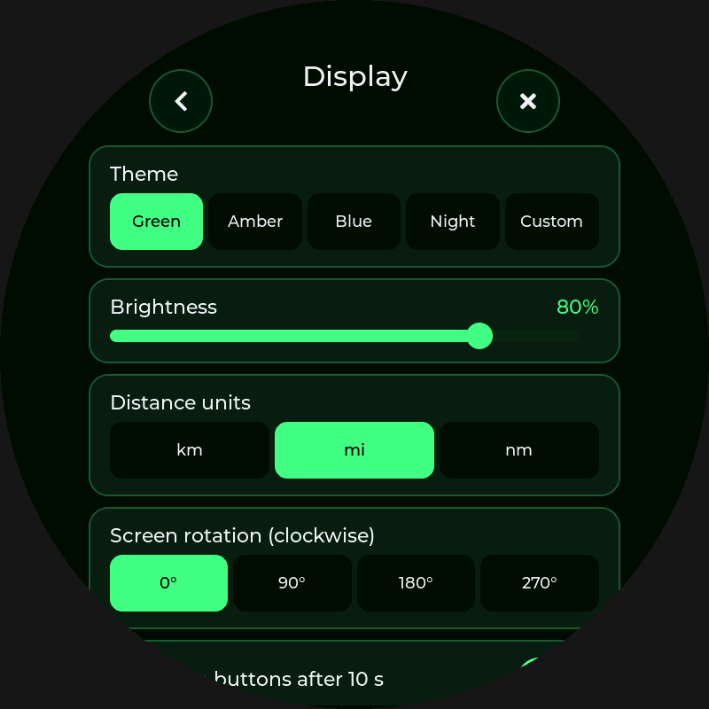 | 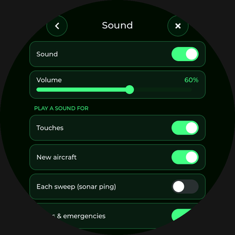 | 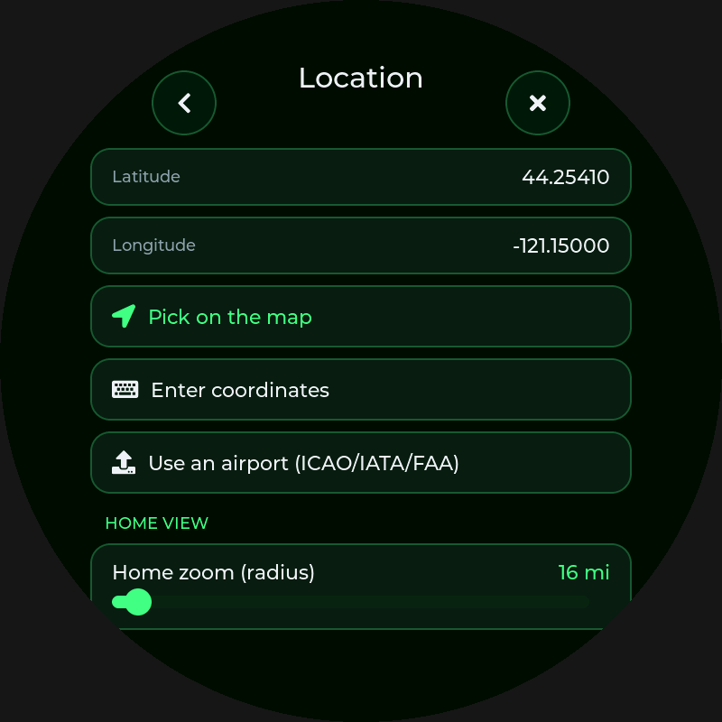 |
| 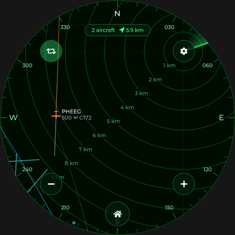 | 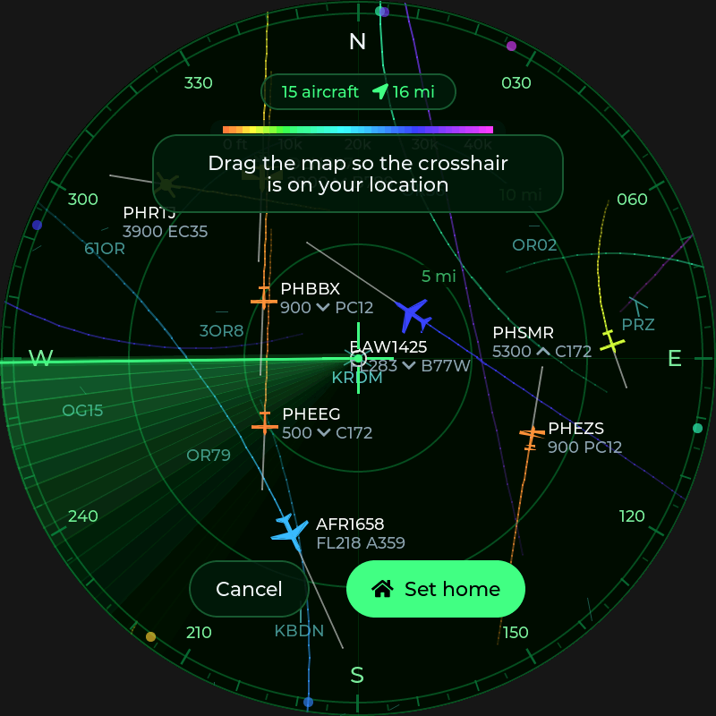 | 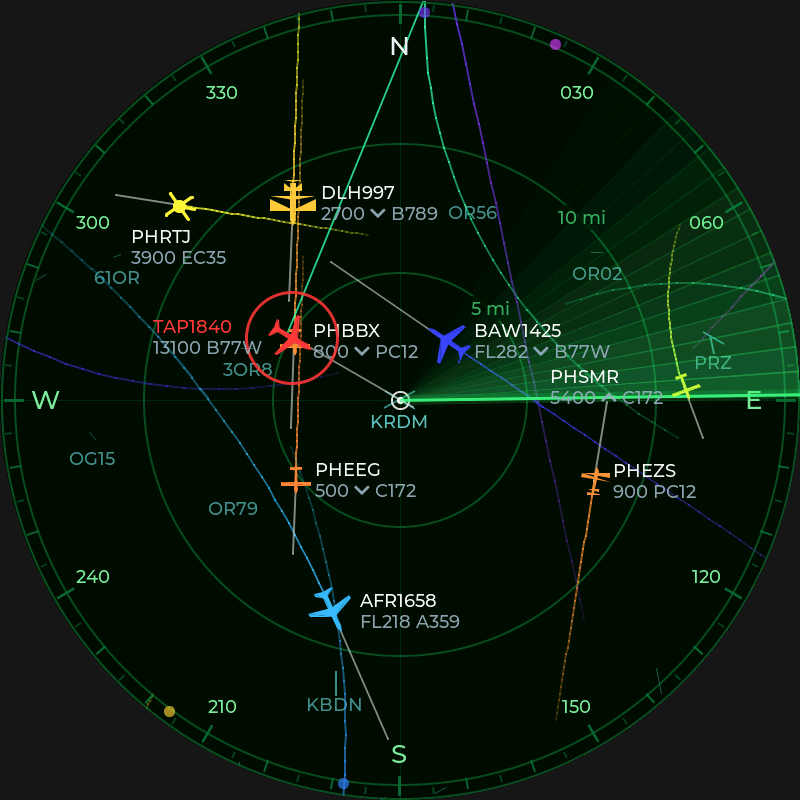 |
| 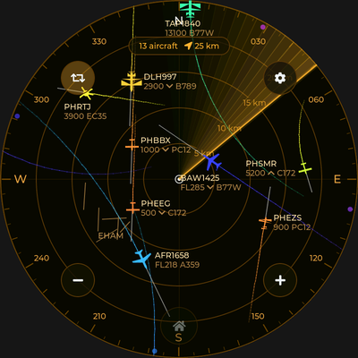 | 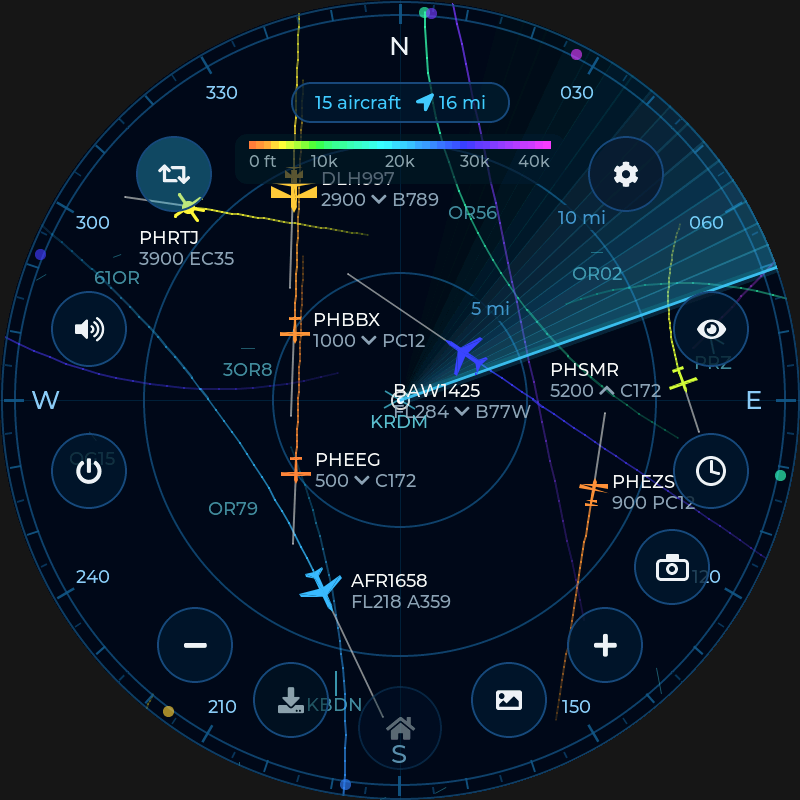 | 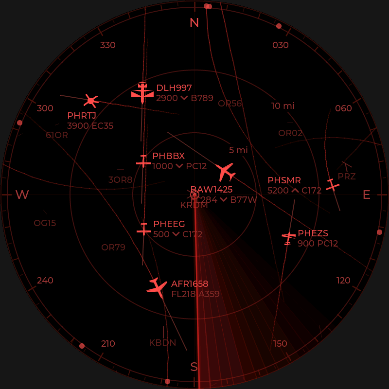 |

## Hardware

| Part | On the board |
|---|---|
| SoC | ESP32-P4 (dual RISC-V, 360 MHz) with 32 MB PSRAM |
| Display | 3.4" 800×800 (or 4" 720×720) round IPS, MIPI-DSI, JD9365 |
| Touch | GT911 capacitive, multi-touch over I2C |
| Wi-Fi | ESP32-C6 co-processor (Wi-Fi 6) over SDIO, via ESP-Hosted |
| Audio | ES8311 codec + speaker amplifier (connect a small speaker to the speaker connector if your kit has none) |

Pin mapping comes from Waveshare's BSP
([`waveshare/esp32_p4_wifi6_touch_lcd_xc`](https://components.espressif.com/components/waveshare/esp32_p4_wifi6_touch_lcd_xc)),
so you don't need to wire anything.

## Building and flashing

You need **ESP-IDF v5.5** or newer.

```bash
# 3.4" 800x800 board (default)
idf.py set-target esp32p4
idf.py build flash monitor

# 4" 720x720 board
idf.py -D SDKCONFIG_DEFAULTS="sdkconfig.defaults;sdkconfig.defaults.4inch" set-target esp32p4
idf.py -D SDKCONFIG_DEFAULTS="sdkconfig.defaults;sdkconfig.defaults.4inch" build flash monitor
```

The first build downloads LVGL 9.4, the Waveshare BSP, `esp_hosted` and
`esp_wifi_remote` through the IDF Component Manager. If you change
`sdkconfig.defaults`, delete `sdkconfig` so the new defaults take effect.

LVGL needs to be 9.4 or newer, because the LVGL adapter that Waveshare's BSP
uses depends on it. `CONFIG_LV_ATTRIBUTE_FAST_MEM_USE_IRAM` stays off: turning
it on overflows the P4's internal RAM at link time.

### Flashing a prebuilt image

A merged image (bootloader + partition table + app) is written at offset `0x0`:

```bash
python -m esptool --chip esp32p4 -b 460800 write_flash 0x0 plane-radar-3.4in-800.bin
```

The CI build artifacts include merged images for both boards. You can also
flash them from a browser with
[ESP Web Flasher / esptool-js](https://espressif.github.io/esptool-js/).

GitHub Actions (`.github/workflows/build.yml`) builds firmware for both
boards, runs the unit tests and renders simulator screenshots on every push.

### If something doesn't work

- **No Wi-Fi networks found / Wi-Fi init fails**: the ESP-Hosted firmware on
  the C6 has to be compatible with the `esp_hosted` version on the P4. Waveshare
  ships the C6 with slave firmware. If the versions don't match, update the C6
  by following the ESP-Hosted docs ("Co-processor OTA" or flashing the C6
  directly).
- **Chip revision error at boot**: older boards use ESP32-P4 rev 1.x, newer
  ones rev 3.x. Pick the matching option under *Component config → Hardware
  Settings → Chip revision* in `idf.py menuconfig`.
- **Touch is mirrored or rotated**: set `touch_cfg.touch_flags` in
  `main/platform/esp/esp_display.cpp`.
- **Animation is sluggish**: lower the sweep speed or turn off the sweep or
  trails in Display settings. A 30 fps sweep at 800×800 is the heaviest load.

## Desktop simulator and tests

The UI only reaches the hardware through `main/platform/platform.h`.
`sim/platform_sim.cpp` fakes that interface, so the same code runs on a PC:

```bash
cmake -S sim -B build-sim && cmake --build build-sim -j
./build-sim/core_tests                       # geo, pinch/zoom math, ADS-B parsing, trails, alerts, sounds
./build-sim/plane_radar_sim sim_out          # scripted taps/drags/pinches -> PNG screenshots + WAV sounds
./build-sim/plane_radar_sim sim_out --size 720
```

LVGL and cJSON are fetched automatically. To build offline, pass
`-DLVGL_DIR=…` and `-DCJSON_DIR=…`. The simulator uses LVGL 9.4 by
default, and the UI code also compiles against 9.2 through 9.6.

## Project layout

```
main/
  main.cpp              boot sequence
  core/                 pure C++, no LVGL/IDF: geo math, viewport (pan/pinch/fling/fly-to),
                        traffic store with trails + alerts, ADS-B JSON parser, sound synth, settings
  app/                  app state: settings persistence glue, ADS-B polling loop, sound policy
  ui/                   LVGL UI: radar_view (static layer cache + per-frame overlay), hud,
                        settings_ui, keyboard, sprites, theme, widgets
  platform/platform.h   hardware abstraction used by app/ui
  platform/esp/         ESP-IDF implementation: display+multi-touch, Wi-Fi, HTTPS, NVS, audio
  data/                 embedded airports/runways (scripts/build_airports.py)
sim/                    desktop simulator (headless LVGL, fake traffic, PNG/WAV output)
tests/                  host unit tests
```

### How rendering works

The software renderer draws 800×800 at up to 30 fps. To keep that fast, the
background, rings, compass, runways, airport codes and trails are drawn into a
cached PSRAM canvas, and that canvas is redrawn only when the view moves or new
data arrives. The sweep, aircraft and labels are drawn every frame on top of
it. Aircraft are pre-rendered at 72 headings and recolored when drawn.

## Data and credits

- Aircraft positions come from free community feeds:
  [adsb.fi](https://adsb.fi), [airplanes.live](https://airplanes.live) and
  [adsb.lol](https://adsb.lol). Please keep the polling interval reasonable
  (5 s default).
- Airport and runway data is from [OurAirports](https://ourairports.com/data/)
  (public domain). Regenerate it with `python3 scripts/build_airports.py`.
- Inspired by and data-compatible with
  [MatixYo/ESP32-Plane-Radar](https://github.com/MatixYo/ESP32-Plane-Radar)
  (MIT).
