# Plane Radar P4

A live ADS-B aircraft radar for the **Waveshare ESP32-P4-WIFI6-Touch-LCD-3.4C**
(3.4", 800×800 round, touch) and its 4" 720×720 sibling (**-4C**). It's a
higher-resolution, touch-driven take on
[MatixYo/ESP32-Plane-Radar](https://github.com/MatixYo/ESP32-Plane-Radar).

<p align="center">
  
  
</p>

> Screenshots come from the desktop simulator in `sim/`. It runs the same UI
> code against synthetic traffic.

## Documentation

| | |
|---|---|
| 📖 **[User guide](docs/USER_GUIDE.md)** | Every screen, gesture and setting explained, plus alerts, flashing and troubleshooting |
| 📝 **[Changelog](CHANGELOG.md)** | What changed in each version |
| ⬇️ **[Releases](https://github.com/ShadowStacker/P4-Radar/releases)** | Ready-to-flash firmware for both boards |

## Quick start

1. **Find your chip revision.** Connect the board to
   [esptool-js](https://espressif.github.io/esptool-js/) and read
   `Chip is ESP32-P4 (revision vX.Y)`.
2. **Download** the image for your board and chip from the
   [latest release](https://github.com/ShadowStacker/P4-Radar/releases/latest),
   e.g. `plane-radar-4in-720x720-chip-v1-….bin` for a 4" board with a v1.x chip.
3. **Flash it at address `0x0`.** In esptool-js, change the default `0x1000`.
   With esptool:
   `python -m esptool --chip esp32p4 write_flash 0x0 <file>.bin`
4. **Set up on the touchscreen.** The device walks you through Wi-Fi, then your
   home location.

Details are in [Flashing the firmware](docs/USER_GUIDE.md#flashing-the-firmware).

## Features

**Radar**
- North-up map centered on your home, with range rings in km, mi or nm and
  a compass bezel.
- Aircraft silhouettes rotated to their heading: light aircraft, airliners,
  heavies and helicopters each get their own shape. Colors can follow
  altitude (tar1090 style) or the theme.
- Labels with callsign, flight level or altitude, a climb/descent arrow and
  the aircraft type. Labels avoid each other and other aircraft.
- Trails covering the last few minutes, plus one-minute speed vectors. Motion
  is dead-reckoned between updates, so it stays smooth.
- Runways and codes for about 48,000 airports worldwide (large, medium and
  small fields from OurAirports), built into the firmware. Detail grows as you
  zoom in, and small strips appear below about 35 km. Unpaved and
  approximately placed runways (strips with no surveyed ends) are drawn thinner
  and fainter.
- Aircraft outside the visible area show as direction dots on the rim.
- Emergency squawks (7500/7600/7700) get a pulsing red ring.
- Military aircraft (flagged by the feed's aircraft database) get a **MIL**
  badge on their info card, and there's a military-only filter.
- **Favorites**: tap the star on an aircraft's info card to save it (up to 32).
  Saved aircraft get a gold ring, a star and an always-on label. A notice and
  a sound tell you when one is detected, and a second sound plays when it comes
  within an adjustable radius of home. Favorites are tracked by the airframe's
  ICAO address, so they still match when the flight number changes.

**Touch**
- One finger pans, with momentum. Two fingers pinch-zoom around the midpoint
  between them.
- Double-tap zooms in. The **＋/−** buttons also zoom.
- **Home** button flies back to your home location and zoom. Quick buttons
  for **Filters**, **Mute** and the **Clock** face sit around the edge.
- **Clock mode**: the bezel turns into a clock dial with hour, minute and
  seconds hands over the live radar. Set the time zone and up to four alarms
  (with snooze) in **Clock & alarms**.
- Tap an aircraft to open an info card: route (origin and destination),
  airline and model, altitude, vertical speed, speed,
  track, distance and bearing from home, squawk and registration. **Follow**
  keeps that aircraft on screen.
- **Flight history**: tapping an aircraft also downloads its whole current
  flight from the feed and draws it, colored by altitude, with a ring where it
  took off.
- Long-press anywhere on the map to make that spot your home.

**Animations and sound**
- Rotating radar sweep. Speed and trail length are adjustable (trail length 0
  gives a clean bar with no trail), and there's a smooth-fade option. You can
  turn it on or off from the radar screen.
- Optional "echo" mode: aircraft fade after the beam passes and light up
  again on the next sweep.
- Smooth fly-to when going home, zooming or following.
- Sounds are generated on the device, so there are no audio files. You get a
  sonar ping on each sweep, a chime for new aircraft, a proximity alert when
  something flies low inside your alert radius (off by default), an emergency
  siren, "favorite detected" and "favorite nearby" sounds, and touch clicks.
  Each sound has its own switch, and there's a volume slider.

**Settings (all on the touchscreen)**
- **Wi-Fi**: scan, pick a network, enter the password on an on-screen
  keyboard (with show/hide), join hidden networks, or forget the network.
- **Location**: pick it on the map with a crosshair, type in lat/lon, or enter
  an airport code (`KJFK`, `AMS`, …). You can also set the zoom the Home
  button returns to.
- **Display**: four themes (Green phosphor, Amber, Blue, red Night mode)
  plus a **Custom** theme with color sliders, aircraft and label size,
  brightness, units, screen rotation in 90° steps, auto-hiding the radar buttons after 10 s idle (on by
  default), label
  detail, color mode, and toggles for trails, flight history,
  vectors, rings, runways and airport codes. Sweep settings and dim-when-idle
  live here too.
- **Sound**: master switch, volume, a switch for each sound, proximity alert
  radius and altitude, favorite "nearby" radius, and test buttons.
- **Favorites**: your saved aircraft, whether each is in range and how far,
  and a remove button.
- **Filters**: aircraft kinds (light, small/business, airliners, heavies,
  fast jets, helicopters, gliders/balloons/drones, unknown), military only,
  ground traffic, ICAO type codes with wildcards (`B738, A32*`), altitude band
  and ground-speed band. Favorites are never filtered out. The status pill
  shows how many aircraft the filters are hiding.
- **Traffic & data**: the feed
  (adsb.fi, airplanes.live or adsb.lol) and the update interval.
- **About**: firmware version, IP address and signal strength, feed status,
  free memory, restart and factory reset.

On first boot the device opens Wi-Fi setup, then asks for your location. No
phone or captive portal is needed.

| | | |
|:-:|:-:|:-:|
| <br>Wi-Fi setup | <br>On-screen keyboard | <br>Settings |
| 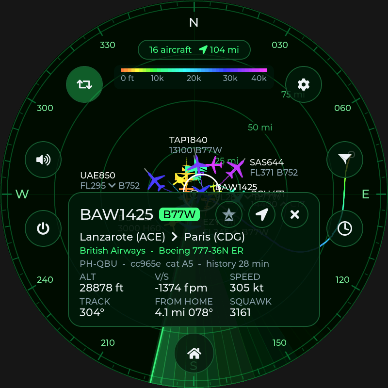<br>Flight history of a tapped aircraft | <br>Info card | <br>Display settings (rotation) |
| 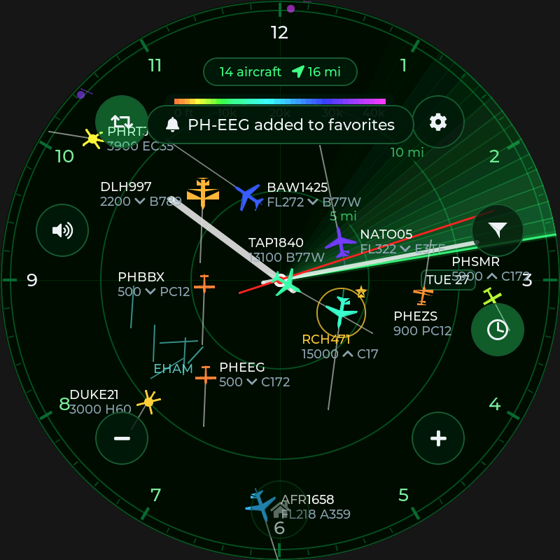<br>Clock face | 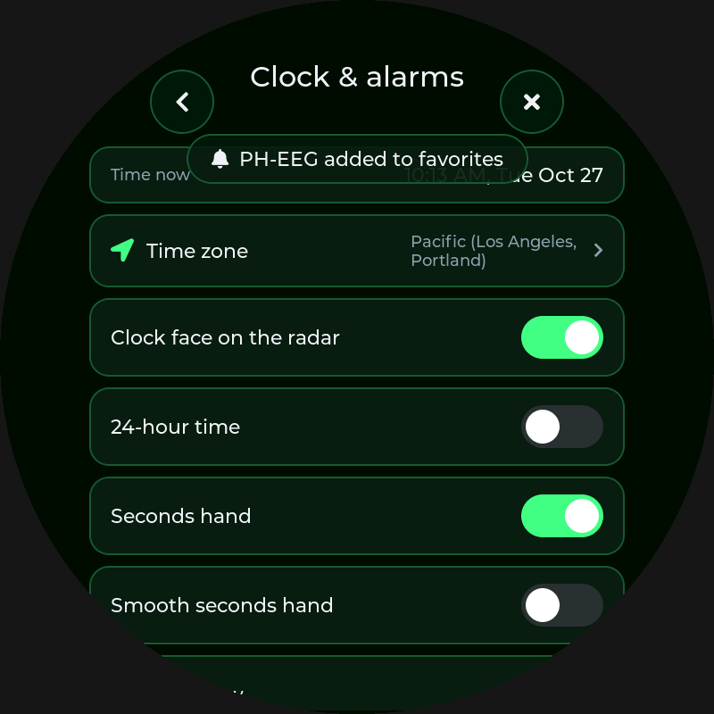<br>Clock & alarms | 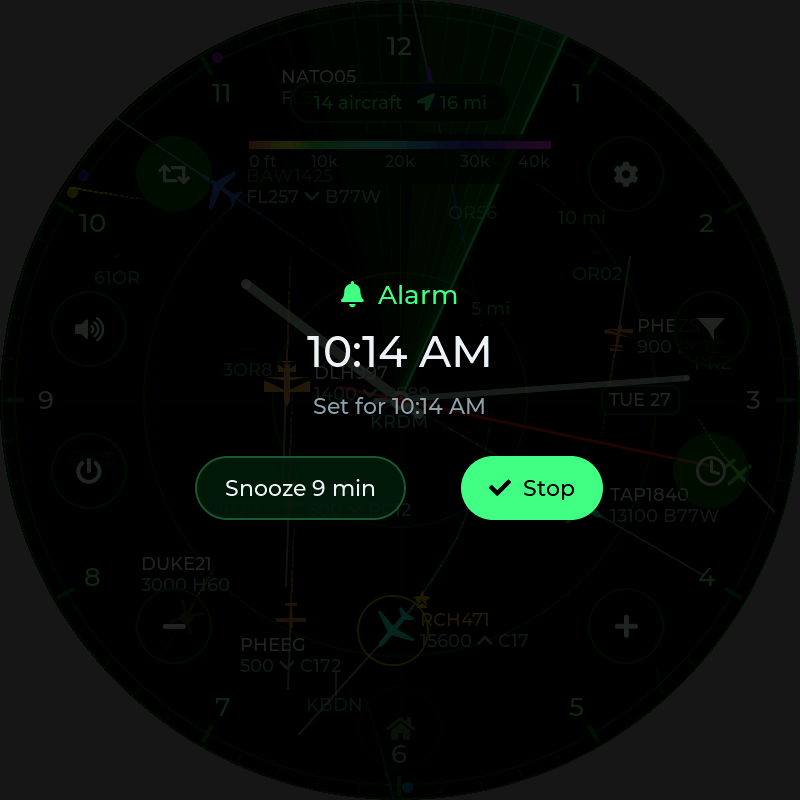<br>Alarm ringing |
| 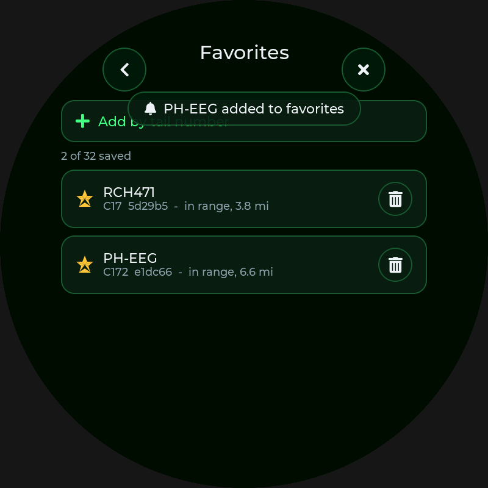<br>Favorite added by tail number | 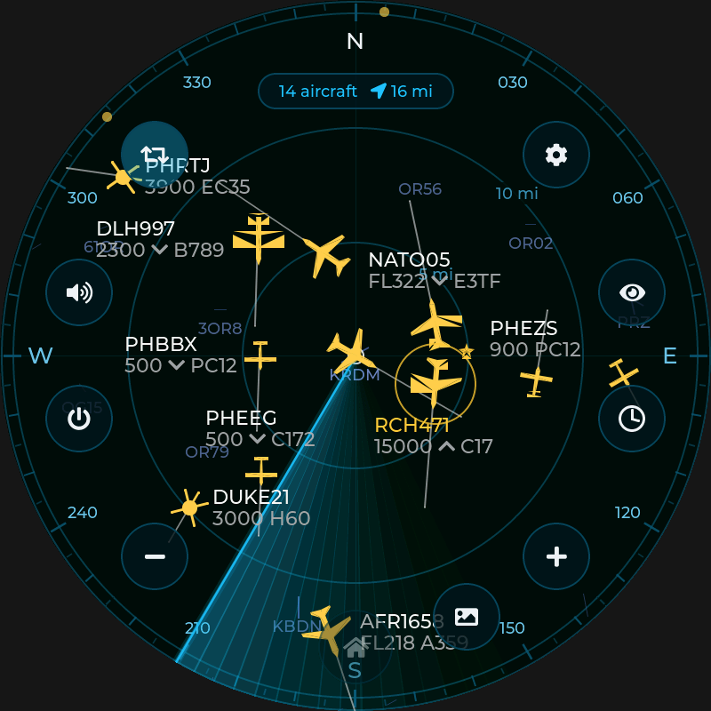<br>Custom theme | 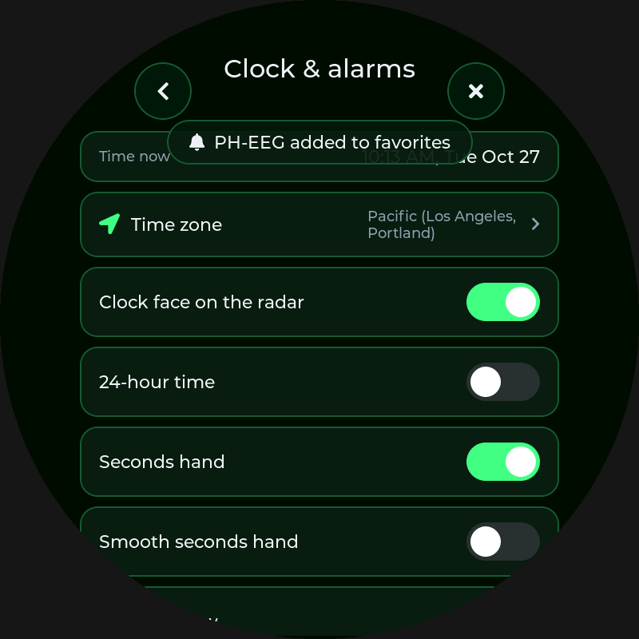<br>Editing an alarm |
| 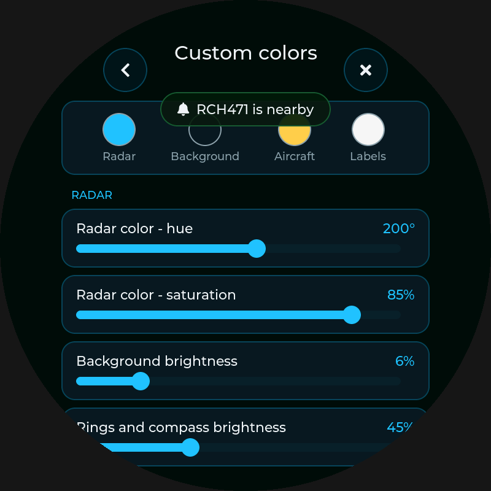<br>Custom colors | <br>Pinch zoom | 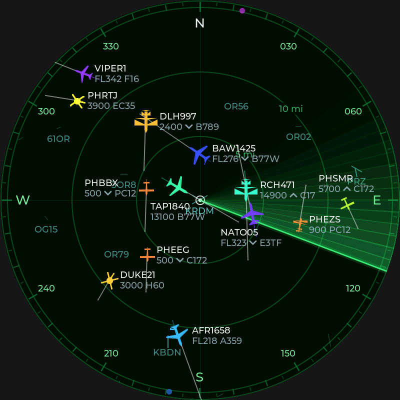<br>Buttons and status auto-hidden |
| 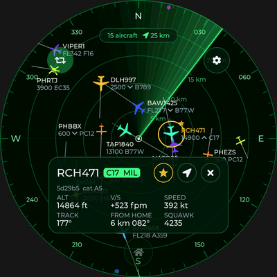<br>Info card, favorite saved | 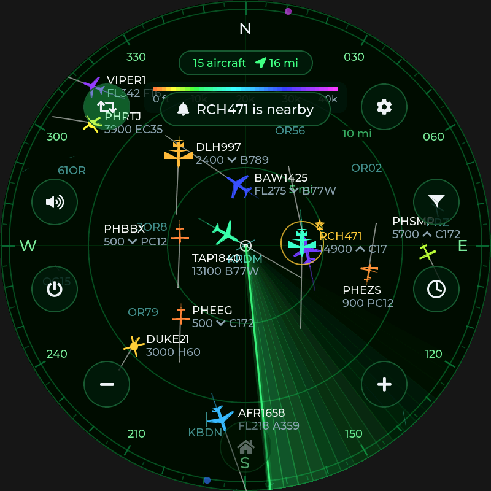<br>Favorite on the radar | 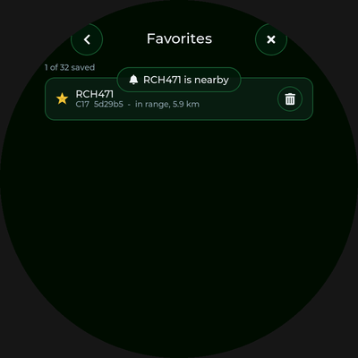<br>Favorites page |
| 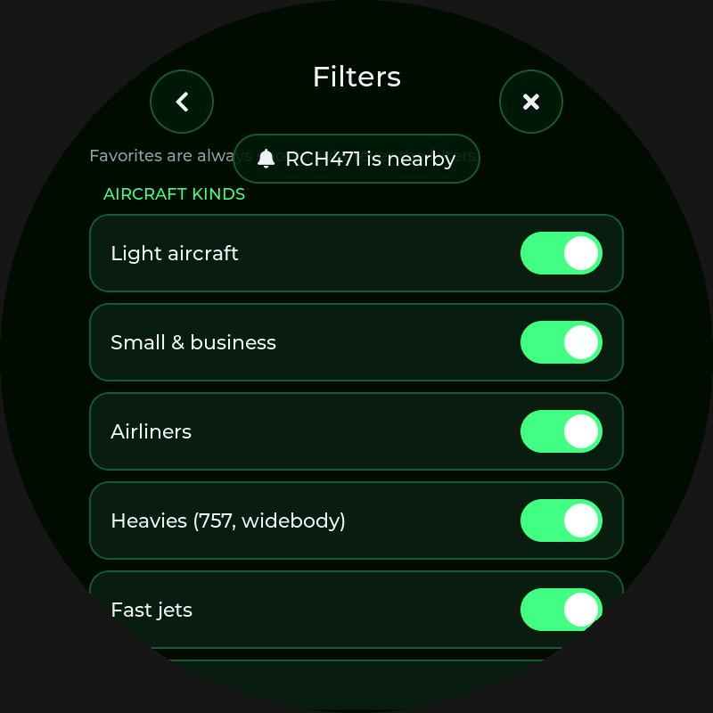<br>Filters | 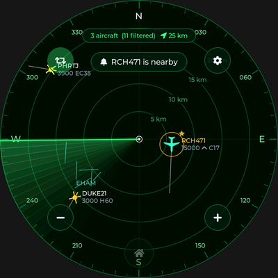<br>Helicopters only | 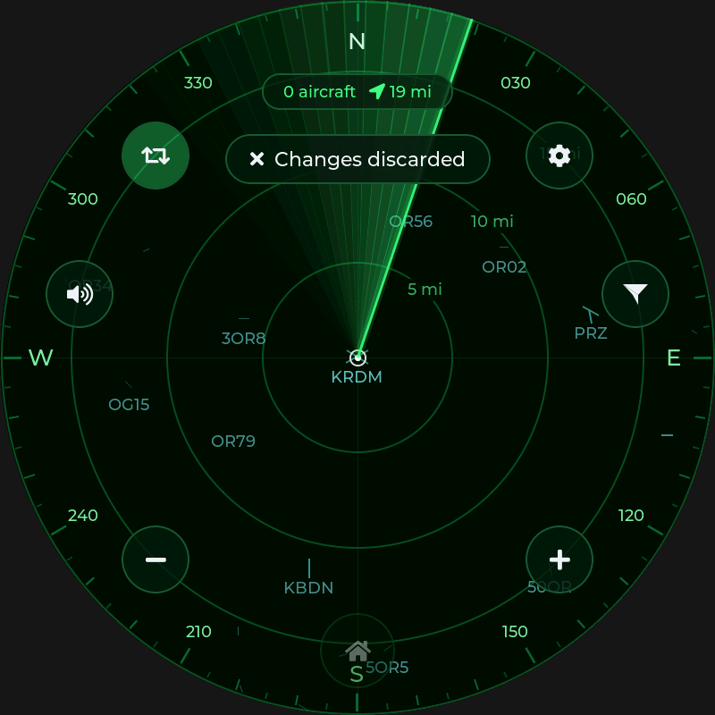<br>Central Oregon airports |
| 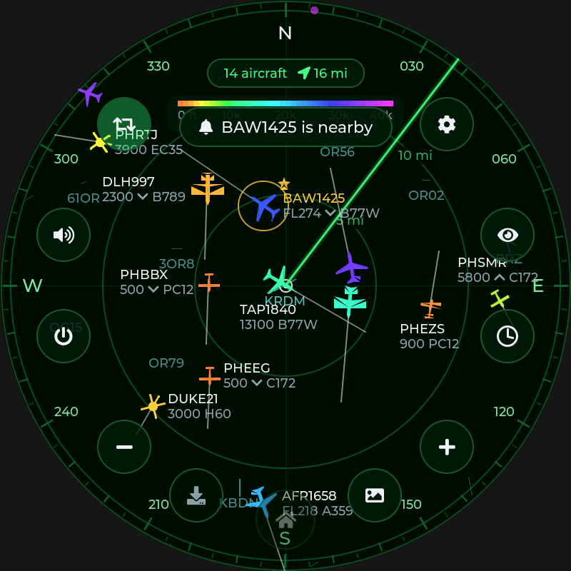<br>Clean sweep bar | 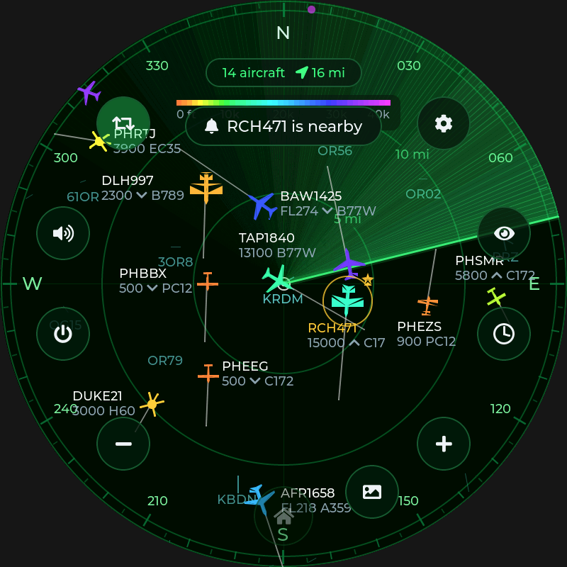<br>Smooth long trail | <br>Pick home on the map |
| <br>Location | 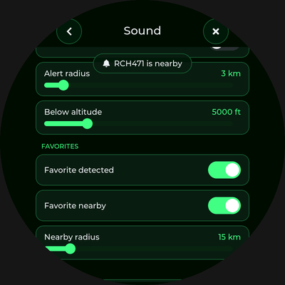<br>Sound and alerts | <br>Emergency squawk |
| <br>Amber theme | <br>Blue theme | <br>Night theme |

## Hardware

| Part | On the board |
|---|---|
| SoC | ESP32-P4 (dual RISC-V, 360 MHz) with 32 MB PSRAM |
| Display | 3.4" 800×800 (or 4" 720×720) round IPS, MIPI-DSI, JD9365 |
| Touch | GT911 capacitive, multi-touch over I2C |
| Wi-Fi | ESP32-C6 co-processor (Wi-Fi 6) over SDIO, via ESP-Hosted |
| Audio | ES8311 codec + speaker amplifier (connect a small speaker to the speaker connector if your kit has none) |

Pin mapping comes from Waveshare's BSP
([`waveshare/esp32_p4_wifi6_touch_lcd_xc`](https://components.espressif.com/components/waveshare/esp32_p4_wifi6_touch_lcd_xc)),
so you don't need to wire anything.

## Building and flashing

You need **ESP-IDF v5.5.2** or newer (v5.5.6 recommended).

```bash
# 3.4" 800x800 board (default)
idf.py set-target esp32p4
idf.py build flash monitor

# 4" 720x720 board
idf.py -D SDKCONFIG_DEFAULTS="sdkconfig.defaults;sdkconfig.defaults.4inch" set-target esp32p4
idf.py -D SDKCONFIG_DEFAULTS="sdkconfig.defaults;sdkconfig.defaults.4inch" build flash monitor
```

The first build downloads LVGL 9.4, the Waveshare BSP, `esp_hosted` and
`esp_wifi_remote` through the IDF Component Manager. If you change
`sdkconfig.defaults`, delete `sdkconfig` so the new defaults take effect.

LVGL needs to be 9.4 or newer, because the LVGL adapter that Waveshare's BSP
uses depends on it. `CONFIG_LV_ATTRIBUTE_FAST_MEM_USE_IRAM` stays off: turning
it on overflows the P4's internal RAM at link time.

### Chip revision (important)

ESP32-P4 chips come in two incompatible families. Newer boards have
**revision v3.x**, older ones **v0.x/v1.x**, and an image built for one won't
boot on the other: the screen stays black and USB keeps disconnecting as the
board resets. Check yours with `python -m esptool --chip esp32p4 chip_id`, or
connect in esptool-js and read "Chip is ESP32-P4 (revision vX.Y)".

The default build targets v3.x. For a v1.x chip, add the overlay:

```bash
idf.py -D SDKCONFIG_DEFAULTS="sdkconfig.defaults;sdkconfig.defaults.p4rev1" build
# 4" board + v1.x chip:
idf.py -D SDKCONFIG_DEFAULTS="sdkconfig.defaults;sdkconfig.defaults.4inch;sdkconfig.defaults.p4rev1" build
```

Revision v3 support needs ESP-IDF **v5.5.2 or newer** (CI uses v5.5.6).

### Flashing a prebuilt image

A merged image (bootloader + partition table + app) is written at offset `0x0`:

```bash
python -m esptool --chip esp32p4 -b 460800 write_flash 0x0 plane-radar-3.4in-800x800-chip-v3-v1.0.1.bin
```

Ready-made images for both boards are on the
[Releases](https://github.com/ShadowStacker/P4-Radar/releases) page. To publish a new one, push a
`v*` tag (e.g. `git tag v1.0.1 && git push origin v1.0.1`), or run the **Build**
workflow from the Actions tab with a release version filled in. Every CI run also keeps the images as build artifacts. You can also
flash them from a browser with
[ESP Web Flasher / esptool-js](https://espressif.github.io/esptool-js/).

GitHub Actions (`.github/workflows/build.yml`) builds firmware for both
boards, runs the unit tests and renders simulator screenshots on every push.

### Making a release

1. Add a `## [vX.Y.Z] - date` section to [CHANGELOG.md](CHANGELOG.md), and
   bump `CONFIG_APP_PROJECT_VER` in `sdkconfig.defaults`.
2. Push, then either push a `vX.Y.Z` tag, or run the **Build** workflow from the
   Actions tab with *release_version* set to `vX.Y.Z`.
3. CI builds all four images and publishes the release. Its notes start with
   that version's changelog section.

### If something doesn't work

See [Troubleshooting](docs/USER_GUIDE.md#troubleshooting) in the user guide.
The two most common problems:

- **Black screen, USB keeps reconnecting**: the image is at the wrong address
  (flash at `0x0`), or it's for the wrong chip revision (`chip-v1` vs
  `chip-v3`).
- **Crash after "Loading..."**: capture the serial log at 115200 baud and open
  an issue. Releases include `symbols-*.elf` files for decoding backtraces.

## Desktop simulator and tests

The UI only reaches the hardware through `main/platform/platform.h`.
`sim/platform_sim.cpp` fakes that interface, so the same code runs on a PC:

```bash
cmake -S sim -B build-sim && cmake --build build-sim -j
./build-sim/core_tests                       # geo, pinch/zoom math, ADS-B parsing, trails, alerts, sounds
./build-sim/plane_radar_sim sim_out          # scripted taps/drags/pinches -> PNG screenshots + WAV sounds
./build-sim/plane_radar_sim sim_out --size 720
```

LVGL and cJSON are fetched automatically. To build offline, pass
`-DLVGL_DIR=…` and `-DCJSON_DIR=…`. The simulator uses LVGL 9.4 by
default, and the UI code also compiles against 9.2 through 9.6.

## Project layout

```
main/
  main.cpp              boot sequence
  core/                 pure C++, no LVGL/IDF: geo math, viewport (pan/pinch/fling/fly-to),
                        traffic store with trails + alerts, ADS-B JSON parser, flight-history
                        (trace) parser, gzip decoder, sound synth, settings
  app/                  app state: settings persistence glue, ADS-B polling loop, sound policy
  ui/                   LVGL UI: radar_view (static layer cache + per-frame overlay), hud,
                        settings_ui, keyboard, sprites, theme, widgets
  platform/platform.h   hardware abstraction used by app/ui
  platform/esp/         ESP-IDF implementation: display+multi-touch, Wi-Fi, HTTPS, NVS, audio
  data/                 embedded airports/runways (scripts/build_airports.py)
bootloader_components/  bootloader hook that keeps the backlight off until the app draws
sim/                    desktop simulator (headless LVGL, fake traffic, PNG/WAV output)
tests/                  host unit tests
```

### How rendering works

The software renderer draws 800×800 at up to 30 fps. To keep that fast, the
background, rings, compass, runways, airport codes and trails are drawn into a
cached PSRAM canvas, and that canvas is redrawn only when the view moves or new
data arrives. The sweep, aircraft and labels are drawn every frame on top of
it. Aircraft are pre-rendered at 72 headings and recolored when drawn.

## Data and credits

- Airline, route and airframe details come from [adsbdb.com](https://www.adsbdb.com)
  (route data by David Taylor and Jim Mason, aircraft data from PlaneBase).
- Aircraft positions come from free community feeds:
  [adsb.fi](https://adsb.fi), [airplanes.live](https://airplanes.live) and
  [adsb.lol](https://adsb.lol). Please keep the polling interval reasonable
  (5 s default).
- Airport and runway data is from [OurAirports](https://ourairports.com/data/)
  (public domain). Regenerate it with `python3 scripts/build_airports.py`.
- Inspired by and data-compatible with
  [MatixYo/ESP32-Plane-Radar](https://github.com/MatixYo/ESP32-Plane-Radar)
  (MIT).
