# Aircraft icons

The radar draws each aircraft with an icon for its type: **388 icons** for **713 ICAO type codes**. This page lists them all, generated from the firmware's own table (`scripts/gen_icon_docs.py`).

**How an icon is picked.** The feed gives most aircraft an ICAO type designator (`B738`, `C172`, `H60`). If the code is in the table, that icon is used; close variants share one (737-800, MAX 8 and P-8 are one icon). If the feed has no type, or one not in the table, the aircraft gets a [size class](#size-classes-when-the-type-is-unknown) icon from its ADS-B emitter category (light, large, heavy, rotorcraft, glider...).

**Size.** Icons are drawn at the sizes below (pixels on the 800 px screen at 100 % aircraft size), from the aircraft's real size: a Robinson R22 is small, an A380 big. *Settings > Display > Aircraft size* scales them all, and zoomed out with many aircraft a smaller set is used.

**Credits.** Icons by ADS-B Radar for macOS - https://adsb-radar.com - https://apps.apple.com/app/id1538149835 (the size classes and a few others below). The rest are drawn in the same style from each aircraft's real dimensions by `scripts/aircraft_catalog.py` and `scripts/aircraft_families.py`.

Missing a type, or a type with the wrong icon? The table is `scripts/gen_aircraft_types.py` and `scripts/aircraft_catalog.py`; `scripts/check_icon_coverage.py` lists live types without one.

## Contents

- [Airliners and regional jets](#airliners-and-regional-jets) (72)
- [Regional turboprops](#regional-turboprops) (17)
- [Business jets](#business-jets) (44)
- [Light aircraft: singles](#light-aircraft-singles) (43)
- [Light aircraft: twins and utility](#light-aircraft-twins-and-utility) (30)
- [Classic airliners and transports](#classic-airliners-and-transports) (15)
- [Warbirds and classic fighters](#warbirds-and-classic-fighters) (23)
- [Experimental and aerobatic](#experimental-and-aerobatic) (8)
- [Military jets](#military-jets) (36)
- [Military transports, bombers, tankers and patrol](#military-transports-bombers-tankers-and-patrol) (14)
- [Helicopters](#helicopters) (53)
- [Families (shared shapes)](#families-shared-shapes) (17)
- [Other ADS-B Radar icons](#other-ads-b-radar-icons) (3)
- [Size classes (when the type is unknown)](#size-classes-when-the-type-is-unknown) (13)

## Airliners and regional jets

| Icon | Aircraft | Type codes | Size |
|:---:|---|---|---:|
|  | Airbus A318 | `A318` | 42 px |
|  | Airbus A319 | `A19N` `A319` | 43 px |
| 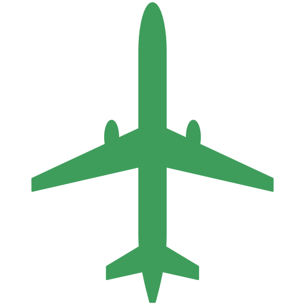 | Airbus A321 | `A21N` `A321` | 46 px |
|  | Airbus A220-100 | `BCS1` | 42 px |
|  | Airbus A220-300 | `BCS3` | 44 px |
|  | COMAC C919 | `C919` | 44 px |
|  | Boeing 737-200 | `B731` `B732` | 41 px |
|  | Boeing 737-300 | `B733` | 42 px |
|  | Boeing 737-400 | `B734` | 43 px |
| 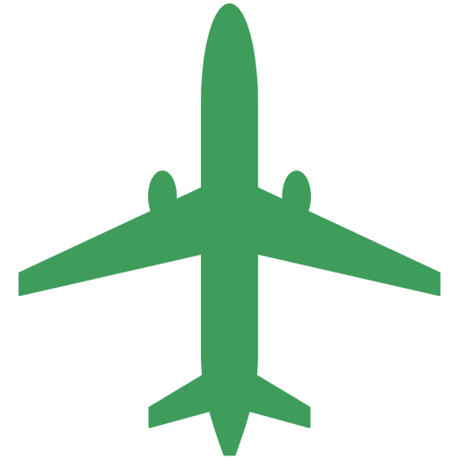 | Boeing 737-500 | `B735` | 41 px |
|  | Boeing 737-600 | `B736` | 42 px |
|  | Boeing 737-700 / MAX 7 | `B37M` `B737` `E737` | 42 px |
|  | Boeing 737-900 / MAX 9 / MAX 10 | `B39M` `B3XM` `B739` | 45 px |
|  | Boeing 757-200 | `B752` | 46 px |
|  | Boeing 757-300 | `B753` | 48 px |
|  | Boeing 767-200 | `B762` | 47 px |
|  | Boeing 767-400 | `B764` | 50 px |
|  | Boeing 777-200 | `B772` `B77L` | 51 px |
|  | Boeing 777-300 | `B773` | 53 px |
|  | Boeing 777-300ER | `B77W` | 53 px |
|  | Boeing 777X | `B778` `B779` | 54 px |
|  | Boeing 787-8 | `B788` | 50 px |
|  | Boeing 787-10 | `B78X` | 52 px |
|  | Airbus A300 | `A306` `A30B` | 48 px |
|  | Airbus A310 | `A310` | 46 px |
|  | Airbus A330-200 | `A332` | 50 px |
|  | Airbus A330neo | `A338` `A339` | 51 px |
|  | Airbus A350-900 | `A359` | 52 px |
|  | Airbus A350-1000 | `A35K` | 53 px |
|  | Airbus A340-500/600 | `A345` `A346` | 53 px |
|  | Boeing 747-8 | `B748` | 54 px |
|  | Boeing 747SP | `B74S` | 50 px |
|  | Airbus Beluga | `A3ST` | 49 px |
|  | Airbus BelugaXL | `A337` | 51 px |
|  | Boeing Dreamlifter | `BLCF` | 53 px |
|  | McDonnell Douglas DC-10 / KC-10 | `DC10` | 49 px |
| 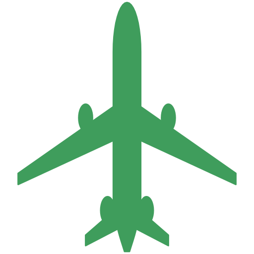 | Lockheed L-1011 TriStar | `L101` | 48 px |
|  | Boeing 717 | `B712` | 43 px |
| 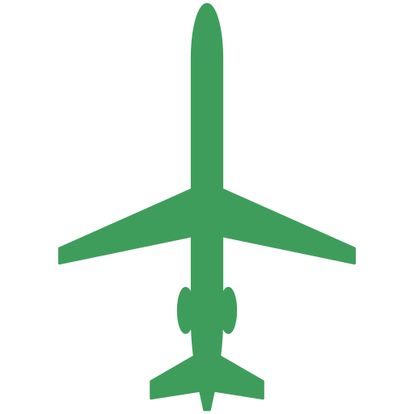 | McDonnell Douglas MD-80 | `MD81` `MD82` `MD83` `MD87` `MD88` | 46 px |
| 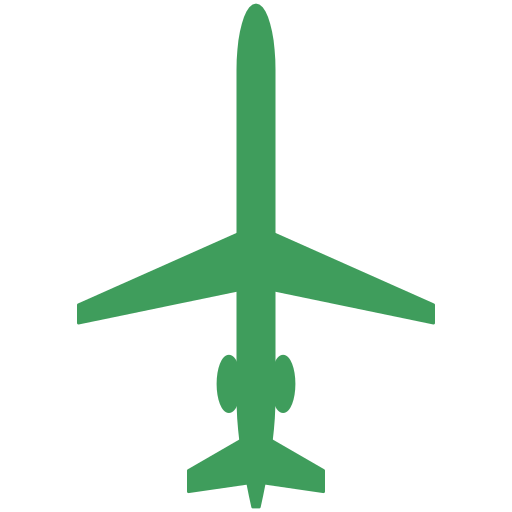 | McDonnell Douglas MD-90 | `MD90` | 46 px |
| 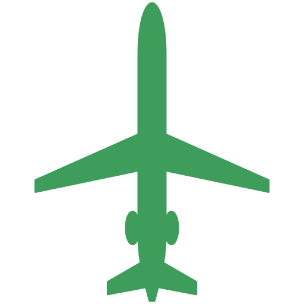 | Douglas DC-9 | `DC91` `DC92` `DC93` `DC94` `DC95` | 43 px |
| 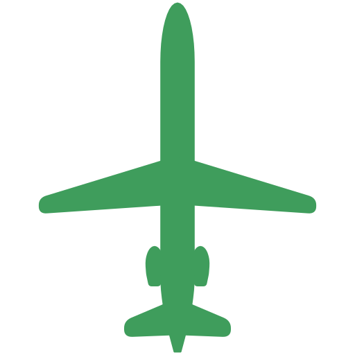 | Fokker 100 | `F100` | 43 px |
|  | Fokker 70 | `F70` | 41 px |
| 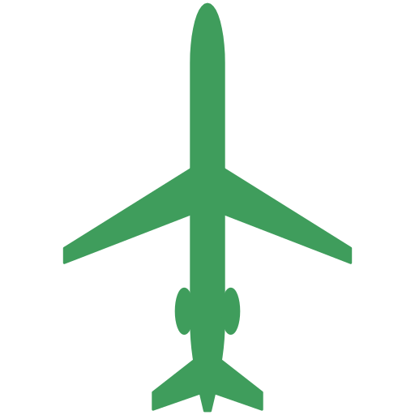 | Boeing 727-200 | `B722` | 46 px |
| 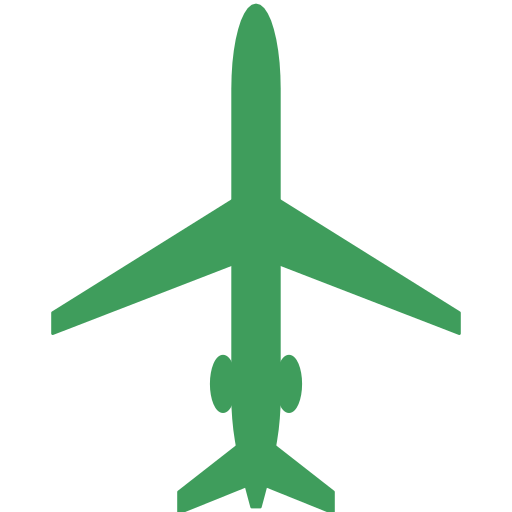 | Boeing 727-100 | `B721` | 44 px |
|  | BAe 146 / Avro RJ85 | `B461` `B462` `RJ70` `RJ85` | 40 px |
| 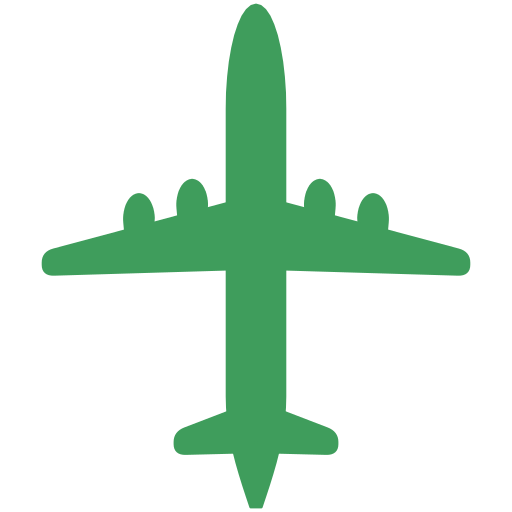 | BAe 146-300 / Avro RJ100 | `B463` `RJ1H` | 41 px |
| 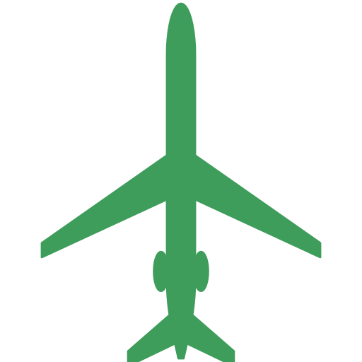 | Tupolev Tu-154 | `T154` | 47 px |
| 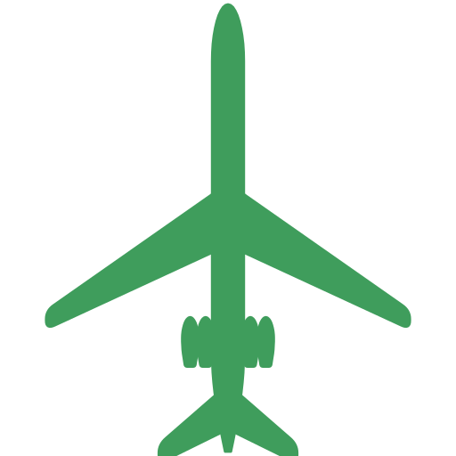 | Ilyushin Il-62 | `IL62` | 48 px |
| 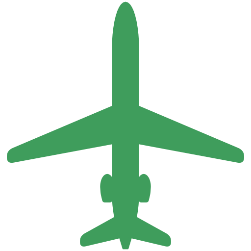 | Yakovlev Yak-42 | `YK42` | 43 px |
| 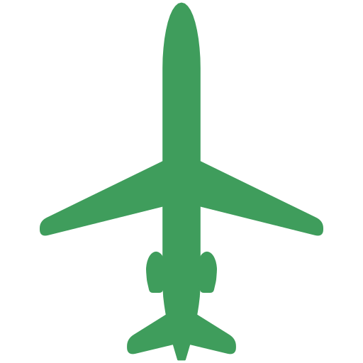 | Bombardier CRJ100/200 | `CRJ1` `CRJ2` | 39 px |
| 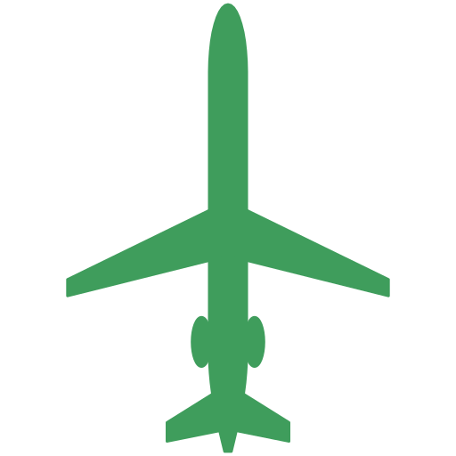 | Bombardier CRJ700 | `CRJ7` | 41 px |
|  | Embraer 170 | `E170` | 40 px |
|  | Embraer 175 | `E175` `E75L` `E75S` | 41 px |
| 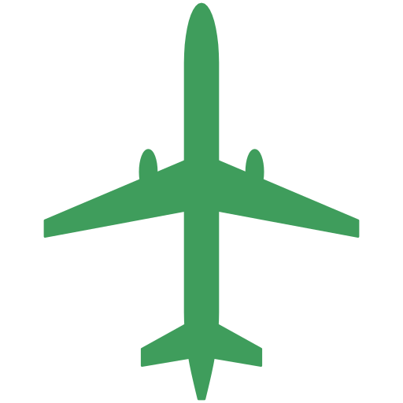 | Embraer 190 | `E190` | 43 px |
| 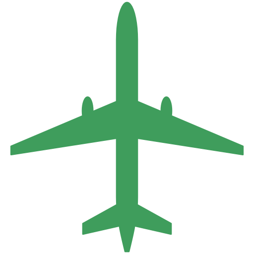 | Embraer E190-E2 | `E290` | 43 px |
| 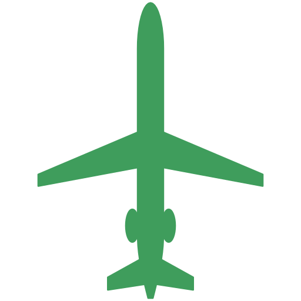 | Embraer ERJ 135 / Legacy | `E135` `E35L` | 39 px |
|  | Sukhoi Superjet 100 | `SU95` | 40 px |
| 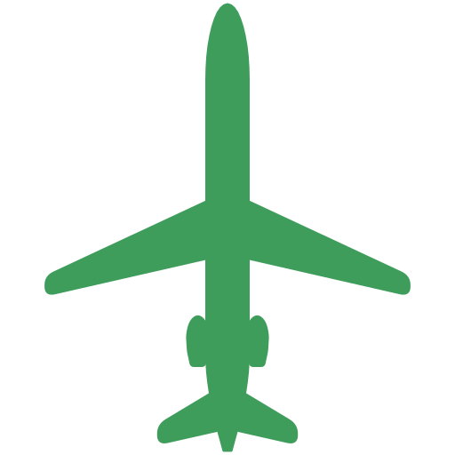 | COMAC ARJ21 | `AJ27` | 42 px |
|  | Airbus A320 / A320neo | `A20N` `A320` | 43 px |
|  | Boeing 737-800 / MAX 8 / P-8 | `B38M` `B738` `P8` | 44 px |
|  | Boeing 787-9 | `B789` | 51 px |
| 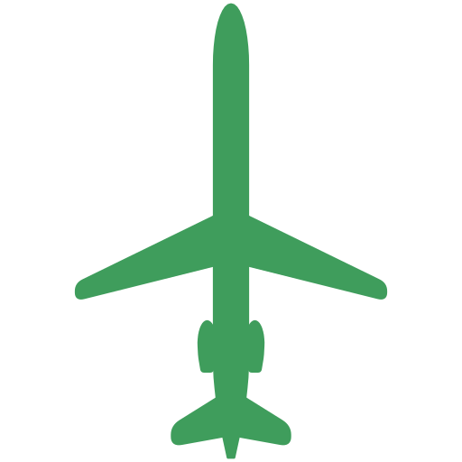 | Bombardier CRJ900/1000 | `CRJ9` `CRJX` | 43 px |
|  | Boeing 767-300 | `B763` | 49 px |
|  | Airbus A330-300 | `A333` | 51 px |
| 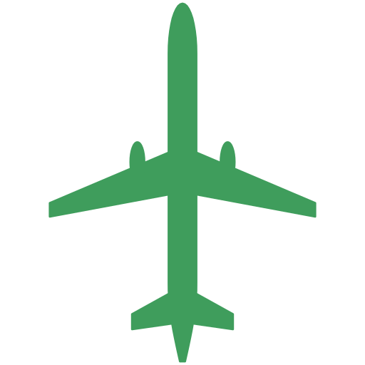 | Embraer 195 | `E195` | 44 px |
|  | Embraer E195-E2 | `E295` | 45 px |
| 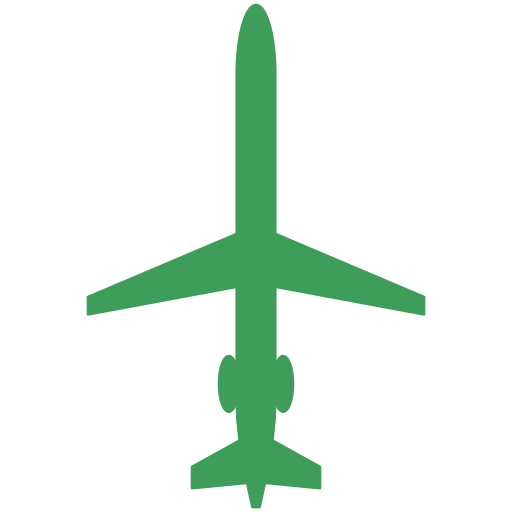 | Embraer ERJ 145 | `E145` `E45X` | 40 px |
|  | Boeing 747-400 / classic | `B741` `B742` `B743` `B744` `B74D` `B74R` | 52 px |
|  | Airbus A380 | `A388` | 54 px |
|  | Airbus A340-200/300 | `A342` `A343` | 51 px |
|  | McDonnell Douglas MD-11 | `MD11` | 50 px |

## Regional turboprops

| Icon | Aircraft | Type codes | Size |
|:---:|---|---|---:|
| 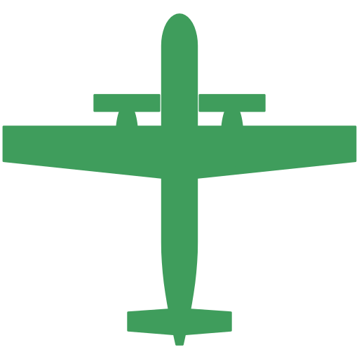 | Dash 8-300 | `DH8C` | 39 px |
| 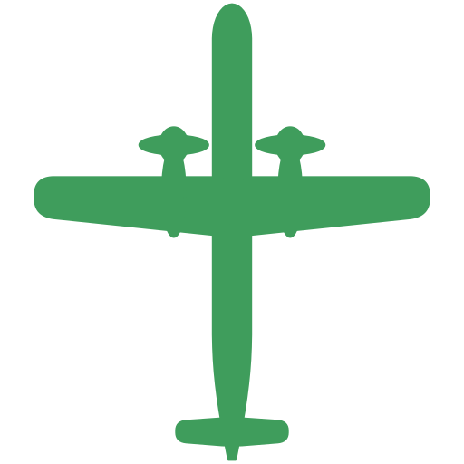 | Dash 8 Q400 | `DH8D` | 42 px |
| 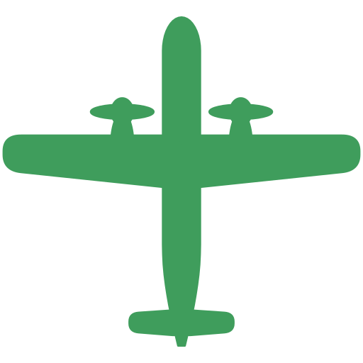 | ATR 42 | `AT43` `AT44` `AT45` `AT46` | 38 px |
| 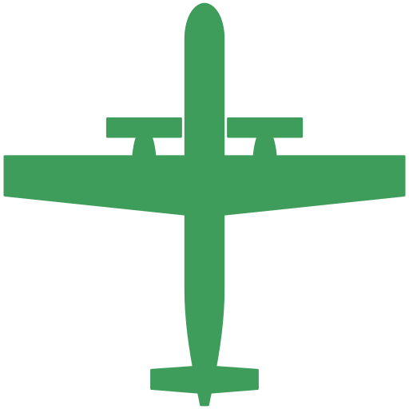 | ATR 72 | `AT72` `AT73` `AT75` `AT76` | 39 px |
| 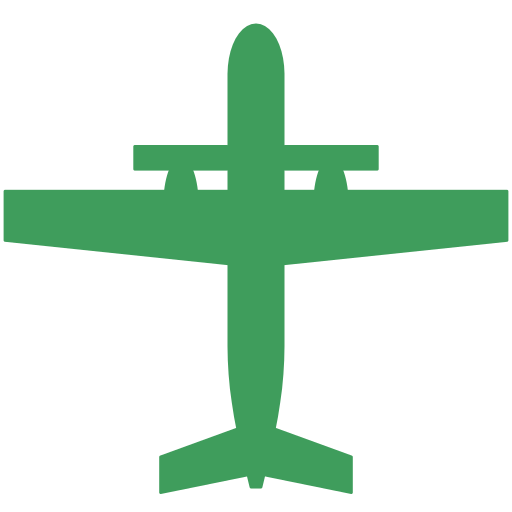 | Saab 340 | `SF34` | 37 px |
| 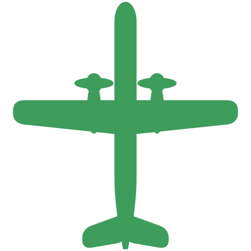 | Saab 2000 | `SB20` | 39 px |
| 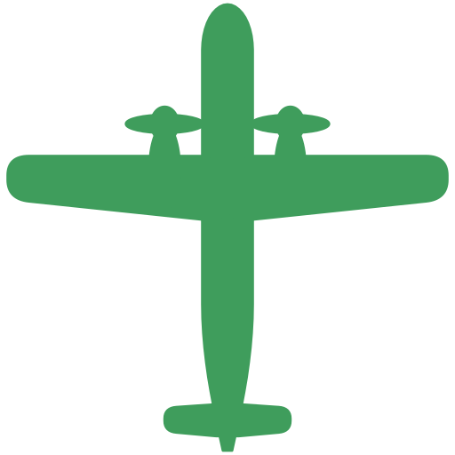 | Dornier 328 | `D328` | 37 px |
| 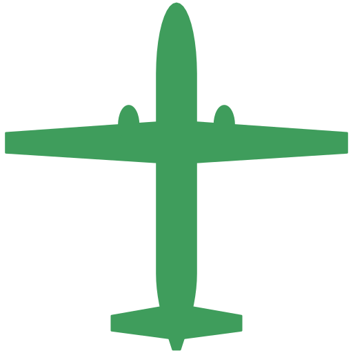 | Dornier 328JET | `J328` | 37 px |
| 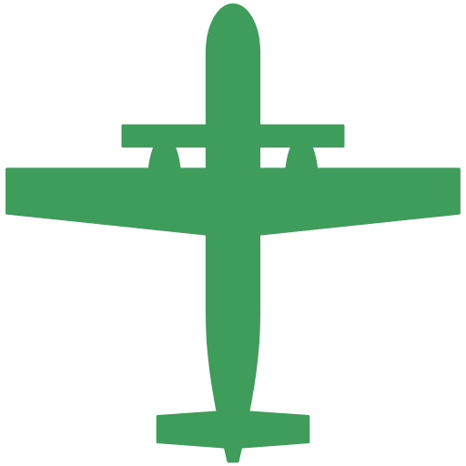 | Embraer Brasilia | `E120` | 36 px |
| 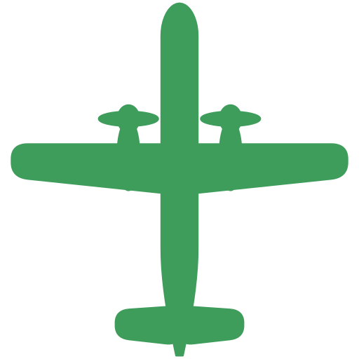 | Jetstream 41 | `JS41` | 36 px |
| 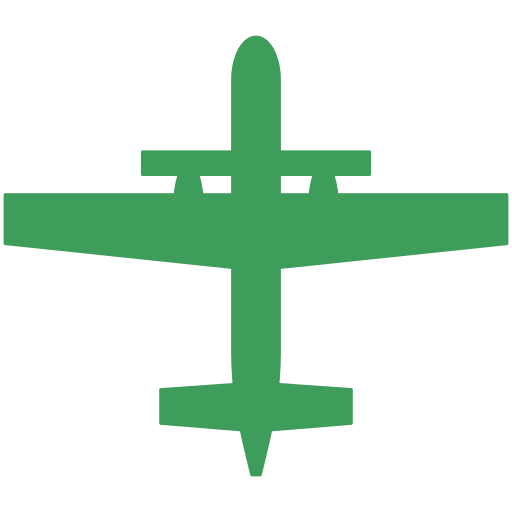 | Fokker 50 / F27 | `F27` `F50` | 40 px |
| 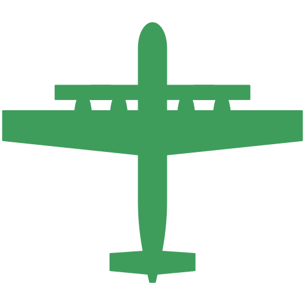 | Dash 7 | `DHC7` | 40 px |
| 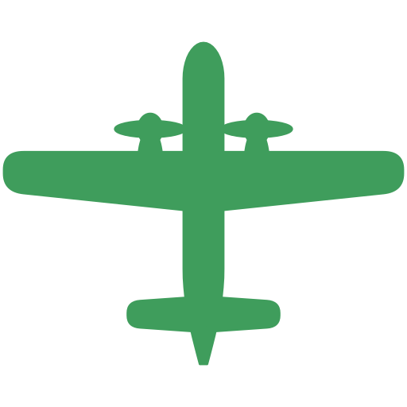 | Antonov An-24/26/32, MA60 | `AN24` `AN26` `AN32` `MA60` | 40 px |
| 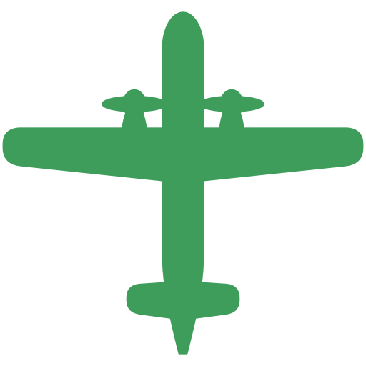 | CASA C-295 | `C295` | 39 px |
| 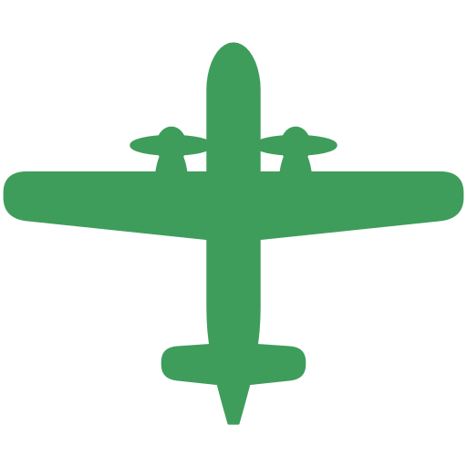 | CASA CN-235 | `CN35` | 39 px |
| 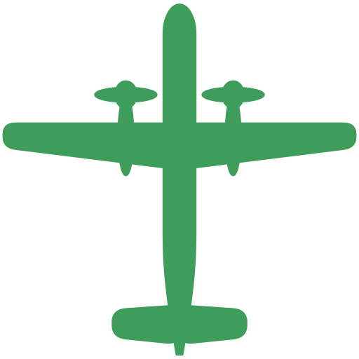 | Beech 1900 | `B190` | 35 px |
| 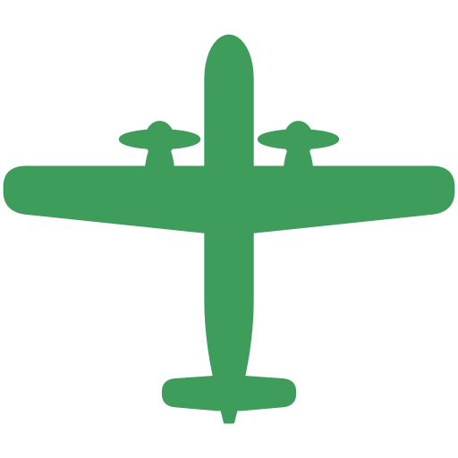 | Dash 8-100/200 | `DH8A` `DH8B` | 39 px |

## Business jets

| Icon | Aircraft | Type codes | Size |
|:---:|---|---|---:|
| 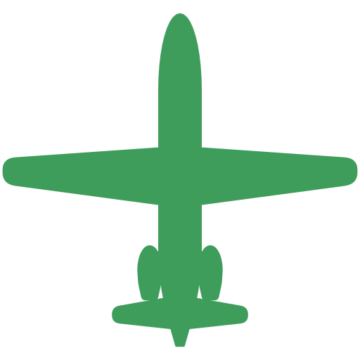 | Citation Mustang | `C510` | 32 px |
| 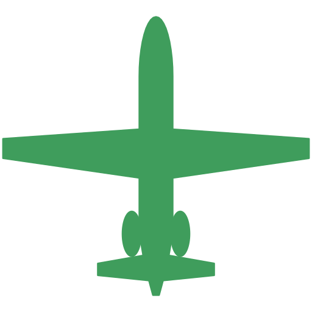 | CitationJet CJ1/M2 | `C25M` `C525` `C526` | 32 px |
| 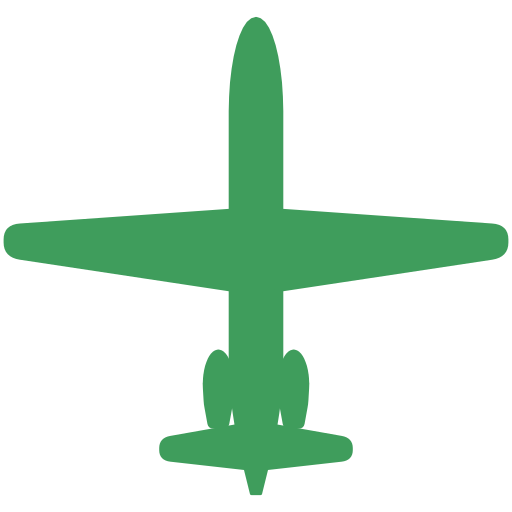 | Citation CJ2 | `C25A` | 33 px |
| 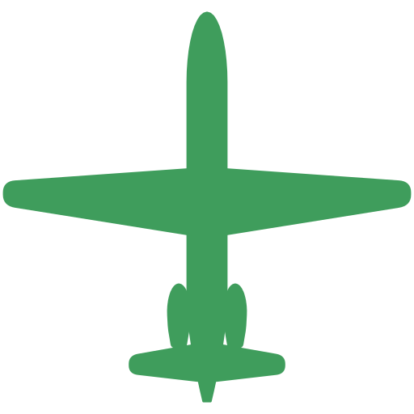 | Citation CJ3 | `C25B` | 34 px |
| 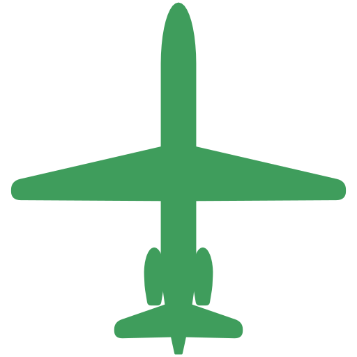 | Citation CJ4 | `C25C` | 34 px |
| 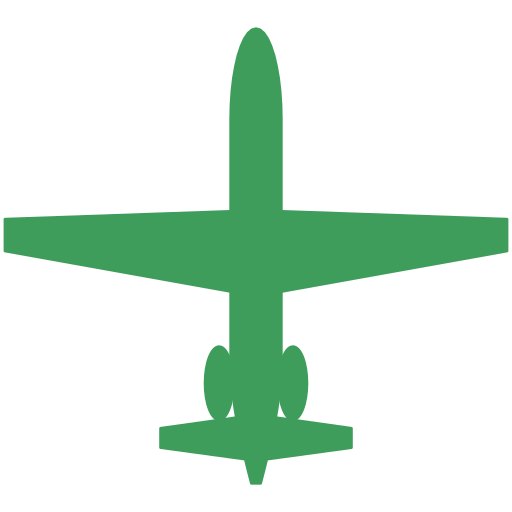 | Citation I/II/Bravo | `C500` `C501` `C550` `C551` `C55B` | 34 px |
| 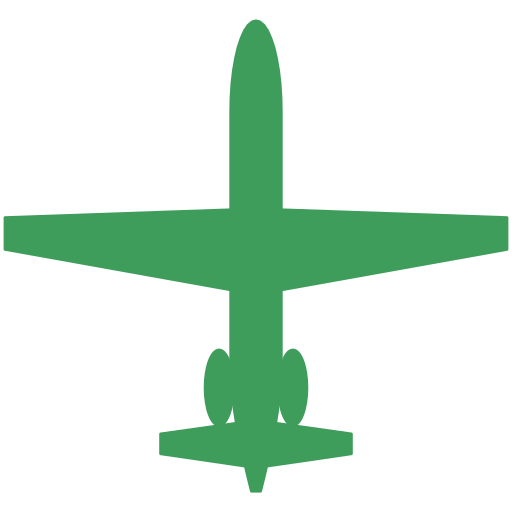 | Citation V/Ultra/Encore | `C560` | 34 px |
| 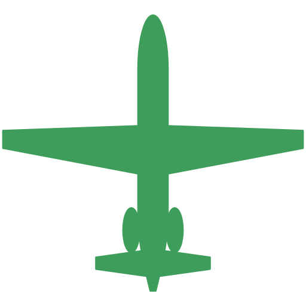 | Citation Excel/XLS | `C56X` | 34 px |
| 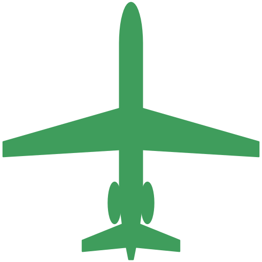 | Citation Sovereign | `C680` | 36 px |
| 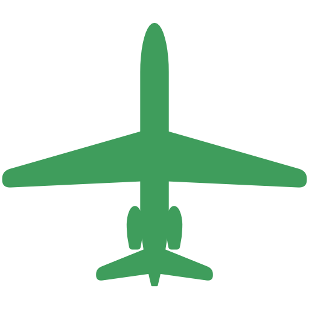 | Citation Latitude | `C68A` | 37 px |
|  | Citation Longitude | `C700` | 37 px |
| 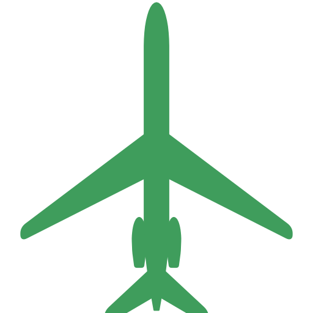 | Citation X | `C750` | 37 px |
|  | Learjet 31/35/36 | `LJ31` `LJ35` `LJ36` | 33 px |
|  | Learjet 40/45/70/75 | `LJ40` `LJ45` `LJ70` `LJ75` | 35 px |
|  | Learjet 55/60 | `LJ55` `LJ60` | 35 px |
|  | Phenom 100 | `E50P` | 31 px |
|  | Phenom 300 | `E55P` | 34 px |
|  | Praetor 500 / Legacy 450 | `E545` | 36 px |
|  | Praetor 600 / Legacy 500 | `E550` | 37 px |
|  | HondaJet | `HDJT` | 32 px |
|  | Cirrus Vision Jet | `SF50` | 31 px |
|  | Pilatus PC-24 | `PC24` | 34 px |
|  | Beechjet 400 / Hawker 400 | `BE40` | 33 px |
|  | Beech Premier | `PRM1` | 32 px |
|  | Hawker 800/900 | `H25A` `H25B` `H25C` | 33 px |
|  | Gulfstream G280 | `G280` | 36 px |
|  | Gulfstream IV/G450 | `GLF4` | 39 px |
|  | Gulfstream G650 | `GLF6` | 41 px |
|  | Gulfstream G700/G800/G500/G600 | `GA5C` `GA6C` `GA7C` `GA8C` | 42 px |
|  | Bombardier Global Express/6000 | `GLEX` | 41 px |
|  | Bombardier Global 5000/5500 | `GL5T` | 40 px |
|  | Bombardier Global 7500/8000 | `GL7T` `GL8T` | 42 px |
|  | Challenger 300/350 | `CL30` `CL35` | 36 px |
|  | Challenger 600/650 | `CL60` | 36 px |
|  | Falcon 8X | `FA8X` | 39 px |
|  | Falcon 2000 | `F2TH` | 37 px |
|  | Falcon 50/900 | `F900` `FA50` | 36 px |
|  | Falcon 6X | `FA6X` | 39 px |
|  | Falcon 10/20 | `FA10` `FA20` | 34 px |
|  | Falcon 7X | `FA7X` | 39 px |
|  | Gulfstream II/III/V/G550 | `GLF2` `GLF3` `GLF5` | 40 px |
|  | Gulfstream G100/G150/G200 | `ASTR` `G150` `GALX` | 34 px |
|  | Citation III/VI/VII | `C650` | 34 px |
|  | Eclipse 500/550 | `EA50` | 30 px |

## Light aircraft: singles

| Icon | Aircraft | Type codes | Size |
|:---:|---|---|---:|
|  | Cessna 150/152 | `C150` `C152` | 29 px |
|  | Cessna 172 | `C172` `C72R` | 30 px |
|  | Cessna 182/206 | `C182` `C205` `C206` `C207` `C82R` `C82S` `C82T` `T206` | 30 px |
|  | Cessna 210 | `C210` `P210` `T210` | 30 px |
|  | Cessna Cardinal | `C177` `C77R` | 30 px |
|  | Cessna 180/185/170 (taildragger) | `C170` `C180` `C185` `C195` | 30 px |
|  | Piper Super Cub | `PA12` `PA14` `PA18` `PA20` `PA22` | 30 px |
|  | Piper J-3 Cub | `J3` | 30 px |
|  | Citabria / Decathlon | `BL8` `CH7A` `CH7B` | 30 px |
|  | Aviat Husky | `HUSK` | 30 px |
|  | Maule | `M5` `M6` `M7` `MT7` | 29 px |
|  | GippsAero Airvan | `GA8` | 31 px |
|  | Piper Saratoga/Cherokee Six | `P32R` `P32T` `PA32` | 30 px |
|  | Piper Tomahawk | `PA38` | 29 px |
|  | Piper Comanche | `PA24` | 30 px |
|  | Piper Malibu/Meridian/M500-M700 | `M700` `P46T` `PA46` | 32 px |
|  | Cirrus SR20/SR22 | `S22T` `SR20` `SR22` | 31 px |
|  | Diamond DA40 | `DA40` | 31 px |
|  | Diamond DA20 | `DA20` `DV20` | 30 px |
|  | Beech Bonanza V-tail | `BE35` | 29 px |
|  | Beech Bonanza A36 | `BE33` `BE36` `BT36` | 29 px |
|  | Mooney M20 | `M20J` `M20K` `M20P` `M20R` `M20T` | 30 px |
|  | Van's RV-6/7/8/9/14 | `RV14` `RV4` `RV6` `RV7` `RV8` `RV9` | 27 px |
|  | Van's RV-10 | `RV10` | 29 px |
|  | Van's RV-12, Tecnam Sierra, JMB VL3 | `RV12` `SIRA` `VL3` | 27 px |
|  | Lancair IV / Evolution | `EVOT` `LNC2` `LNC4` | 28 px |
|  | Piper PA-28 Cherokee/Warrior/Archer/Arrow | `P28A` `P28B` `P28R` `P28T` `P28U` `PA28` | 30 px |
|  | Socata Trinidad/Tobago | `TB10` `TB20` `TB21` `TB9` `TOBA` | 29 px |
|  | Robin DR400 | `DR40` | 28 px |
|  | Grob 115/120 | `G115` `G120` | 29 px |
|  | Grumman Tiger/Traveler, Globe Swift | `AA1` `AA5` `GC1` | 29 px |
|  | Daher TBM 700/850/900, Epic | `EPIC` `TBM7` `TBM8` `TBM9` | 31 px |
|  | Quest Kodiak | `KODI` | 32 px |
|  | Pilatus Porter | `PC6P` `PC6T` | 34 px |
|  | DHC-2 Beaver | `DHC2` | 33 px |
|  | DHC-3 Otter | `DH3T` `DHC3` | 35 px |
|  | Cessna Caravan | `C208` | 34 px |
|  | Pilatus PC-12 | `PC12` | 34 px |
|  | Air Tractor (crop duster) | `AT01` `AT3T` `AT4T` `AT5T` `AT6T` `AT8T` | 33 px |
|  | Piper Pawnee | `PA25` `PA36` | 30 px |
|  | Lake Buccaneer (pusher amphibian) | `LA25` `LA4` | 30 px |
|  | ICON A5 / SeaRey | `ICON` `SRAY` | 30 px |
|  | Sling 2/4/TSi | `SLG2` `SLG4` `SLGT` | 28 px |

## Light aircraft: twins and utility

| Icon | Aircraft | Type codes | Size |
|:---:|---|---|---:|
|  | Piper Aztec/Apache | `PA23` | 30 px |
|  | Piper Seneca | `PA34` | 31 px |
|  | Piper Seminole | `PA44` | 31 px |
|  | Beech Baron | `B58T` `BE55` `BE58` `BE95` | 30 px |
|  | Beech Duchess | `BE76` | 30 px |
|  | Cessna 310/320 | `C303` `C310` `C320` | 30 px |
|  | Cessna 340/335 | `C335` `C340` | 30 px |
|  | Cessna 401/402/414 | `C401` `C402` `C411` `C414` | 32 px |
|  | Cessna 421/404 | `C404` `C421` | 31 px |
|  | Diamond DA42 | `DA42` | 32 px |
|  | Diamond DA62 | `DA62` | 33 px |
|  | Vulcanair/Partenavia P68 | `P68` | 31 px |
|  | Piper Navajo/Chieftain | `PA31` `PA3T` | 31 px |
|  | Piper Aerostar | `AEST` | 30 px |
|  | King Air 350 | `B350` `BE30` | 35 px |
|  | King Air 90/100 | `BE10` `BE9L` `BE9T` | 33 px |
|  | Fairchild Metro/Merlin | `SW2` `SW3` `SW4` | 35 px |
|  | Jetstream 31/32 | `JS31` `JS32` | 34 px |
|  | Mitsubishi MU-2 | `MU2` | 31 px |
|  | Cessna Conquest | `C425` `C441` | 33 px |
|  | Piper Cheyenne | `PAY1` `PAY2` `PAY3` `PAY4` | 33 px |
|  | Piaggio Avanti | `P180` | 33 px |
|  | Cessna Skymaster (push-pull) | `C337` | 30 px |
|  | Let 410 | `L410` | 36 px |
|  | Britten-Norman Islander | `BN2P` `BN2T` | 33 px |
|  | Dornier 228 | `D228` | 34 px |
|  | CASA C-212 | `C212` | 36 px |
|  | Shorts Skyvan / 330 / 360 | `SC7` `SH33` `SH36` | 36 px |
|  | King Air 200/250/260 | `BE20` | 34 px |
|  | Tecnam P2006T | `P06T` | 30 px |

## Classic airliners and transports

| Icon | Aircraft | Type codes | Size |
|:---:|---|---|---:|
|  | Douglas DC-3 / C-47 | `C47` `DC3` `DC3T` | 40 px |
|  | Douglas DC-4 / C-54 | `DC4` | 43 px |
|  | Douglas DC-6/DC-7 | `DC6` `DC7` | 43 px |
|  | Curtiss C-46 Commando | `C46` | 42 px |
|  | Lockheed Constellation | `CONI` `L049` `L1049` `L749` | 43 px |
|  | Lockheed Electra | `L188` | 41 px |
|  | Vickers Viscount | `VISC` | 40 px |
|  | Junkers Ju 52 (trimotor) | `JU52` | 40 px |
|  | Antonov An-2 (biplane) | `AN2` | 35 px |
|  | Beech 18 (twin tail) | `BE18` | 33 px |
|  | Beech Staggerwing (biplane) | `BE17` | 29 px |
|  | Grumman Goose | `G21` `G44` | 33 px |
|  | Consolidated Catalina | `CAT` `PBY` | 41 px |
|  | DHC-6 Twin Otter | `DHC6` | 36 px |
|  | Canadair CL-215/415 | `CL2P` `CL2T` `CL4T` | 40 px |

## Warbirds and classic fighters

| Icon | Aircraft | Type codes | Size |
|:---:|---|---|---:|
|  | P-51 Mustang | `P51` | 30 px |
|  | Supermarine Spitfire | `SPIT` | 30 px |
|  | Hawker Hurricane | `HURI` | 31 px |
|  | Messerschmitt Bf 109 | `ME09` | 29 px |
|  | Focke-Wulf Fw 190 | `FW90` | 30 px |
|  | Mitsubishi Zero | `A6M` `ZERO` | 31 px |
|  | Vought F4U Corsair | `CORS` `F4U` | 31 px |
|  | P-47 Thunderbolt | `P47` | 31 px |
|  | P-40 Warhawk | `P40` | 30 px |
|  | P-38 Lightning (twin boom) | `P38` | 34 px |
|  | B-17 Flying Fortress | `B17` | 41 px |
|  | B-24 Liberator | `B24` | 42 px |
|  | B-25 Mitchell | `B25` | 36 px |
|  | B-29 Superfortress | `B29` | 45 px |
|  | Avro Lancaster | `LANC` | 41 px |
|  | de Havilland Mosquito | `MOSQ` | 34 px |
|  | North American T-6 Texan/Harvard | `T6` | 31 px |
|  | North American T-28 Trojan | `T28` | 31 px |
|  | Boeing Stearman (biplane) | `ST75` | 29 px |
|  | de Havilland Tiger Moth (biplane) | `DH82` | 28 px |
|  | Pitts Special (biplane) | `PTS1` `PTS2` | 25 px |
|  | Yak-52 / Yak-18 | `YK18` `YK52` | 29 px |
|  | Douglas A-1 Skyraider | `A1` | 33 px |

## Experimental and aerobatic

| Icon | Aircraft | Type codes | Size |
|:---:|---|---|---:|
|  | Rutan Long-EZ / VariEze / Cozy | `COZY` `LGEZ` `VEZE` | 27 px |
|  | Velocity | `VELO` | 28 px |
|  | Extra 300/330 | `E200` `E300` `E330` | 27 px |
|  | Sukhoi Su-26/29/31 | `SU26` `SU29` `SU31` | 27 px |
|  | CAP 10/232 | `CP10` `CP23` | 27 px |
|  | Kitfox / Zenith / light sport high wing | `C42` `CH60` `CH70` `ECHO` `KFOX` `P92` `SAVG` | 29 px |
|  | CubCrafters Carbon/XCub | `CC11` `CC18` `CC19` `XCUB` | 29 px |
|  | Glasair | `GLAS` `GLST` | 27 px |

## Military jets

| Icon | Aircraft | Type codes | Size |
|:---:|---|---|---:|
|  | F-86 Sabre | `F86` | 30 px |
|  | MiG-15/17 | `MG15` `MG17` | 29 px |
|  | MiG-21 | `MG21` | 33 px |
|  | F-104 Starfighter | `F104` | 34 px |
|  | de Havilland Vampire (twin boom) | `VAMP` | 30 px |
|  | Hawker Hunter | `HUNT` | 32 px |
|  | Aero L-39/L-159 | `L159` `L39` | 31 px |
|  | A-4 Skyhawk | `A4` | 31 px |
|  | F-4 Phantom II | `F4` | 35 px |
|  | F-14 Tomcat | `F14` | 36 px |
|  | F-15 Eagle | `F15` | 36 px |
|  | F/A-18 Hornet / Super Hornet | `EA18` `F18` `F18S` | 35 px |
|  | F-22 Raptor | `F22` | 35 px |
|  | F-35 Lightning II | `F35` | 33 px |
|  | Sukhoi Su-27/30/35 | `J11` `J15` `SU27` `SU30` `SU33` `SU35` | 37 px |
|  | MiG-29 | `MG29` `MG35` | 34 px |
|  | Panavia Tornado | `TOR` | 34 px |
|  | SEPECAT Jaguar | `JAGR` | 34 px |
|  | Mirage 2000 / Mirage III | `M2000` `MIR2` `MIR3` | 33 px |
|  | Saab Draken | `DRAK` | 33 px |
|  | Saab Viggen | `VIGN` | 34 px |
|  | Dassault Rafale | `RFAL` | 33 px |
|  | Saab Gripen | `GRIF` `JAS3` | 32 px |
|  | Eurofighter Typhoon | `EUFI` | 34 px |
|  | Chengdu J-10 | `J10` | 34 px |
|  | F-16 Fighting Falcon | `F16` `F2` | 33 px |
|  | F-5 / T-38 | `F5` `T38` | 33 px |
|  | BAE Hawk / T-45 | `HAWK` `T45` | 31 px |
|  | Dassault Alpha Jet | `AJET` | 31 px |
|  | M-346 / Yak-130 | `M346` `YK13` | 30 px |
|  | Boeing T-7 Red Hawk | `T7` | 32 px |
|  | A-10 Thunderbolt II | `A10` | 34 px |
|  | Harrier | `AV8B` `HAR` `HAR2` | 32 px |
|  | F-117 Nighthawk | `F117` | 36 px |
|  | SR-71 Blackbird | `SR71` | 42 px |
|  | Lockheed U-2 | `U2` | 41 px |

## Military transports, bombers, tankers and patrol

| Icon | Aircraft | Type codes | Size |
|:---:|---|---|---:|
|  | C-5 Galaxy | `C5` `C5M` | 53 px |
|  | Airbus A400M | `A400` | 46 px |
|  | P-3 Orion / L-188 | `P3` | 43 px |
|  | Transall C-160 | `C160` | 44 px |
|  | Antonov An-124 | `A124` | 53 px |
|  | Antonov An-225 | `A225` | 56 px |
|  | Ilyushin Il-76 | `A50` `IL76` | 47 px |
|  | RQ-4 Global Hawk | `Q4` `RQ4` | 44 px |
|  | MQ-9 Reaper / MQ-1 | `HRON` `MQ1` `MQ9` `Q1` `Q9` | 36 px |
|  | KC-135 / Boeing 707 / E-6 | `B701` `B703` `B720` `C135` `E6` `K35E` `K35R` `K35T` `R135` | 45 px |
|  | KC-46 Pegasus / Boeing 767-200 | `K46` `KC46` | 47 px |
|  | Boeing C-17 Globemaster III | `C17` | 48 px |
|  | Lockheed C-130 Hercules, An-12, Il-18 | `AN12` `C130` `C30J` `IL18` | 44 px |
|  | Alenia C-27J Spartan | `C27J` | 40 px |

## Helicopters

| Icon | Aircraft | Type codes | Size |
|:---:|---|---|---:|
|  | Robinson R22 | `R22` | 28 px |
|  | Robinson R44 | `R44` | 31 px |
|  | Robinson R66 | `R66` | 31 px |
|  | Bell 206 JetRanger / LongRanger | `B06` `B06T` | 31 px |
|  | Bell 505 | `B505` | 31 px |
|  | Bell 47 (bubble) | `B47G` | 32 px |
|  | Bell UH-1 Huey / 204/205/212 | `B204` `B205` `B212` `UH1` | 34 px |
|  | Bell AH-1 Cobra | `AH1` `H1` | 35 px |
|  | Bell 222/230 | `B222` `B230` | 33 px |
|  | Bell 407 | `B407` | 31 px |
|  | Bell 412 | `B412` | 34 px |
|  | Bell 427/429 | `B427` `B429` | 32 px |
|  | Bell 525 | `B525` | 36 px |
|  | MD 500 | `H500` `H520` `H530` | 29 px |
|  | MD 900 Explorer (NOTAR) | `EXPL` `MD60` `MD90X` | 31 px |
|  | Airbus AS350 / H125 | `AS50` `H125` | 31 px |
|  | Airbus AS355 TwinStar | `AS55` | 31 px |
|  | Airbus EC130 / H130 | `EC30` `H130` | 31 px |
|  | Airbus EC120 Colibri | `EC20` | 30 px |
|  | Airbus EC135 / H135 | `EC35` `H135` | 31 px |
|  | Airbus H145 / BK117 | `BK17` `EC45` `H145` | 32 px |
|  | Airbus Dauphin / H155 | `AS65` `EC55` `H155` | 32 px |
|  | Airbus H160 | `H160` | 33 px |
|  | Airbus H175 | `EC75` `H175` | 35 px |
|  | Airbus H225 / Super Puma | `AS32` `AS3B` `EC25` `H215` `H225` | 36 px |
|  | Aerospatiale Gazelle | `GAZL` | 31 px |
|  | Alouette II/III, Lama | `ALO2` `ALO3` `LAMA` | 31 px |
|  | Leonardo A109 / A119 | `A109` `A119` | 32 px |
|  | Leonardo AW139 | `A139` | 34 px |
|  | Leonardo AW169 | `A169` | 33 px |
|  | Leonardo AW189 / AW149 | `A149` `A189` | 35 px |
|  | Leonardo AW101 / Merlin | `EH10` | 37 px |
|  | Sikorsky S-76 | `S76` | 34 px |
|  | Sikorsky S-92 / H-92 | `H92` `S92` | 36 px |
|  | Sikorsky UH-60 Black Hawk / S-70 | `H60` `MH60` `S70` `UH60` | 36 px |
|  | Sikorsky CH-53 | `CH53` `H53` `H53S` | 41 px |
|  | Sikorsky S-61 / Sea King | `H3` `S61` | 37 px |
|  | Boeing CH-47 Chinook | `CH47` `H47` | 41 px |
|  | Boeing CH-46 Sea Knight | `H46` | 39 px |
|  | Boeing AH-64 Apache | `AH64` `H64` | 35 px |
|  | Airbus Tiger | `TIGR` | 33 px |
|  | Leonardo A129 Mangusta | `A129` | 32 px |
|  | Mil Mi-8/17 | `MI14` `MI17` `MI8` | 39 px |
|  | Mil Mi-24/35 Hind | `MI24` `MI35` | 37 px |
|  | Mil Mi-26 | `MI26` | 44 px |
|  | Mil Mi-28 | `MI28` | 37 px |
|  | Kamov Ka-50/52 | `KA50` `KA52` | 33 px |
|  | Kamov Ka-27/32 | `KA26` `KA27` `KA32` | 34 px |
|  | NHIndustries NH90 | `NH90` | 36 px |
|  | Westland Lynx / AW159 | `A159` `LYNX` | 33 px |
|  | Enstrom 280/480 | `EN28` `EN48` | 29 px |
|  | Schweizer 300 / Hughes 269 | `H269` `S300` | 29 px |
|  | Guimbal Cabri G2 | `G2CA` | 27 px |

## Families (shared shapes)

| Icon | Aircraft | Type codes | Size |
|:---:|---|---|---:|
|  | A1 light (unknown type): a high-wing single | *(by emitter category)* | 30 px |
|  | Cessna 150-210 and other high-wing singles | `C162` `C175` | 30 px |
|  | Piper PA-28/32, Cirrus, Diamond, Bonanza, Mooney, RV | `BE19` `BE23` `BE24` `COL3` `COL4` `CRUZ` `F260` | 30 px |
|  | PC-12, TBM, PA-46, T-6, Super Tucano, Air Tractor | `E314` `PC21` `PC7` `PC9` `T34` `TEX2` | 34 px |
|  | Baron, Seneca, Seminole, Cessna 310-421, DA42 | `BE60` `PA27` `PA30` | 32 px |
|  | Beech 99, Metro, Jetstream, Conquest, MU-2, Cheyenne | `AC11` `AC90` `AC95` `BE99` `E121` `F406` `PA42` | 36 px |
|  | Twin Otter, Islander, Do 228, Let 410, CASA 212, Skyvan, P68 | `AN28` `DO28` `M28` | 38 px |
|  | AWACS: E-3, A-50, E-767 | `E3CF` `E3TF` `E767` | 50 px |
|  | E-2 Hawkeye, C-2 | `C2` `E2` | 40 px |
|  | B-52 | `B52` | 56 px |
|  | B-1 | `B1` | 50 px |
|  | B-2 | `B2` | 54 px |
|  | single-fin fighters: F-16, F-4, F-5, Tornado, A-4 | `AMX` `JF17` `SU25` | 34 px |
|  | twin-fin fighters: F-15, F/A-18, F-22, F-35, F-14, Su-27 family, MiG-29 | `J20` `MG31` `SU34` `SU57` | 38 px |
|  | delta fighters: Eurofighter, Rafale, Gripen, Mirage 2000, J-10 | `KFIR` | 36 px |
|  | jet trainers: T-38, Hawk, L-39, M-346, Alpha Jet, T-45, T-7 | `K8` `T50` | 32 px |
|  | four-blade helicopters: H135, H145, Bell 407/429/412, A109, S-76, Dauphin | `B430` | 36 px |

## Other ADS-B Radar icons

| Icon | Aircraft | Type codes | Size |
|:---:|---|---|---:|
|  | regional turboprops: Dash 8, ATR, Saab, Do 328 | `IL14` | 40 px |
|  | heavy jet freighters: C-17, C-5, An-124, Il-76 | `AN22` | 54 px |
|  | V-22, AW609 | `B609` `V22` | 40 px |

## Size classes (when the type is unknown)

| Icon | Aircraft | Type codes | Size |
|:---:|---|---|---:|
|  | A0 / unknown | *(by emitter category)* | 40 px |
|  | A2 small | *(by emitter category)* | 34 px |
|  | A3 large | *(by emitter category)* | 42 px |
|  | A4 (757 class) | *(by emitter category)* | 46 px |
|  | A5 heavy | *(by emitter category)* | 48 px |
|  | A6 high performance | *(by emitter category)* | 36 px |
|  | A7 rotorcraft (unknown type) | *(by emitter category)* | 38 px |
|  | B6 unmanned | *(by emitter category)* | 22 px |
|  | B1 glider | `AS21` `ASK21` `ASK3` `ASW2` `DG1T` `DIMO` `DISC` `DUOD` `GLID` `GLIM` `JANU` `LS8` `NIMB` `VENT` | 32 px |
|  | B2 lighter than air | `BALL` `SHIP` | 30 px |
|  | B3 parachutist | *(by emitter category)* | 20 px |
|  | B4 ultralight | `PIAT` `ULAC` | 28 px |
|  | C1-C7 surface vehicles; ground stations | `GND` `SERV` `TWR` | 18 px |
