# Plane Radar P4 — User Guide

<p align="center">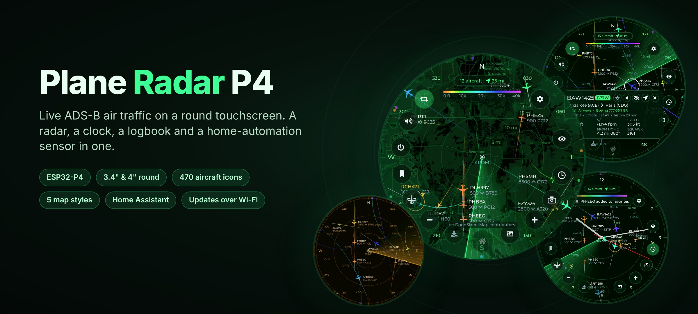</p>

This is the complete guide to Plane Radar P4. It covers every screen, button,
menu and setting, explains how the features work behind the scenes, and helps
when something goes wrong. For what changed in each version, see the
[changelog](../CHANGELOG.md).

> **Version.** This guide describes v1.47.1. Screenshots are from the
> 3.4" (800×800) board; the 4" board looks the same, scaled down.

### Contents

**Getting started**
[What you need](#what-you-need) ·
[Installing the firmware](#installing-the-firmware) ·
[First start](#first-start)

**Using the radar**
[The radar screen](#the-radar-screen) ·
[Touch gestures](#touch-gestures) ·
[Buttons](#buttons) ·
[The status pill and notices](#the-status-pill-and-notices) ·
[Aircraft icons, colours and labels](#aircraft-icons-colours-and-labels) ·
[The info card](#the-info-card) ·
[Flight history](#flight-history) ·
[Long-press: home and bookmarks](#long-press-home-and-bookmarks) ·
[Background maps](#background-maps) ·
[Clock face and alarms](#clock-face-and-alarms) ·
[Sleep](#sleep) ·
[Screenshots](#screenshots) ·
[Replaying a day](#replaying-a-day)

**Settings, menu by menu**
[How settings work](#how-settings-work) ·
[Wi-Fi](#wi-fi) ·
[Location](#location) ·
[Bookmarks](#bookmarks) ·
[Display](#display) ·
[Aircraft & labels](#aircraft--labels) ·
[Map & airports](#map--airports) ·
[Radar sweep](#radar-sweep) ·
[Dimming & night](#dimming--night) ·
[Custom colours](#custom-colours) ·
[Sound](#sound) ·
[Traffic & data](#traffic--data) ·
[Filters](#filters) ·
[Clock & alarms](#clock--alarms) ·
[SD card](#sd-card) ·
[Favorites](#favorites) ·
[Nearby aircraft](#nearby-aircraft) ·
[Hidden aircraft](#hidden-aircraft) ·
[Watchlist alerts](#watchlist-alerts) ·
[Home Assistant (MQTT)](#home-assistant-mqtt) ·
[Phone settings page](#phone-settings-page) ·
[Daily log](#daily-log) ·
[Logbook](#logbook) ·
[Replay a day](#replay-a-day-settings) ·
[Updates](#updates) ·
[About](#about)

**How it works**
[Alerts explained](#alerts-explained) ·
[Where the data comes from](#where-the-data-comes-from) ·
[What's stored where](#whats-stored-where) ·
[Updating over Wi-Fi](#updating-over-wi-fi) ·
[What the radar connects to](#what-the-radar-connects-to)

**Reference**
[settings.txt, every setting](#settingstxt-every-setting) ·
[Glossary](#glossary) ·
[Troubleshooting](#troubleshooting)

---

# Getting started

## What you need

| | |
|---|---|
| **A board** | Waveshare **ESP32-P4-WIFI6-Touch-LCD-3.4C** (3.4" round, 800×800) or **-4C** (4" round, 720×720). |
| **A USB-C cable** | For power, and to install the firmware the first time. Any 5 V USB supply runs it afterwards. |
| **Wi-Fi** | A 2.4 GHz network (the Wi-Fi chip doesn't do 5 GHz). |
| **A microSD card** *(optional)* | FAT32. It enables offline maps, the daily log, logbook, replays, screenshots, your own sounds, hidden aircraft and a copy of your settings. A few GB is plenty. |
| **A small speaker** *(optional)* | For the sounds and alarms: plug a small 8 Ω speaker into the board's speaker connector if your kit doesn't include one. |

## Installing the firmware

Each [release](https://github.com/ShadowStacker/P4-Radar/releases) has one
image per board:

| File | Board |
|---|---|
| `plane-radar-3.4in-800x800-chip-v1-<version>.bin` | ESP32-P4-WIFI6-Touch-LCD-3.4C |
| `plane-radar-4in-720x720-chip-v1-<version>.bin` | ESP32-P4-WIFI6-Touch-LCD-4C |

> **Use the file without `-ota` in its name.** The `-ota.bin` files are for
> [updates over Wi-Fi](#updating-over-wi-fi) only. They have no bootloader, so
> flashing one over USB gives a black screen (the serial log says
> `invalid header`).

### In the browser (no install)

1. Open [esptool-js](https://espressif.github.io/esptool-js/) in **Chrome or
   Edge**, connect the board by USB and click **Connect**.
2. **Change *Flash Address* from `0x1000` to `0x0`.** This is the most common
   mistake: at the wrong address the board logs
   `invalid header: 0xffffffff` and restarts in a loop.
3. Choose the `.bin` file, click **Program**, and wait for it to finish.
4. Press **RESET** on the board.

If the board isn't detected, hold **BOOT**, tap **RESET**, then release BOOT.

### With esptool (command line)

```bash
pip install --upgrade esptool
python -m esptool --chip esp32p4 -p COM3 -b 460800 write_flash 0x0 plane-radar-4in-720x720-chip-v1-<version>.bin
```

Replace `COM3` with your port (`/dev/ttyACM0` on Linux, `/dev/cu.usbmodem…`
on macOS). Your settings and favourites are kept when you flash a newer
version this way. To start completely fresh, run
`python -m esptool --chip esp32p4 -p COM3 erase_flash` first; this doesn't
touch the copy of your settings on the SD card.

**Chip revision.** The images are built for ESP32-P4 chip revision v0.x/v1.x,
which is what these boards have. On a v3.x chip they don't start (the log
shows `Illegal instruction` or `Image requires chip rev`).
`python -m esptool --chip esp32p4 chip_id` shows the revision.

**After the first install you never need the cable again:** the radar
[updates itself over Wi-Fi](#updating-over-wi-fi).

## First start

<p align="center">
  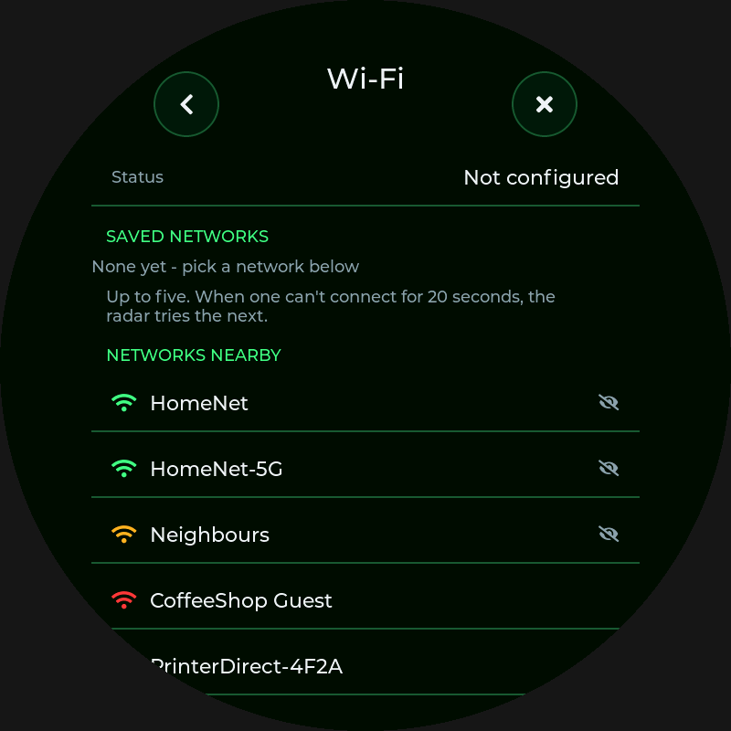
  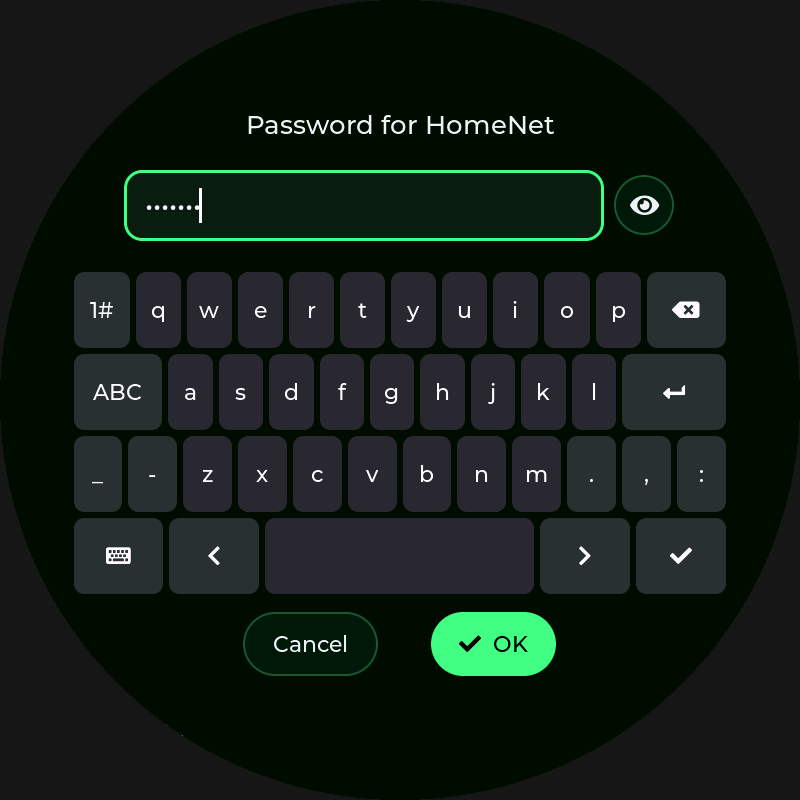
  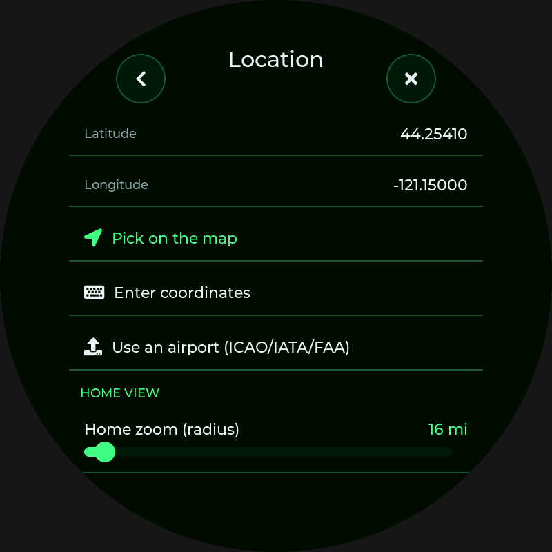
</p>

1. **Wi-Fi.** On first start the radar opens the Wi-Fi page and scans for
   networks.
   - Tap yours and type the password on the on-screen keyboard. The eye
     button shows what you've typed. Open networks connect right away.
   - For a network that doesn't broadcast its name, use **Hidden network...**.
2. **Home.** Next it asks where home is. Any of these works:
   - **Search**: type your town, *Bend, Oregon*, or any place name, and pick
     **Set as home**.
   - **Pick on the map**: drag the map until the crosshair is on your house,
     then tap **Set home**.
   - **Enter coordinates**: latitude, then longitude, in decimal degrees. West
     and south are negative (the **±** key).
   - **Use an airport**: type a code like `KRDM`, `RDM`, `BDN` or `S39`.
3. Tap **X** to go to the radar. Traffic appears within a few seconds.

You can change all of this later from **Settings** (the gear button). An SD
card with a `settings.txt` from another radar brings its settings, Wi-Fi
included, when the radar starts (see [settings.txt](#settingstxt-and-favoritestxt)).

---

# Using the radar

## The radar screen

<p align="center">
  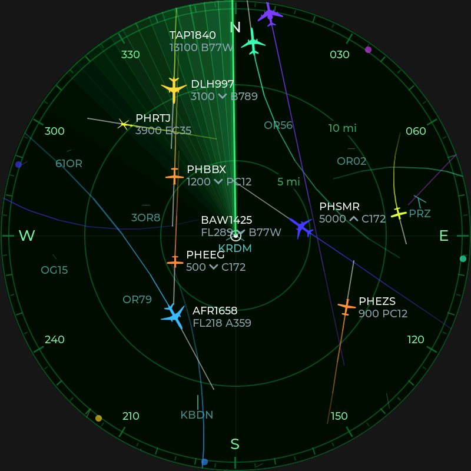
  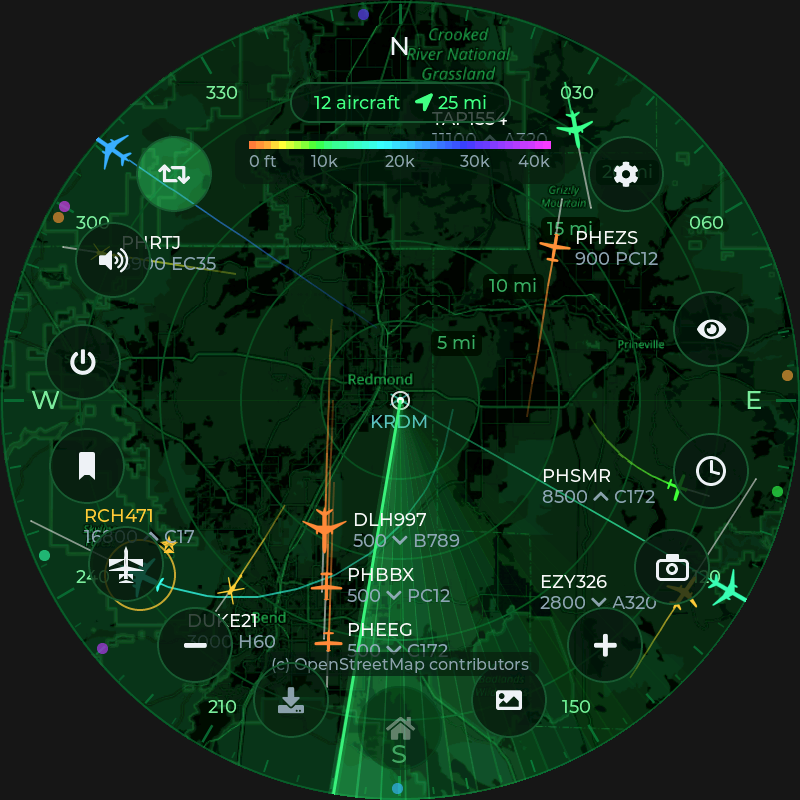
</p>

| What you see | What it means |
|---|---|
| **Home marker** (ring with a dot) | Your home. The range rings, the sweep and all distances are measured from it. |
| **Range rings** | Distance from home in your units (mi, km or nm), labelled. Their spacing changes with the zoom. A faint crosshair runs through home. |
| **Compass bezel** | North is always up. N, E, S, W and every 30° are marked around the edge. In [clock mode](#clock-face-and-alarms) it's a clock dial instead. |
| **Aircraft** | One icon per aircraft, pointing where the nose points. See [Aircraft icons, colours and labels](#aircraft-icons-colours-and-labels). |
| **Trails** | Where each aircraft has been over the last few minutes, coloured by its altitude at each point, older parts fainter. |
| **Speed vectors** | A thin line ahead of each aircraft: where it will be in one minute at its current speed and track. |
| **Rim dots** | Aircraft just beyond the edge of the screen, shown at the right bearing. Favourites' dots are gold. |
| **Runways and airport codes** | From the built-in database of about 48,000 airports. Large airports appear from 250 km of zoom, medium ones below 70 km, small strips below 35 km. Thin faint runways are unpaved, or placed approximately. |
| **The sweep** | The rotating radar beam, purely decorative unless you use [echo mode](#radar-sweep). |
| **Red pulsing ring** | An emergency: squawk 7500 (hijack), 7600 (radio failure) or 7700 (general emergency). |
| **Gold ring and star** | One of your [favourites](#favorites). |
| **Altitude key** (under the status pill) | The altitude colour scale from 0 to 40,000 ft, shown when aircraft are coloured by altitude. |
| **Map credit** (bottom) | The map's copyright line, as the map providers require. It fades with the buttons. |

**Motion is smooth.** New positions arrive every 5 seconds (adjustable). In
between, each aircraft keeps moving along its track at its reported speed. An
aircraft the feed stops reporting disappears after 45 seconds.

**The area the radar asks for follows your view.** It fetches the traffic for
what's on screen, plus a margin, up to the feeds' limit of about 250 nm (460
km). Zoom out to watch a wider area. Alerts only work for aircraft inside that
area.

## Touch gestures

| Gesture | What it does |
|---|---|
| **Drag** with one finger | Pan the map. Flick it and it keeps gliding. |
| **Pinch** with two fingers | Zoom in or out around the point between your fingers. |
| **Double-tap** | Zoom in 2× on that spot. |
| **Tap an aircraft** | Open its [info card](#the-info-card). Tap empty map to close it. |
| **Long-press** the map | Choose: make this spot **home**, or **bookmark** it. See [Long-press](#long-press-home-and-bookmarks). |
| **Touch anywhere** | Bring back the buttons when they've faded, or wake the screen from dimming or sleep (that touch does nothing else). |

<p align="center">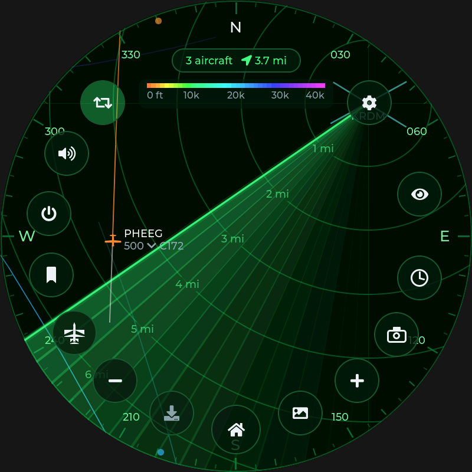</p>

Zoom goes from a 1 km to a 460 km radius (centre to the edge of the screen).
While you're touching the screen, the radar holds back background work (map
downloads, flight history) so that gestures stay smooth.

## Buttons

<p align="center">
  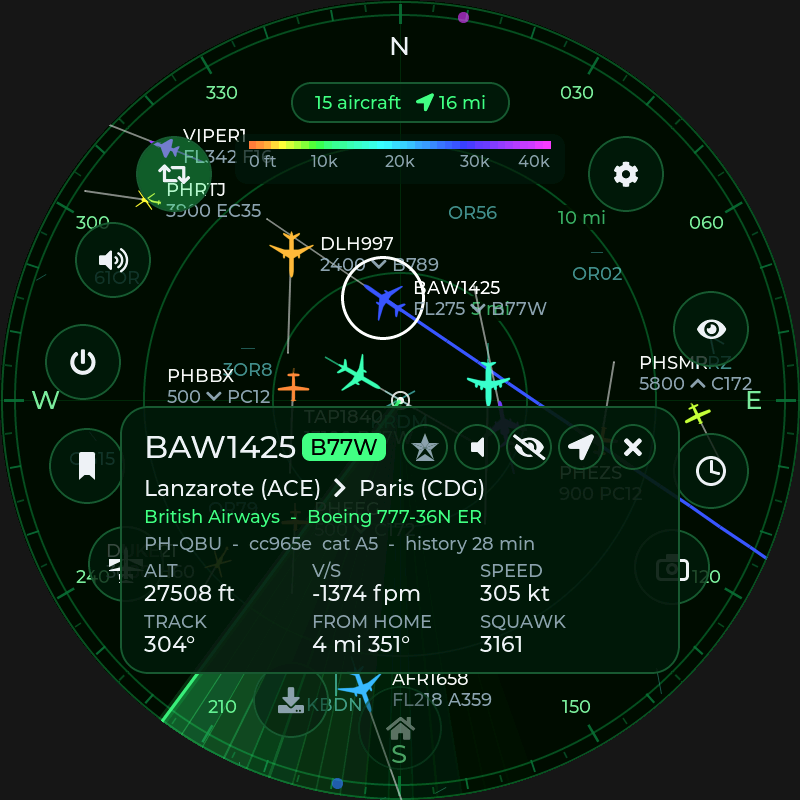
  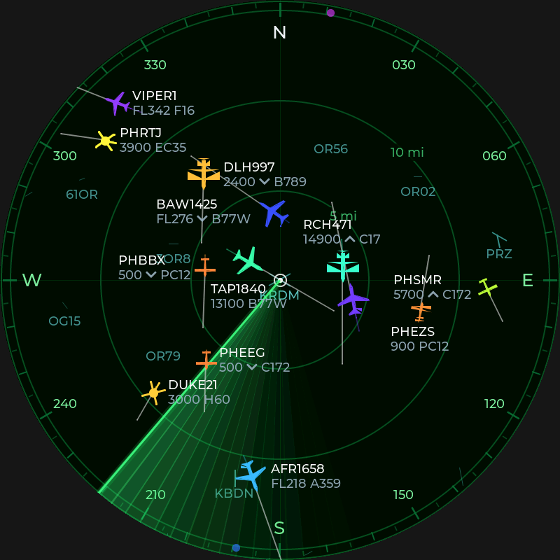
</p>

| Button | Where | What it does |
|---|---|---|
| ⚙ **Gear** | top right | Opens [Settings](#how-settings-work). |
| ⟳ **Sweep** | top left | Turns the radar sweep on or off (lit = on). |
| 🔊 **Speaker** | left | Mutes or unmutes all sounds (the same as **Sound → Sound**). Alarms still ring when muted. |
| ⏻ **Power** | left | [Sleep](#sleep): screen off and sounds muted; a tap wakes it. |
| 🔖 **Bookmark** | left | Opens your [bookmarks](#bookmarks). |
| ✈ **Airplane** | left | Opens the [nearby aircraft](#nearby-aircraft) list. |
| 👁 **Eye** | right | Opens [Filters](#filters). It's lit while a filter is hiding aircraft. |
| 🕘 **Clock** | right | Switches the bezel between compass and [clock face](#clock-face-and-alarms) (lit = clock). |
| 📷 **Camera** | right | Saves a [screenshot](#screenshots) on the SD card. |
| ＋ / − | lower right / lower left | Tap to zoom in or out a little (1.25×), smoothly; quick taps add up. Hold to keep zooming. |
| ⌂ **Home** | bottom | Flies back to home at your home zoom. Dimmed when you're already there. |
| 🖼 **Picture** | lower right | Picks the [background map](#background-maps). |
| ⬇ **Update** | lower left | Greyed out normally; tap to check for an update. **Lit when an update is available:** tap to install it. |

With **Auto-hide buttons** on (the default), the buttons and status pill fade
out after 10 seconds without a touch, leaving a clean radar. Touch anywhere to
bring them back. They stay while an info card is open, and while the status
pill reports a problem.

## The status pill and notices

The pill at the top shows:

- **how many aircraft** are on the radar, plus how many the filters are
  hiding, e.g. *14 aircraft (3 filtered)*;
- **the zoom radius;**
- **any problem**, in place of the count: *No Wi-Fi*, *Connecting...*,
  *Data 25 s old*, *Rate limited*, *Your receiver isn't answering*...

**Tap it** to open Wi-Fi when you're offline, or About when you're online.

**Notices** are short messages that slide in under the pill and fade after a
few seconds, for example:

- *RCH471 is nearby*;
- *Watchlist: RCH471 (C17, military), 23 mi*;
- *First time here: N123AB (B738)*;
- *adsb.fi isn't answering - using airplanes.live*;
- *Settings loaded from SD card*.

<p align="center">
  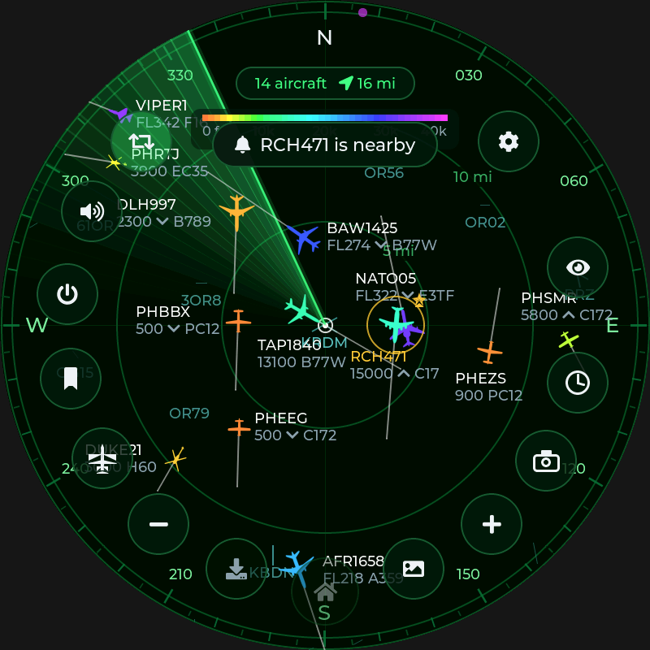
  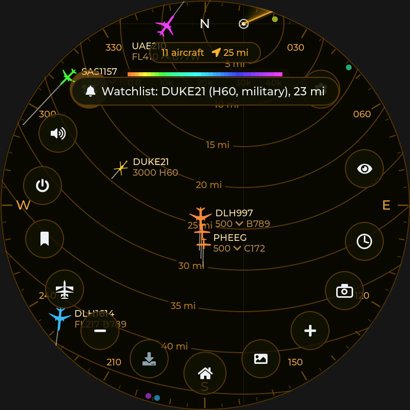
</p>

## Aircraft icons, colours and labels

**Icons.** Each aircraft is drawn as the shape of its type. There are **470
icons** for about **2,900 ICAO type codes**:

- airliners variant by variant (737-700/-800/-900, A319/A320/A321, 777-300ER...),
  business jets, light singles and twins, turboprops;
- warbirds and classic airliners, biplanes, experimentals and airshow aircraft
  (Ford Tri-Motor, Pitts, Fokker Dr.I...);
- fighters, bombers, tankers and transports;
- over 50 helicopters with their real number of blades;
- gliders, gyroplanes, hot air balloons, airships, drones and powered
  parachutes.

Bigger aircraft get bigger icons. A type without an icon of its own gets one
for its class (light single, light twin, turboprop, business jet,
helicopter...). An aircraft that doesn't report its type gets one for its size
category.

See **[every icon and its types](AIRCRAFT_ICONS.md)**, or
[all of them in one picture](images/aircraft_icons.png).

**Colours.** With *Aircraft colours → By altitude* (the default), colour shows
height:

- orange near the ground;
- green around 10,000 ft;
- blue, then magenta at 40,000 ft and above.

The same scale colours the trails, and the key under the status pill shows it.
With *Theme*, every aircraft has the theme's colour. Emergencies are always red,
and aircraft on the ground grey.

**Labels** have two lines:

- **Line 1:** the callsign, or the registration when there's no callsign.
  Aircraft seen only by ground radar (a `~` address) are called *Radar track*.
- **Line 2:** altitude, a climb or descent arrow (over 400 ft/min) and the
  type code. Altitude is in feet below 18,000 ft (`4500`), as a flight level
  above (`FL350`), or `GND` on the ground.

Labels move to avoid each other and the aircraft. When the radar is crowded,
some are left out: favourites, the selected aircraft and emergencies always
keep theirs. Zoomed far out with many aircraft, icons switch to a smaller set.

## The info card

<p align="center">
  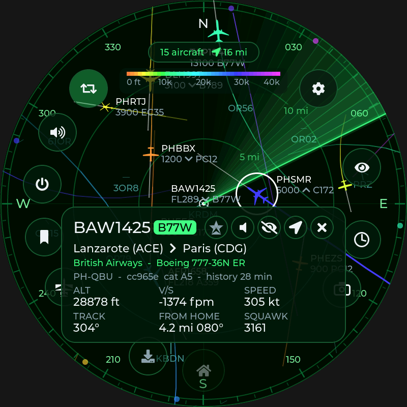
  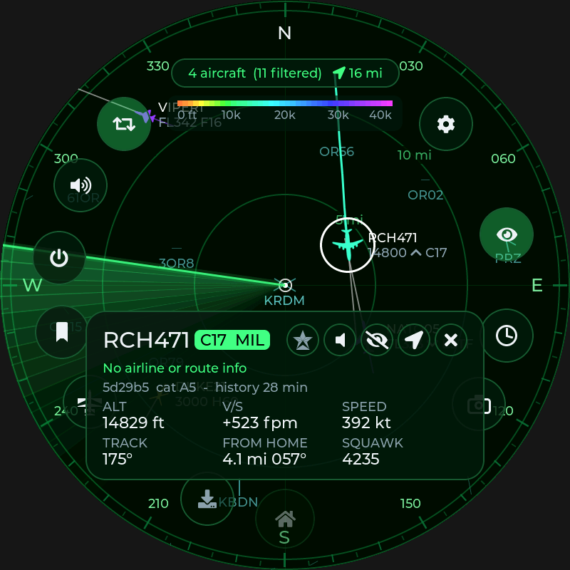
</p>

Tap an aircraft to open its card.

| Field | Meaning |
|---|---|
| **Callsign and type badge** | Flight number (or registration) and ICAO type code, e.g. `B77W`. **MIL** marks a military aircraft. |
| **Route** | From and to, e.g. *Lanzarote (ACE) > Paris (CDG)*, when known. |
| **Airline line** | The airline (or the owner, for private and military aircraft) and the exact model, e.g. *British Airways - Boeing 777-36N ER*. |
| **Next line** | Registration, ICAO address, emitter category (e.g. *cat A5*) and the [flight history](#flight-history) status. |
| **ALT** / **V/S** | Altitude in feet (or *Ground*), and vertical speed in ft/min (+ climbing, − descending). |
| **SPEED** / **TRACK** | Ground speed in knots, and direction of travel in degrees. |
| **FROM HOME** | Distance and bearing from home. |
| **SQUAWK** | The transponder code. |

The card's buttons:

| Button | What it does |
|---|---|
| ★ **Star** | Saves the aircraft as a [favourite](#favorites), or removes it (gold = saved). |
| 🔇 **Mute** | **Silences** this aircraft: no new-aircraft chime, proximity or watchlist sound for it from now on (lit = silenced). Emergencies still sound. Manage the list under **Sound → Silenced aircraft**. |
| 👁 **Hide** (crossed-out eye) | **Hides** it for good, after asking: never shown, heard or counted. See [Hidden aircraft](#hidden-aircraft). Needs the SD card. |
| ➤ **Follow** | Keeps the aircraft on screen: the map re-centres when it drifts away from the middle. Panning or pinching stops following. |
| ✕ **Close** | Closes the card. |

**Where the airline and route come from.** When you tap an aircraft, the radar
looks it up on [adsbdb.com](https://www.adsbdb.com), a free database of
airframes and flight routes.

- **Accuracy:** routes are matched by flight number from a community list, so
  now and then one is out of date, or missing (mostly private, military and
  charter flights).
- **While it looks:** the card says *Looking up airline and route...*, then
  *No airline or route info* if nothing is known.
- **Remembered:** results are kept for the last 24 aircraft, and on the SD card
  if you have one (see [SD card](#sd-card)).
- **Off:** turn it off with **Aircraft & labels → Airline and route on tap**.

## Flight history

<p align="center">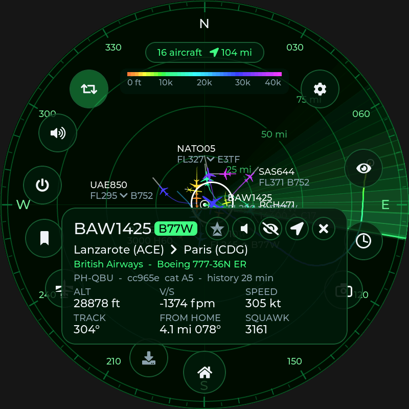</p>

When you tap an aircraft, the radar also downloads **its whole current flight**
and draws it behind the aircraft. The line is thicker than a trail and coloured
by altitude, with a ring where the flight started (its takeoff, if the feed
saw it). Zoom out to see the whole route.

- **Status:** the card shows *loading history...*, then how much is shown
  (*history 1h 42m*), or *no history*.
- **What's drawn:** only the current flight; earlier legs of the day are left
  out, and at most the last 14 hours.
- **Kept up to date:** it refreshes every 2 minutes while the card is open.
- **Source:** it comes from the selected feed's globe map, with the other two
  feeds as backups. These files aren't an official API, so a feed may stop
  serving them; the card then says *no history* and the normal trail still
  works.
- **Off:** turn it off with **Aircraft & labels → Flight history on tap**.

## Long-press: home and bookmarks

<p align="center">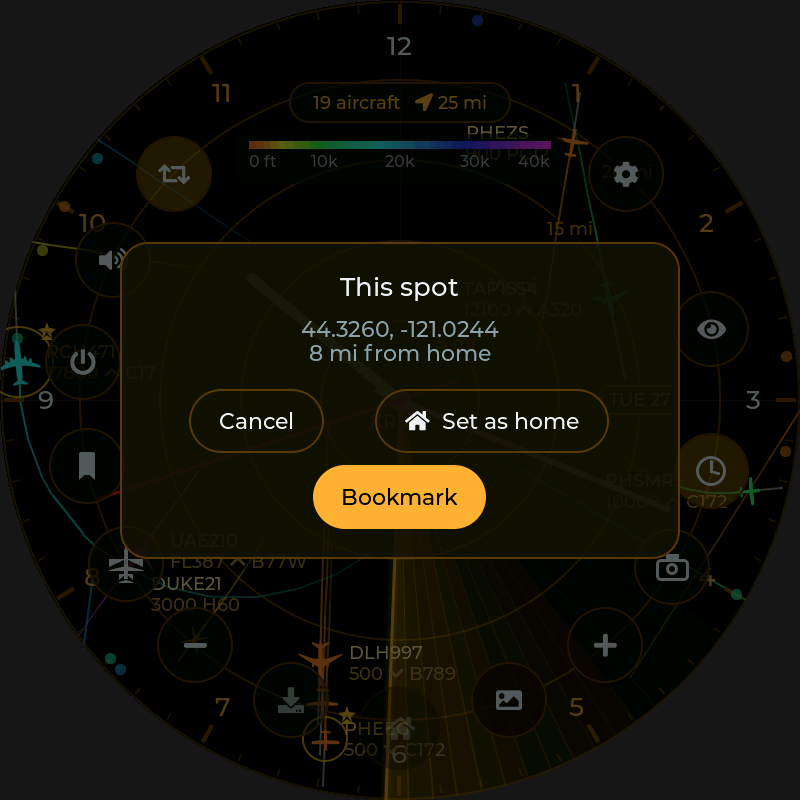</p>

Press and hold anywhere on the map. A box asks what to do with that spot:

- **Set as home** moves home there.
- **Bookmark** saves it as a [bookmark](#bookmarks), at the current zoom. You
  name it; leaving the name blank gives *Bookmark 3*.

## Background maps

<p align="center">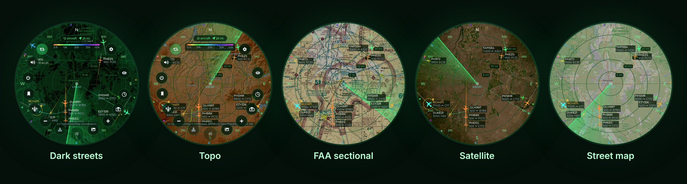</p>

Tap the picture button on the radar (or **Map & airports → Background map**)
and choose:

| Map | What it shows |
|---|---|
| **Off** | Plain radar background with a soft glow. |
| **Dark streets** | Roads, water and, optionally, place names, on black: CARTO's *Dark Matter* map. CARTO needs a free API key (request one at [carto.com/basemaps](https://www.carto.com/basemaps/apikey/)): enter it under **Map & airports → CARTO key**, or put it as the only line of `carto_key.txt` on the SD card. **Without a key**, Dark streets shows OpenStreetMap's map instead, darkened and tinted. A wrong key shows as tiles stamped *API KEY REQUIRED*. |
| **Topo** | Contour lines, forests, roads and peaks, from OpenTopoMap. |
| **FAA sectional** | The FAA's VFR sectional charts: airspace, airports, frequencies and terrain. US only, always in their own colours. **Not for navigation.** |
| **Satellite** | Aerial and satellite photos (Esri World Imagery), in their own colours. |
| **Street map** | OpenStreetMap's standard map in its own colours, with **street names** once you zoom in. Use it when you want to read names. |

<details>
<summary><b>Bigger pictures of each map</b></summary>

| | |
|:-:|:-:|
| <br>Dark streets (OpenStreetMap, without a CARTO key) | 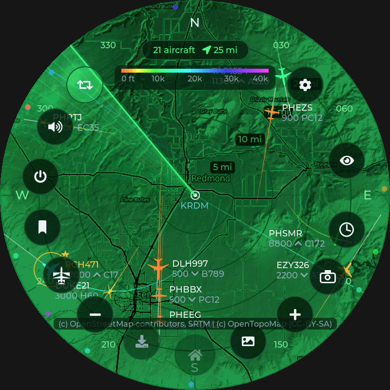<br>Topo, tinted to the theme |
| 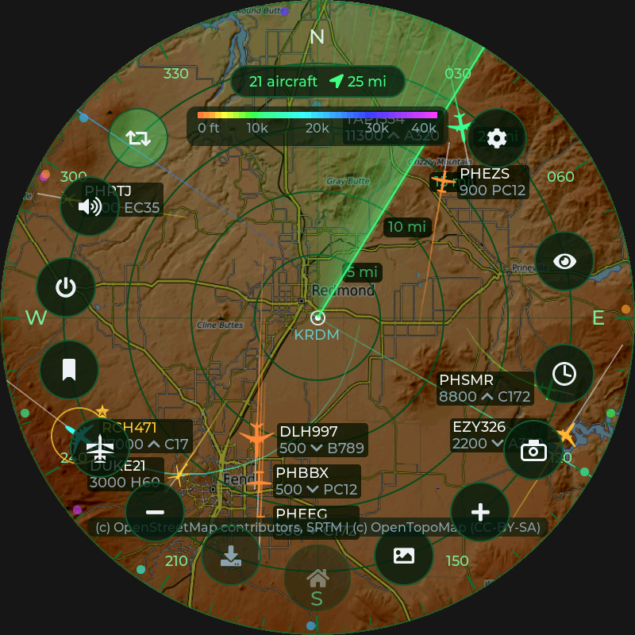<br>Topo, own colours | 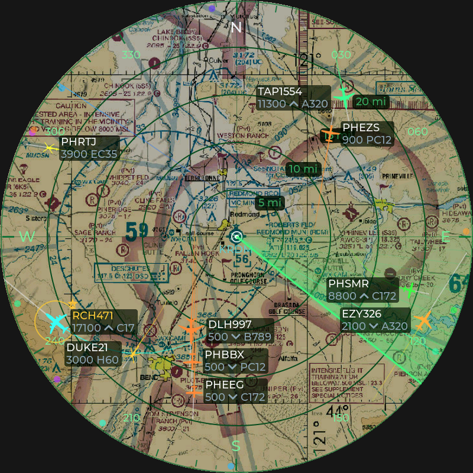<br>FAA sectional |
| 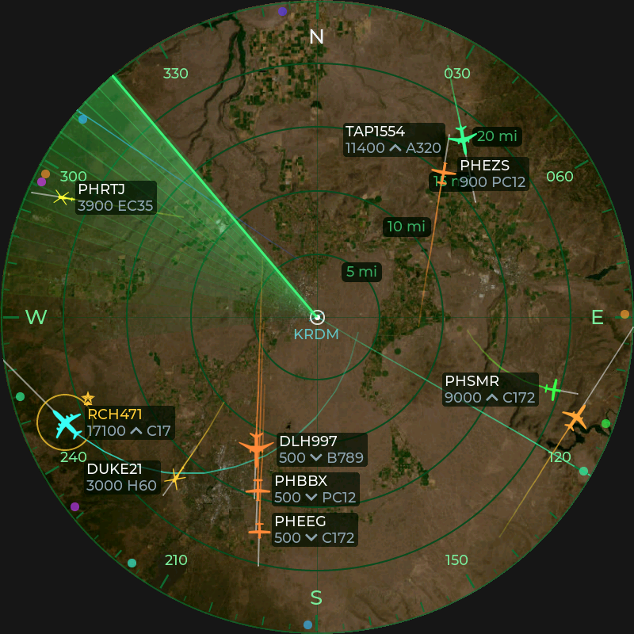<br>Satellite | 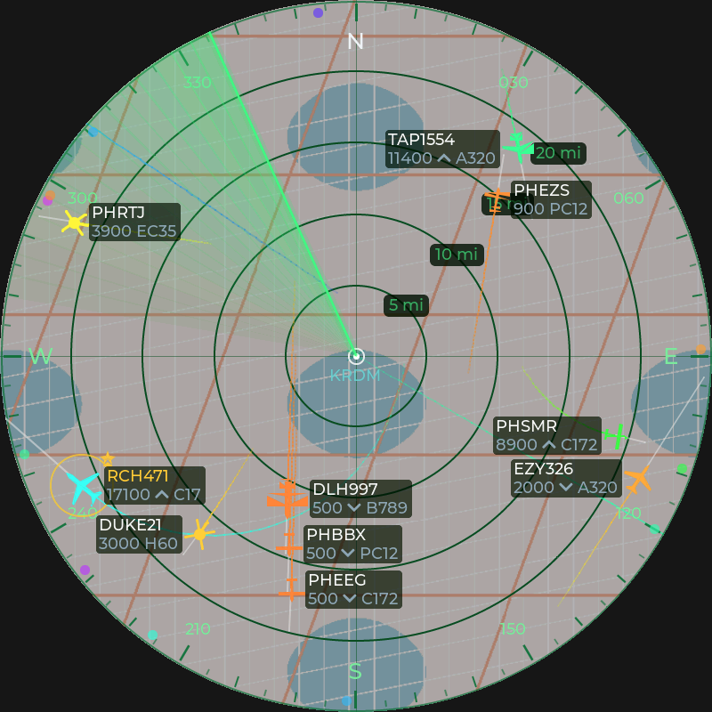<br>Street map, with street names |

</details>

- **Tint:** **Tint map to theme colour** (on by default) redraws the map in the
  theme's colour, so it looks like part of the radar. Topo is inverted so its
  white background turns dark.
- **Brightness:** **Map brightness** keeps the map in the background.
- **Readable labels:** on the FAA chart and satellite photos, aircraft labels
  get a dark backing.

**How tiles load.**

- **What's fetched:** map pieces (tiles) for the area on screen, the closest
  first. A blurry larger-scale version stands in until the sharp one arrives.
- **While you move the map:** the last map picture moves with your fingers and
  is redrawn sharply when you let go.
- **Where they're kept:** on the [SD card](#sd-card), so a map you've seen
  appears instantly next time and works without internet. Without a card
  they're kept in memory until the next restart.

The map services are free community services meant for light personal use,
which is how the radar uses them: it only downloads what you look at, and saves
it. That's why there's no "download a whole region" button.

## Clock face and alarms

<p align="center">
  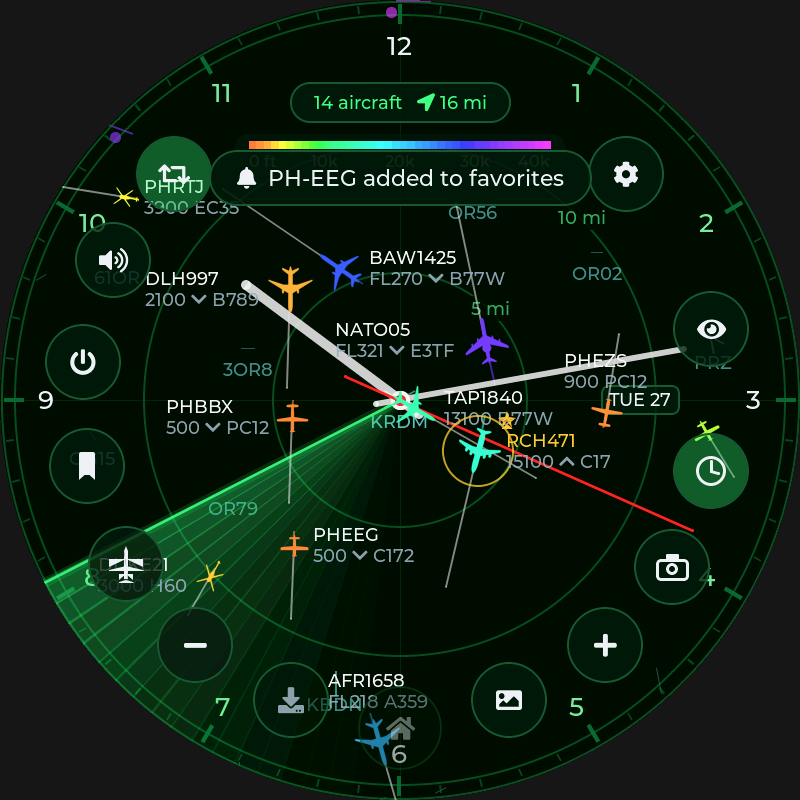
  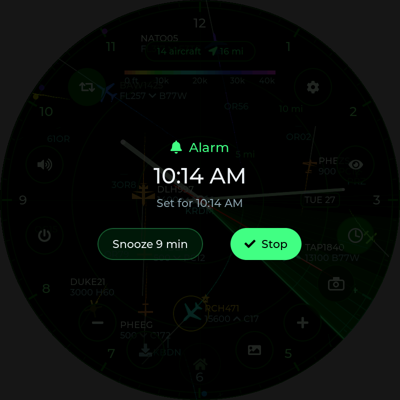
</p>

Tap the clock button to turn the radar into a clock:

- **The dial:** the compass marks become the numbers 1–12 with minute marks.
- **The hands:** hour, minute and (optionally) seconds hands sweep from the
  middle, under the aircraft.
- **The date** sits in a window at three o'clock.

The radar keeps working as usual. Tap the button again for the compass.

**The time** comes from the internet, so after power-up the clock needs Wi-Fi.
Until then the face says *Waiting for the time...*. Set your time zone under
[Clock & alarms](#clock--alarms); daylight saving is automatic.

**When an alarm goes off,** a full-screen box shows the time, with **Snooze 9
min** and **Stop**:

- **Loud enough:** the screen wakes if it was dimmed, and the alarm beeps every
  2 seconds at no less than 70 % volume, even if sound is switched off.
- **Asleep:** if you've put the radar to [sleep](#sleep), it only rings when
  **Wake on alarm** is on.
- **Time limit:** it stops by itself after 10 minutes.

## Sleep

<p align="center">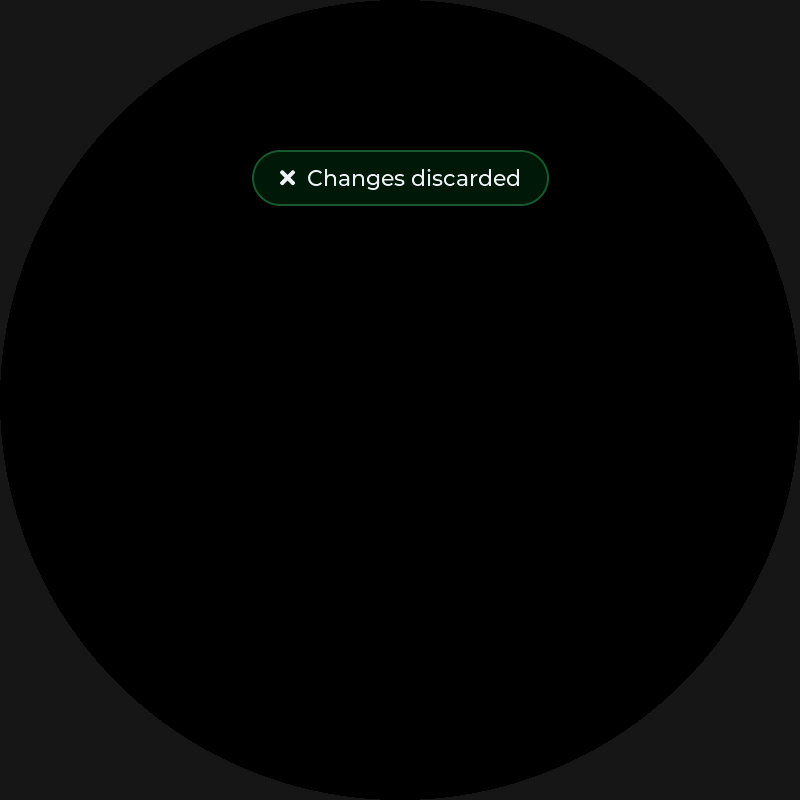</p>

The power button puts the radar to sleep: the screen goes dark and all sounds
are muted. **A tap anywhere wakes it**, and that tap does nothing else.

- **Still working:** traffic keeps updating while asleep, so the daily log,
  logbook and Home Assistant stay current.
- **Alarms** ring only if **Wake on alarm** is on.
- **Automatic sleep:** [Dimming & night](#dimming--night) can put the radar to
  sleep at night and wake it in the morning.

## Screenshots

The camera button saves a picture of the radar, without the buttons, on the SD
card. It goes in `screenshots/YYYY-MM-DD_HH-MM-SS.png`, a full-resolution PNG of
150–300 KB. The [phone page](#phone-settings-page)'s Screenshots tab shows,
downloads and takes them too. Screenshots need an SD card.

<p align="center">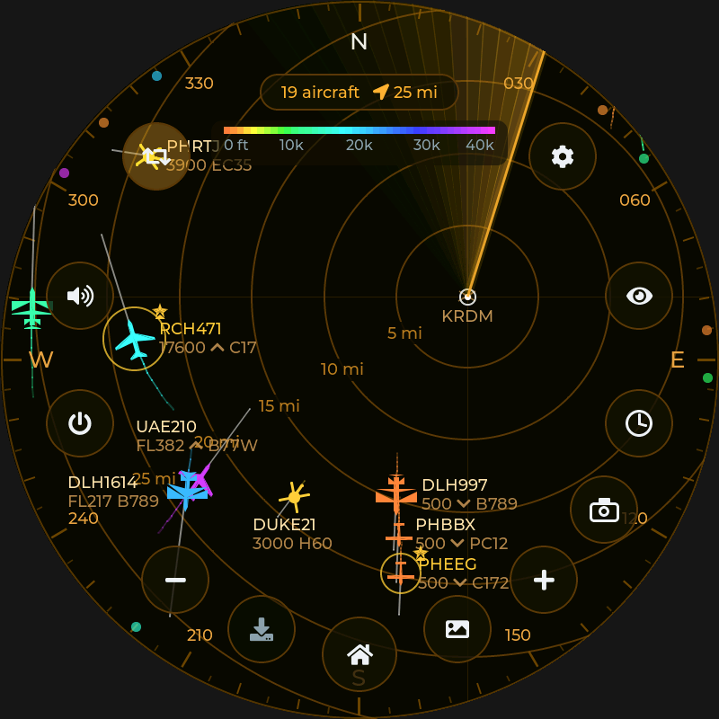</p>

## Replaying a day

<p align="center">
  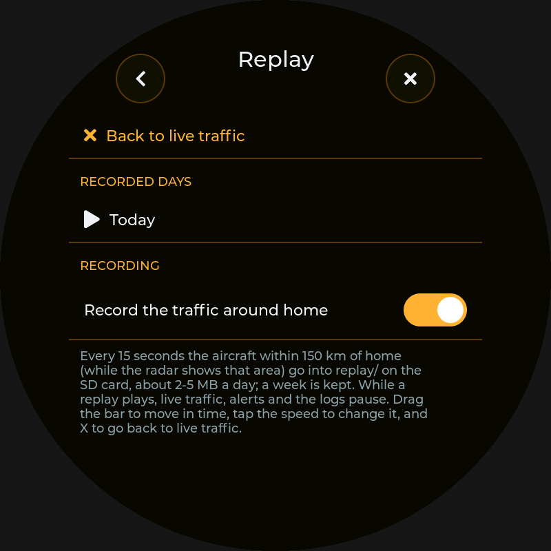
  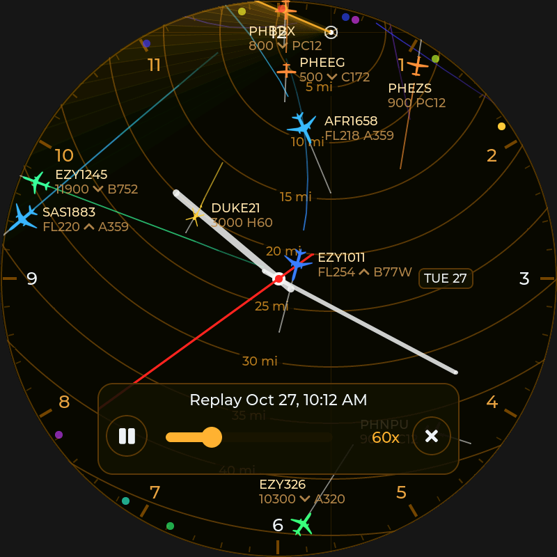
</p>

With an SD card, the radar records the traffic around home and can play any of
the last 7 days back. Start one from **Settings → Replay a day**.

A bar at the bottom of the radar has:

- **the time** of the moment being shown;
- **play/pause**;
- **a slider** to move through the day;
- **the speed:** tap it for 1×, 10×, 60× or 300×;
- **X** to go back to live traffic.

You can pan, zoom and tap aircraft as usual. While a replay plays, live
traffic, alerts and sounds, the daily log and the logbook pause. How recording
works is under [Replay a day](#replay-a-day-settings).

---

# Settings, menu by menu

## How settings work

<p align="center">
  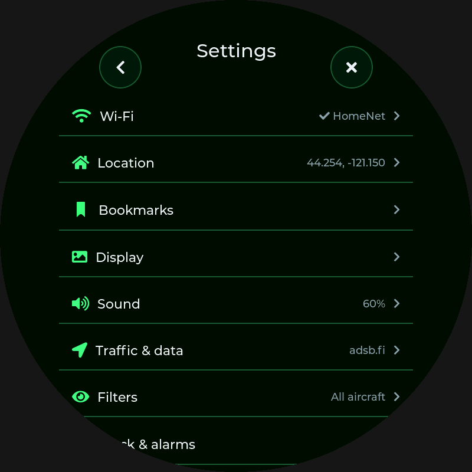
  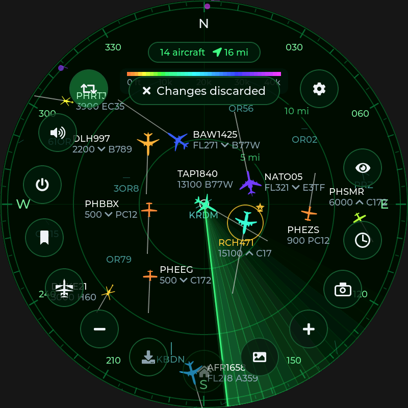
</p>

Open settings with the gear button. The main page lists every menu, each with a
short summary of its state on the right:

| Menu | What's in it |
|---|---|
| [Wi-Fi](#wi-fi) | Networks: join, save up to five, hidden networks |
| [Location](#location) | Home: search, map, coordinates or airport; the home zoom |
| [Bookmarks](#bookmarks) | Up to eight places to jump to |
| [Display](#display) | Theme, brightness, units, rotation, then [Aircraft & labels](#aircraft--labels), [Map & airports](#map--airports), [Radar sweep](#radar-sweep) and [Dimming & night](#dimming--night) |
| [Sound](#sound) | Volume, every sound's switch, proximity alert, your own sounds |
| [Traffic & data](#traffic--data) | The data feed (or your own receiver) and how often it updates |
| [Filters](#filters) | Which aircraft are shown |
| [Clock & alarms](#clock--alarms) | Time zone, clock face options, four alarms |
| [SD card](#sd-card) | The card, saved map tiles and lookups |
| [Favorites](#favorites) | Your saved aircraft |
| [Nearby aircraft](#nearby-aircraft) | A list of what's around |
| [Hidden aircraft](#hidden-aircraft) | Aircraft you never want to see |
| [Watchlist alerts](#watchlist-alerts) | Kinds, types and callsigns to announce |
| [Home Assistant (MQTT)](#home-assistant-mqtt) | Sensors and events for home automation |
| [Phone settings page](#phone-settings-page) | The QR code for your phone, the radar's hotspot |
| [Daily log](#daily-log) | Today's traffic near home, and earlier days |
| [Logbook](#logbook) | Every aircraft ever seen near home |
| [Replay a day](#replay-a-day-settings) | Recorded days, and recording on or off |
| [Updates](#updates) | Versions, checking and installing |
| [About](#about) | Version, status, diagnostics, restart and factory reset |

**Changes show right away**, so you can see what each does.

- **<** goes back a level. On the main page it returns to the radar and
  **keeps** your changes.
- **X** returns to the radar and **discards** everything you changed since you
  opened settings: options, home, filters, theme and removed favourites. It says
  *Changes discarded*.
- **What X can't undo:** joining or forgetting a Wi-Fi network, and a restart
  you confirmed.

Settings are saved a few seconds after you leave the menu. With an SD card in,
they're also written to `settings.txt`, see [SD card](#sd-card).

## Wi-Fi

<p align="center">
  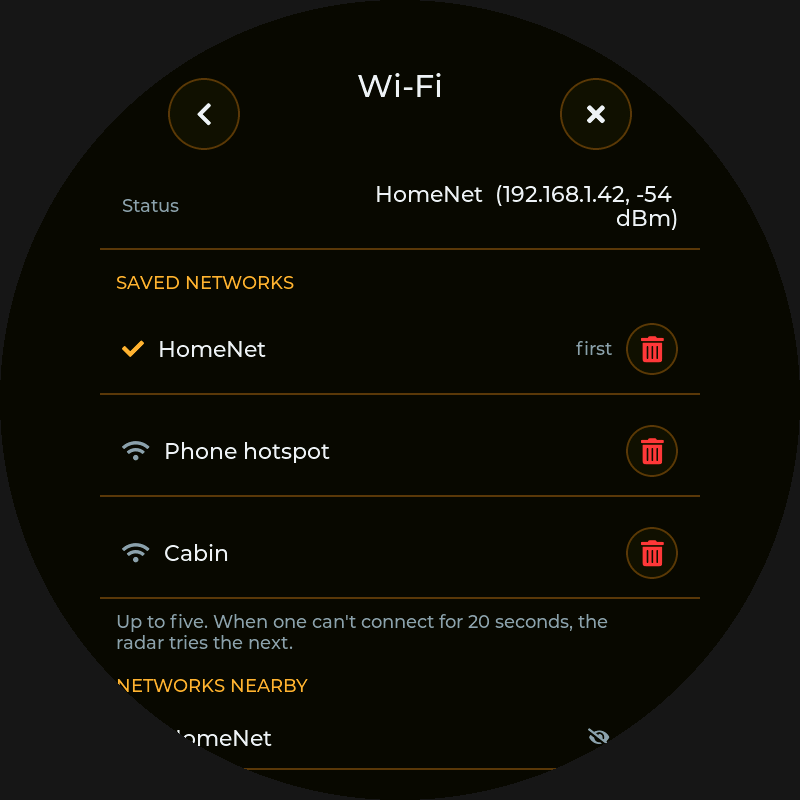
  
</p>

| Item | What it does |
|---|---|
| **Status** | The connected network, the radar's IP address and the signal strength in dBm (closer to 0 is better; −50 is excellent, −75 is weak). |
| **Saved networks** | Up to five. ✓ marks the connected one, *first* the one tried first. Tap one to connect to it; the trash button forgets it. |
| **Networks nearby** | Tap one to join it. Saved ones are marked *saved* and connect without asking for the password again. The bars show signal; a lock marks secured networks. |
| **Scan again** | Refreshes the list. |
| **Hidden network...** | For a network that doesn't broadcast its name: type the name (SSID), then the password. |

**Several networks.**

- **Saving:** joining a new network keeps the others saved. With five saved,
  the oldest is dropped.
- **Moving on:** if the connection drops, the radar retries by itself. With
  more than one saved, it tries the next after 20 seconds without a
  connection, which helps when the radar travels between home, a cabin and a
  phone hotspot.
- **Order:** whichever network connects becomes the one tried first.

**What you'll see:** short messages say what's happening: *Connecting to
HomeNet...*, *Connected to HomeNet*, *Lost Wi-Fi (HomeNet) - reconnecting* and,
when it can't connect, why (*Wrong password*, *Network not found*...).

**If the internet goes away** while Wi-Fi stays up:

1. **Rejoin:** after a few minutes with nothing answering, the radar rejoins
   the network.
2. **Restart:** if that doesn't help, it restarts, which also resets the Wi-Fi
   chip.
3. **Then just retry:** after two restarts in a row that didn't help, it only
   keeps rejoining, so a router with no internet doesn't cause endless
   restarts.

## Location

<p align="center">
  
  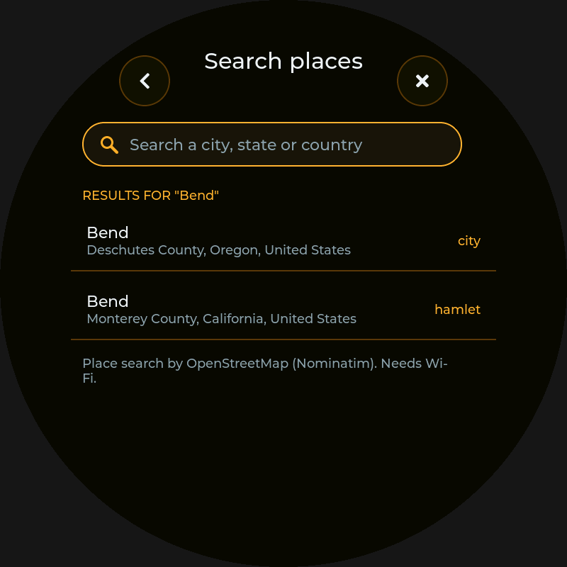
  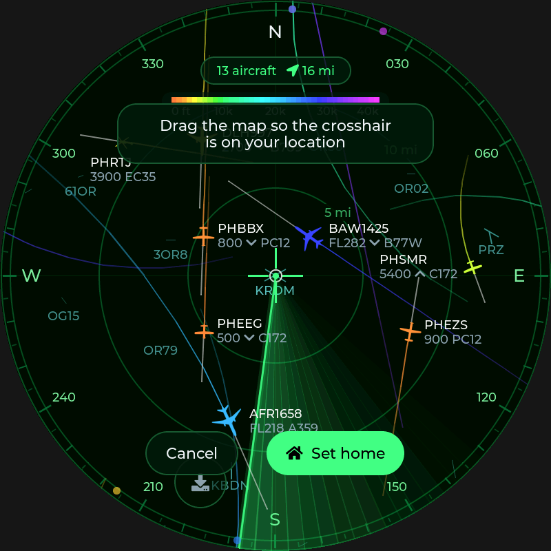
</p>

Home is the centre of the range rings and the sweep, and the reference for
distances, the proximity, favourite and watchlist alerts, the daily log and the
logbook.

| Item | What it does | Default |
|---|---|---|
| **Search bar** | Type a city, state, country or any place name, then pick a result. See below. | |
| **Latitude / Longitude** | Your home, in decimal degrees. | Redmond, Oregon |
| **Pick on the map** | Closes settings and shows a crosshair. Drag the map under it, then tap **Set home**. The current zoom becomes the home zoom too. | |
| **Enter coordinates** | Type latitude (−90 to 90), then longitude (−180 to 180). West and south are negative. | |
| **Use an airport (ICAO/IATA/FAA)** | Moves home to an airport by its ICAO (`KRDM`), IATA (`RDM`) or FAA code (`S39`). | |
| **Bookmarks** | Opens [Bookmarks](#bookmarks). | |
| **Home zoom (radius)** | How far the view reaches when you press Home, from the centre to the edge of the screen. 2–250 in your units. | 25 km (15.5 mi) |

**Searching for a place.** Type a name, such as *Bend*, *Oregon*, *Germany* or
*Lake Tahoe*.

- **Results:** up to six matches, each with where it is (county, state,
  country) and what it is (city, state, country...). If a name is ambiguous,
  add the state or country (*Bend, Oregon*).
- **Tap a match** to choose one of:
  - **Show on radar:** fly there, zoomed to fit the whole place. Home doesn't
    change.
  - **Set as home.**
  - **Bookmark:** save it as a bookmark, named after the place.

The search uses OpenStreetMap's free Nominatim service, so it needs Wi-Fi. The
radar only contacts it when you search.

You can also long-press any spot on the radar and choose **Set as home**.

## Bookmarks

<p align="center">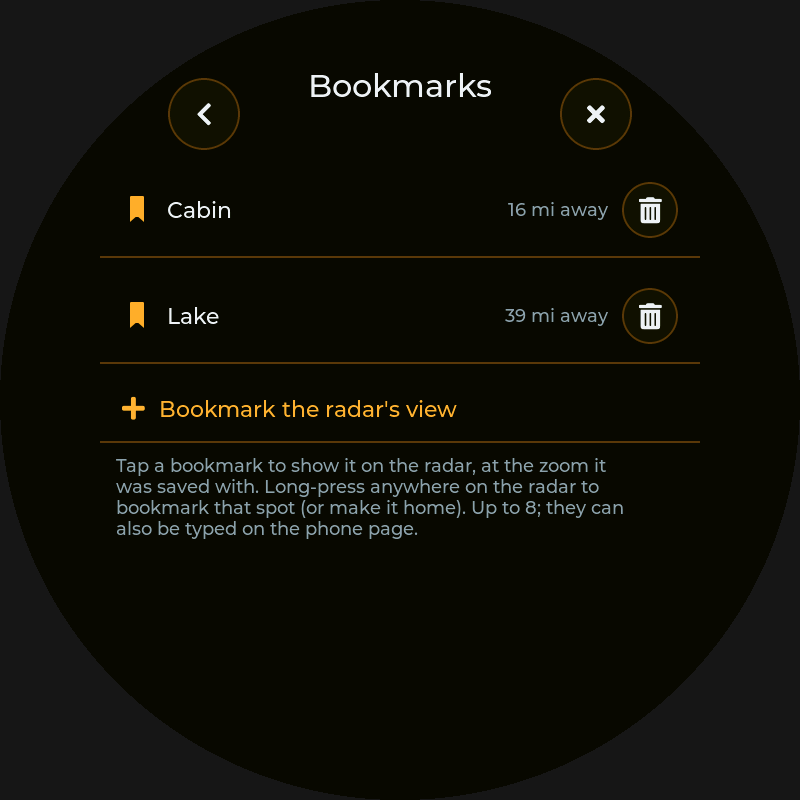</p>

Up to **eight places** to jump to: a cabin, a busy airport, a friend's town.
Open them from the bookmark button on the radar or **Settings → Bookmarks**.
Each bookmark shows how far it is from home.

- **Tap one** to close settings and show it on the radar at the zoom it was
  saved with.
- **The trash can** removes it, after asking.
- **Bookmark the radar's view** saves what the radar shows now: pan and zoom to
  the spot first.
- **Long-press the radar** and choose **Bookmark** to save that spot.
- **Search** on the Location page and choose **Bookmark** to save a place by
  name.

A bookmark is just a view: home stays where it is. In `settings.txt` they're
lines like `place1 = Cabin, 44.05000, -121.31000, 15` (name, latitude,
longitude, zoom radius in km), `place1` to `place8`. An empty value frees the
slot.

## Display

<p align="center">
  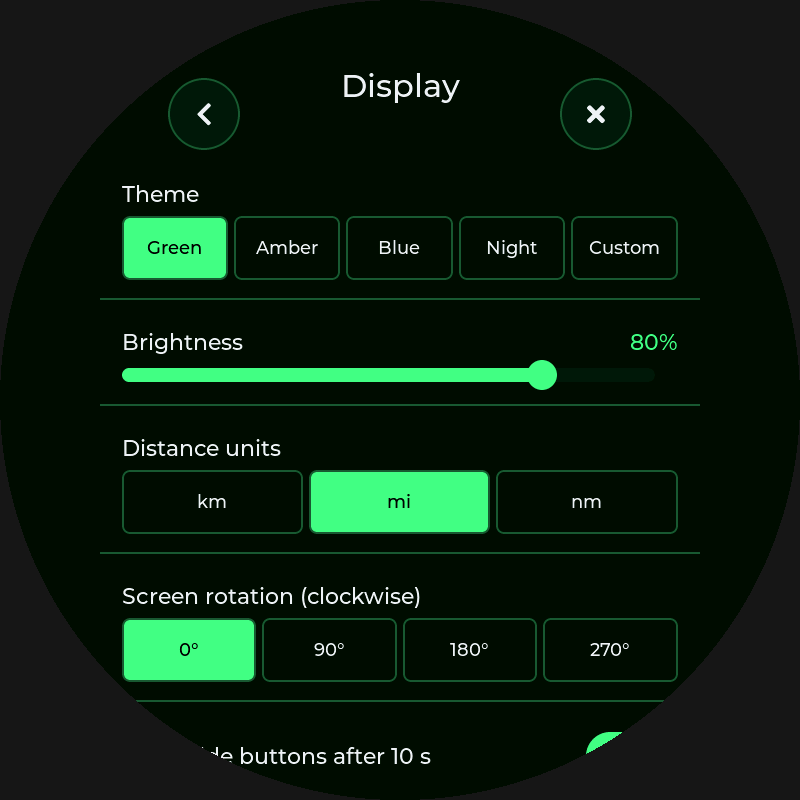
  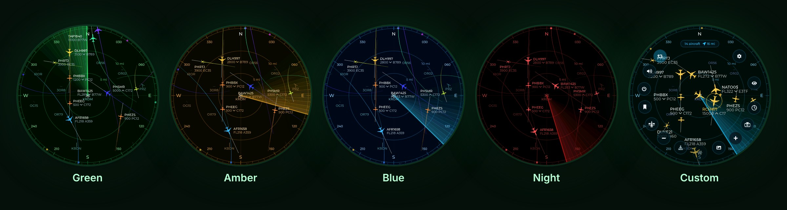
</p>

| Item | What it does | Default |
|---|---|---|
| **Theme** | **Green** (classic phosphor), **Amber**, **Blue**, **Night** (dim red, kind to night vision; aircraft stay red) or **Custom** (your own colours). | Green |
| **Custom colors** | With the Custom theme: opens [Custom colours](#custom-colours). | |
| **Brightness** | Backlight level, 5–100 %. | 80 % |
| **Distance units** | **km**, statute miles (**mi**) or nautical miles (**nm**), for rings, distances and the zoom readout. | mi |
| **Screen rotation (clockwise)** | Turns the whole picture by 0°, 90°, 180° or 270°, e.g. when the board is mounted with its USB port on another side. North stays at the top and touch follows. It asks to restart, which applies it (or it applies at the next power-up). | 0° |
| **Auto-hide buttons after 10 s** | Fades the radar's buttons and status pill when nobody touches the screen; a touch brings them back. | On |
| **Aircraft & labels** | Opens [Aircraft & labels](#aircraft--labels). | |
| **Map & airports** | Opens [Map & airports](#map--airports). | |
| **Radar sweep** | Opens [Radar sweep](#radar-sweep). | |
| **Dimming & night** | Opens [Dimming & night](#dimming--night). | |

<details>
<summary><b>The themes, full size</b></summary>

| | |
|:-:|:-:|
| <br>Green | 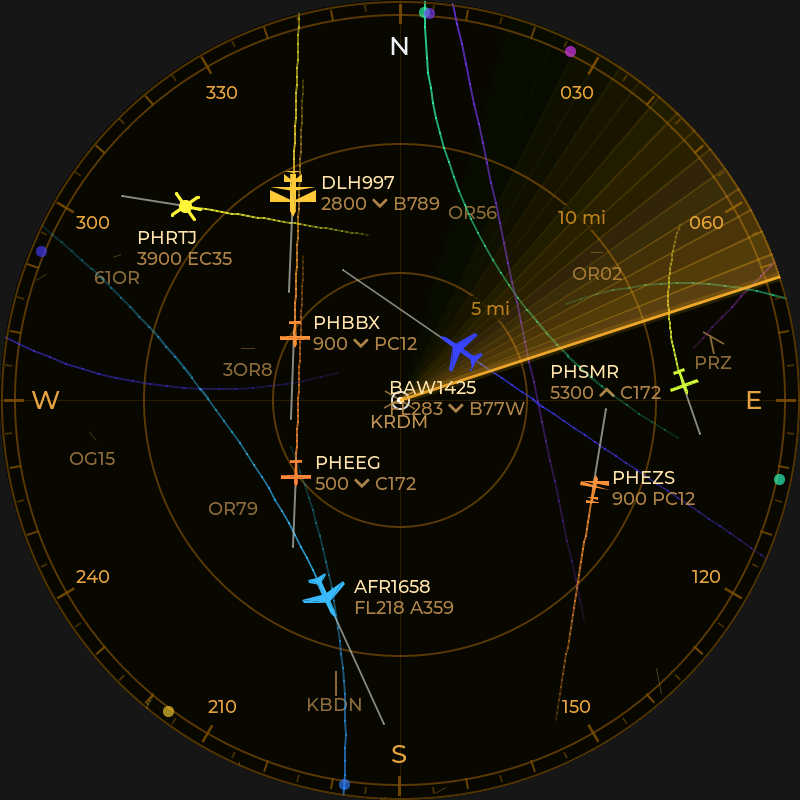<br>Amber |
| 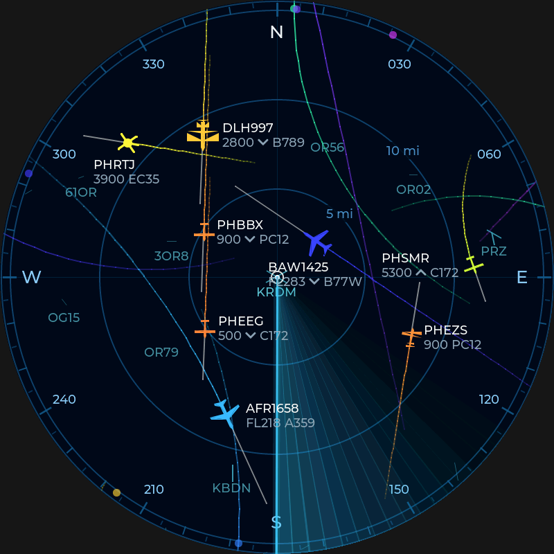<br>Blue | 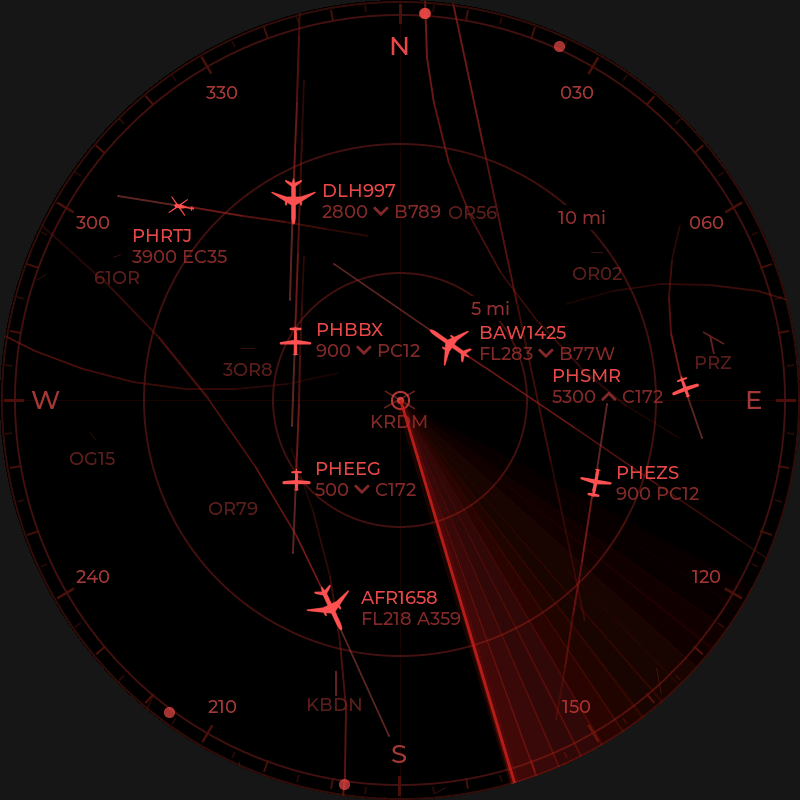<br>Night |

</details>

## Aircraft & labels

<p align="center">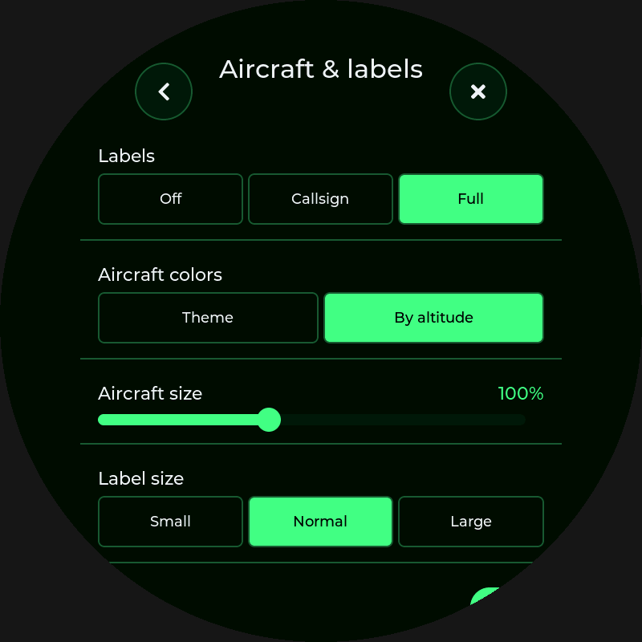</p>

| Item | What it does | Default |
|---|---|---|
| **Labels** | **Off**: no labels, except on the selected aircraft, emergencies and favourites. **Callsign**: one line. **Full**: callsign, plus altitude, climb arrow and type. | Full |
| **Aircraft colors** | **Theme**: one colour for all. **By altitude**: orange → green → blue → magenta with height. | By altitude |
| **Aircraft size** | Size of the aircraft icons, 60–160 %. | 100 % |
| **Label size** | **Small**, **Normal** or **Large** label text. | Normal |
| **Trails** | Where aircraft have been over the last few minutes. | On |
| **Flight history on tap** | Download and draw the whole current flight of the aircraft you tap ([Flight history](#flight-history)). | On |
| **Airline and route on tap** | Look up the airline, route and model of the aircraft you tap ([The info card](#the-info-card)). | On |
| **Speed vectors (1 min)** | A line to where each aircraft will be in one minute. | On |

## Map & airports

<p align="center">
  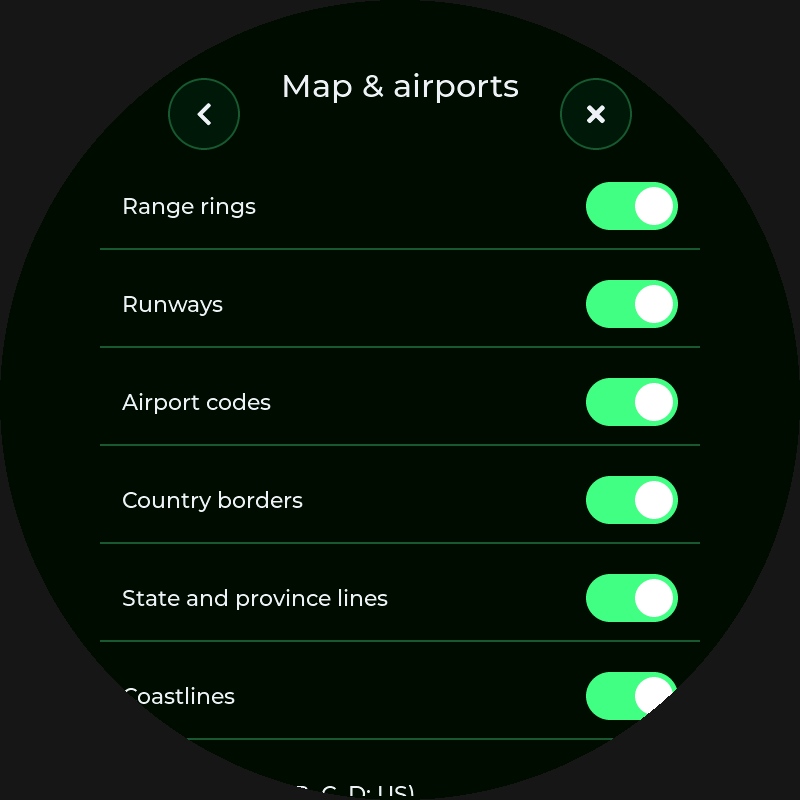
  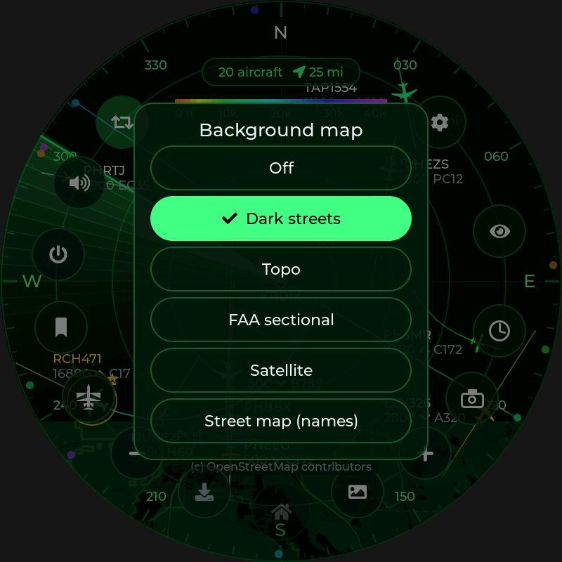
</p>

| Item | What it does | Default |
|---|---|---|
| **Range rings** | Distance rings and the crosshair around home. | On |
| **Runways** | Airport runways. | On |
| **Airport codes** | Airport labels. | On |
| **Background map** | **Off**, **Dark streets**, **Topo**, **FAA** (sectional charts), **Satellite** or **Street map**. See [Background maps](#background-maps). | Off |
| **CARTO key** | The free API key the Dark streets map needs, shown as *set* or *not set*. Tap to enter it. A `carto_key.txt` on the SD card works too. | not set |
| **Place names (dark streets with a CARTO key)** | Town and road names on the Dark streets map. | On |
| **Tint map to theme color** | Redraws the map in the theme's colour (topo inverted so it stays dark). Off shows the map's own colours, dimmed. Doesn't apply to the FAA chart and satellite photos. | On |
| **Map brightness** | How bright the map is behind the radar, 10–100 %. | 60 % |
| **SD card** | Opens [SD card](#sd-card) (saved tiles). | |
| **Airport code style** | **ICAO** (`KRDM`; fields with only a local code such as `S39` use their IATA code `PRZ`) or **IATA** (`RDM`, wherever one exists). | ICAO |

## Radar sweep

<p align="center">
  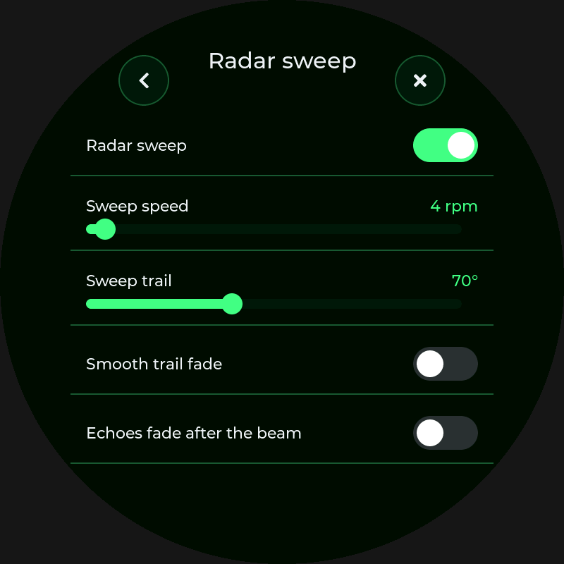
  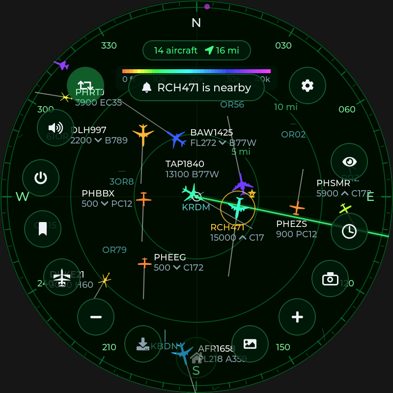
  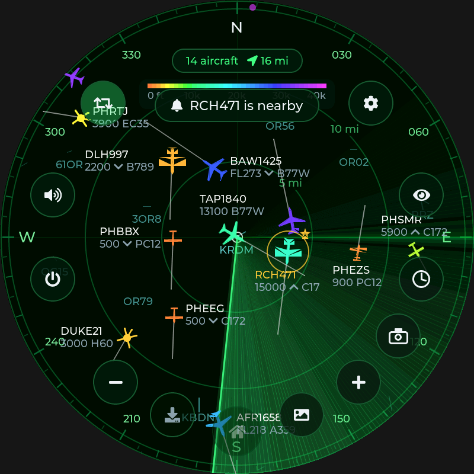
  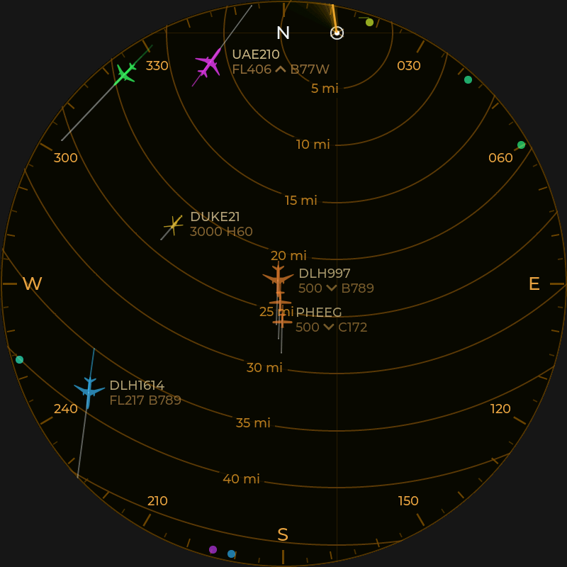
</p>

| Item | What it does | Default |
|---|---|---|
| **Radar sweep** | The rotating beam (also the button at the top left of the radar). | On |
| **Sweep speed** | Revolutions per minute, 1–60. | 4 rpm |
| **Sweep trail** | Length of the glow behind the beam, 0–180°. **0 = a clean bar**, just the beam line, which is also the cheapest to draw. | 70° |
| **Smooth trail fade** | Draws the glow in finer steps with a softer fade, with no visible bands. Costs a little more processing. | Off |
| **Echoes fade after the beam** | Like a real radar scope: aircraft (and their trails) dim after the beam passes and light up again on the next pass. The selected aircraft, emergencies and favourites stay bright. | Off |

With **Each sweep (sonar ping)** on in [Sound](#sound), the radar pings once
per revolution.

## Dimming & night

<p align="center">
  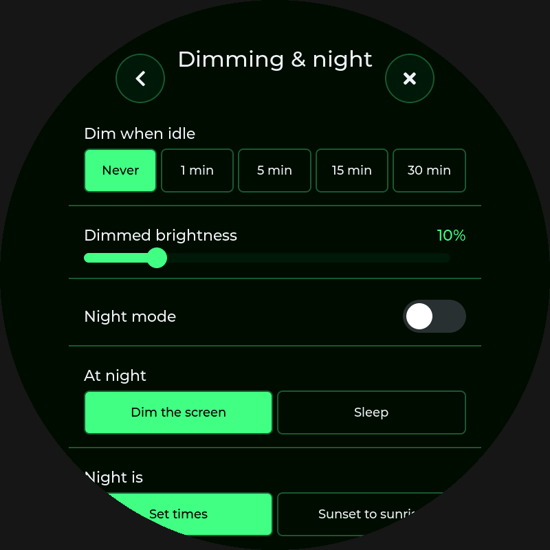
  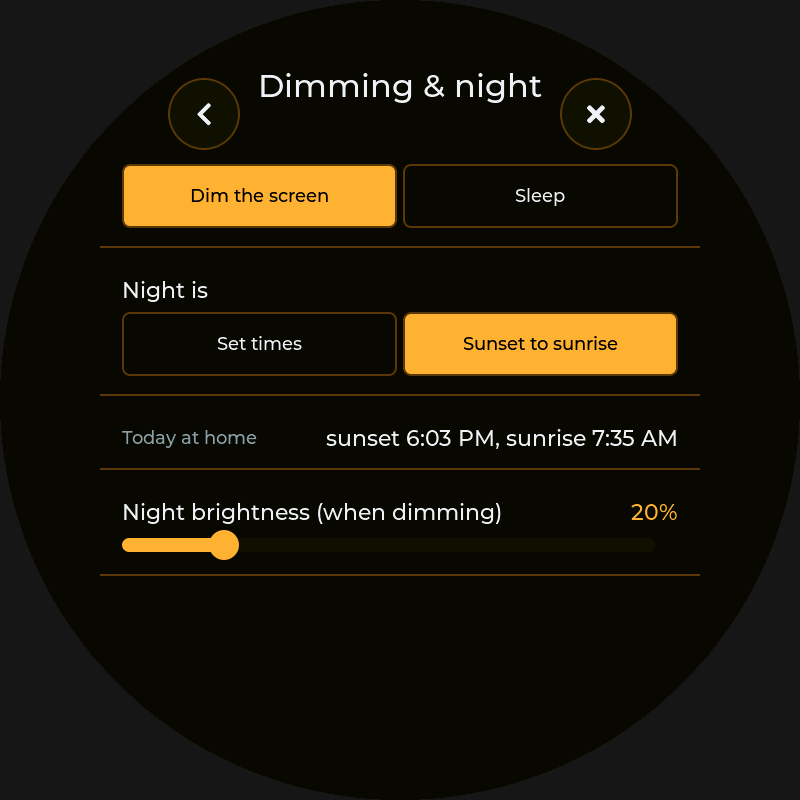
</p>

| Item | What it does | Default |
|---|---|---|
| **Dim when idle** | Lowers the backlight after **Never**, 1, 5, 15 or 30 minutes without a touch. A touch brings it back. | Never |
| **Dimmed brightness** | Backlight level while dimmed, 0–50 %. | 10 % |
| **Night mode** | Do something different at night (needs the time from the internet). | Off |
| **At night** | **Dim the screen** to the night brightness, or **Sleep**: screen off and sounds muted, as with the power button. | Dim the screen |
| **Night is** | **Set times**: between the two times below. **Sunset to sunrise**: from sunset to sunrise at home, worked out for each day (today's times are shown). | Set times |
| **Night starts / Night ends** | The night window, in 15-minute steps; it can cross midnight. | 10:00 PM / 7:00 AM |
| **Night brightness (when dimming)** | Backlight level at night, 1–100 %. | 20 % |

**Sleeping at night.** With **At night → Sleep**:

- **On its own:** the radar sleeps when night starts and wakes when it ends.
- **During the night:** a tap still wakes it, and after a minute untouched it
  goes back to sleep.
- **Still working:** alarms follow **Wake on alarm**, and traffic, the daily
  log and Home Assistant keep updating while it sleeps.

## Custom colours

<p align="center">
  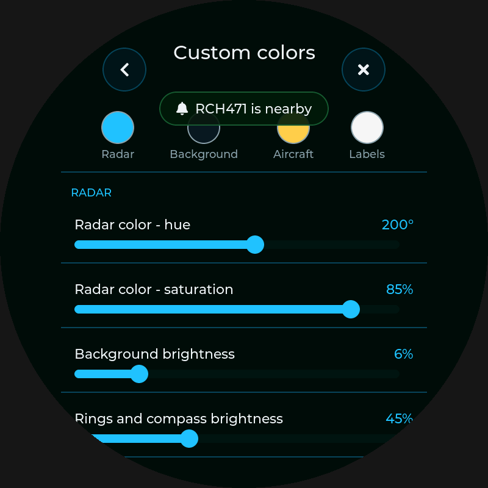
  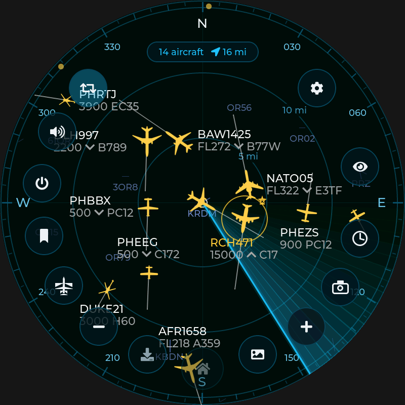
</p>

Choose **Custom** as the theme, then tap **Custom colors**. Four swatches at the
top preview the radar colour, background, aircraft and labels as you move the
sliders. The whole screen takes the new colours when you let go of a slider.

| Item | What it does | Default |
|---|---|---|
| **Radar color: hue / saturation** | The main colour: sweep, rings, compass, trails and buttons. Hue goes round the colour wheel (0 red, 120 green, 200 blue); saturation 0 is grey. | 175°, 80 % |
| **Background brightness** | 0 = black; higher gives a tinted background. 0–30 %. | 6 % |
| **Rings and compass brightness** | How bright the rings and compass marks are, 15–100 %. | 45 % |
| **Aircraft color: hue / saturation** | The aircraft's colour when **Aircraft colors** is *Theme*. Saturation 0 = white. | White |
| **Label color: hue / saturation** | Aircraft label text. Saturation 0 = white. | White |
| **Altitude colors: low / middle / high** | The *By altitude* scale's colours at the ground, 10,000 ft and 40,000 ft, blended in between. The defaults (20°, 140°, 300°) give the standard orange → green → blue → magenta. The altitude key follows. | 20°, 140°, 300° |
| **Reset custom colors** | Back to the defaults. | |

## Sound

<p align="center">
  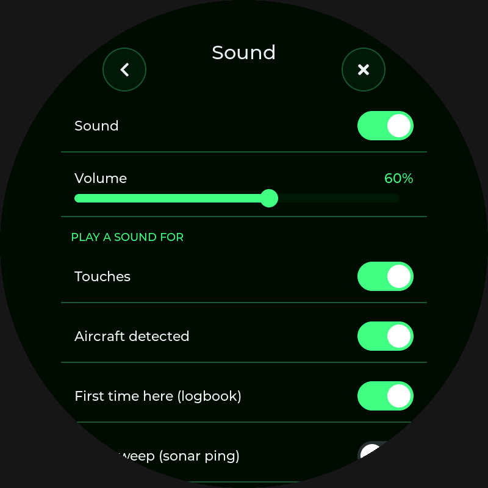
  
  
</p>

All sounds are synthesised on the board, and each has its own switch.

| Item | What it does | Default |
|---|---|---|
| **Sound** | The master switch for all sounds (also the speaker button on the radar). Alarms ring anyway. | On |
| **Volume** | Speaker volume, 0–100 %. A chime plays when you let go. | 60 % |
| **Touches** | A click on button presses. | On |
| **Aircraft detected** | A soft chime when 1–3 new aircraft appear. Bigger batches (after you pan to a new area, say) stay quiet. | On |
| **First time here (logbook)** | Four rising notes for an aircraft the [logbook](#logbook) has never seen near home (the announcement itself is switched on the Logbook page). | On |
| **Each sweep (sonar ping)** | A sonar ping once per sweep revolution. | Off |
| **Emergency squawks** | A siren when an aircraft squawks 7500/7600/7700 or reports an emergency. | On |
| **Proximity alert** | Three beeps when **any** airborne aircraft comes within the alert radius of home, below the altitude limit. | Off |
| **Alert radius** | The proximity distance from home, 1–20 in your units. | 3 km (2 mi) |
| **Below altitude** | Only alert for aircraft below this, 500–20,000 ft. | 5,000 ft |
| **Favorite detected** | A fanfare when a favourite comes into range. | On |
| **Favorite nearby** | A two-tone chime when a favourite comes within the nearby radius. | On |
| **Watchlist aircraft** | The [watchlist](#watchlist-alerts) sound. | On |
| **Silenced aircraft** | The aircraft you muted from their info card (up to 32), each with an unmute button. | none |
| **Nearby radius** | How close to home a favourite has to come for *Favorite nearby*, 1–100 in your units. | 15 km (9 mi) |
| **Test** | Plays each sound: sonar ping, aircraft detected, first time here, proximity, favourite detected, favourite nearby, emergency, watchlist. | |
| **Load them again** | Reads [your own sounds](#your-own-sounds) from the SD card again. | |

See [Alerts explained](#alerts-explained) for exactly when each sound plays.

### Your own sounds

Any sound can be replaced with your own WAV file:

1. **Copy it to the card:** put the file in a `sounds` folder on the SD card,
   named after the sound it replaces (below).
2. **Load it:** tap **Load them again** at the bottom of the Sound page. They're
   also read at startup and whenever a card is put in.

| File | Replaces |
|---|---|
| `click.wav` | Touches (cut to 1 s) |
| `ping.wav` | Each sweep (cut to 1 s) |
| `aircraft_detected.wav` | Aircraft detected |
| `first_time.wav` | First time here |
| `proximity.wav` | Proximity alert |
| `emergency.wav` | Emergency squawks |
| `favorite_seen.wav` / `favorite_near.wav` | Favourite detected / nearby |
| `watchlist.wav` | Watchlist alerts |
| `alarm.wav` | The alarm clock (up to 20 s) |
| `startup.wav` | Startup |
| `home.wav` | The Home button |

- **Formats:** any ordinary WAV: 8, 16, 24 or 32-bit, or 32-bit float, mono or
  stereo, any sample rate. It's converted to mono at 22 kHz.
- **Length and size:** sounds are cut to 8 seconds unless noted above, and
  files can be up to 8 MB.
- **Checking:** the page lists each file found and whether it worked, e.g.
  *not a WAV file*, or *unsupported format* for compressed ones like ADPCM or
  MP3.
- **Going back:** delete a file and tap **Load them again** to get the
  built-in sound back. The switches above still apply to your sounds.

## Traffic & data

<p align="center">
  
  
</p>

| Item | What it does | Default |
|---|---|---|
| **ADS-B feed** | Where aircraft data comes from: **adsb.fi**, **airplanes.live** or **adsb.lol** (free community networks with similar coverage), or **My receiver**. | adsb.fi |
| **Receiver** | With *My receiver*: your receiver's address, e.g. `192.168.1.50` or `pi.local:8080`. See below. | (empty) |
| **Use online feeds if it doesn't answer** | With *My receiver*: after three failed updates, switch to the online feeds, and try your receiver again every 2 minutes. Off: always your receiver, waiting if it's down. | On |
| **Update every** | How often to fetch new positions, 2–30 s. Aircraft move smoothly in between either way. With the online feeds, please keep 5 s or more for everyday use: they're free services. With your own receiver 2 s is fine. | 5 s |
| **Filters...** | A shortcut to [Filters](#filters). | |

**Failover.** If the chosen online feed fails three times in a row, the radar
switches to the next one (*adsb.fi isn't answering - using airplanes.live*). It
tries the chosen one again every 10 minutes, and goes back as soon as it
answers. **About → Feed** shows which feed is in use.

**Your own receiver.** If you run an ADS-B receiver on your network (a
Raspberry Pi with readsb, tar1090, dump1090 or dump1090-fa, SkyAware, the
FlightAware or Flightradar24 image, or adsb.im), the radar can read it directly:

- **Speed:** traffic comes straight from your antenna, in real time, with no
  rate limits.
- **Offline:** no internet is needed for the traffic itself (maps, routes and
  photos still use it).
- **Address:** type just the address. The radar looks for `aircraft.json` where
  these programs keep it: `/tar1090/data/`, `/data/`, `/skyaware/data/`,
  `/dump1090-fa/data/` and `/dump1090/data/`. A full URL ending in `.json` is
  used as it is.
- **Area:** only aircraft inside the area shown are kept; a receiver reports
  everything it hears.
- **Checking it:** the serial log says *your receiver answers at ...* when it
  finds it.

## Filters

<p align="center">
  
  
  
</p>

Filters decide which aircraft appear. **Favourites and watchlist aircraft are
always shown**, whatever the filters, and their alerts still work. While a
filter hides aircraft, the eye button on the radar is lit and the status pill
says how many, e.g. *3 aircraft (11 filtered)*.

| Item | Shows / hides | Default |
|---|---|---|
| **Aircraft kinds** | One switch per kind, from the category each aircraft broadcasts: **Light aircraft** (Cessnas, Pipers, ultralights), **Small & business** (business jets, turboprops), **Airliners** (A320/737 size), **Heavies** (757 and widebodies), **Fast jets** (high-performance, mostly fighters), **Helicopters**, **Gliders, balloons, drones** (also parachutists), **Unknown category** (aircraft that don't broadcast one; quite a few). | all on |
| **Military aircraft only** | Hide everything the feed doesn't flag as military. | Off |
| **Aircraft on the ground** | Include taxiing and parked aircraft (shown grey). | Off |
| **Only types** | ICAO type codes separated by commas. A `*` at the end matches a prefix: `A32*` = the A320 family, `B7*` = Boeing 7-series. Empty = all. | all |
| **Hide below / Hide above** | An altitude band, in 500 ft steps (up to 40,000 / 60,000 ft). | no limit |
| **Slower than / Faster than** | A ground-speed band in knots: e.g. hide anything slower than 100 kt to drop light traffic. | no limit |
| **Reset all filters** | Back to showing everything airborne. | |

<p align="center"></p>

Filters combine: *Helicopters* only plus *Hide above 3,000 ft* shows
low-flying helicopters.

## Clock & alarms

<p align="center">
  
  
  
</p>

| Item | What it does | Default |
|---|---|---|
| **Time now** | The local time and date, or *Not set yet* before the clock has synced over Wi-Fi. | |
| **Time zone** | Your zone, from a list of 24 (US zones, Europe, Asia, Australia...). Daylight saving is automatic. | Pacific |
| **Clock face on the radar** | The same as the clock button on the radar. | Off |
| **24-hour time** | 19:45 instead of 7:45 PM, on the alarm screens and in settings. | Off |
| **Seconds hand** | Show the seconds hand. | On |
| **Smooth seconds hand** | The seconds hand sweeps instead of ticking (redraws the screen more often). | Off |
| **Date window** | The day and date at three o'clock. | On |
| **Hand colors** | Hue and saturation for the hour and minute hands, and for the seconds hand. Saturation 0 = white. The Night theme keeps them red. | White, red seconds |
| **Alarms 1–4** | Each shows its time and days. The switch turns it on or off; tap the row to edit it. | Off, 7:00 AM weekdays |
| **Wake on alarm (when asleep)** | While the radar is [asleep](#sleep): **On** = alarms ring and wake it; **Off** = they pass silently. No effect while it's awake. | Off |
| **Snoozed / Cancel snooze** | Shown while an alarm is snoozed, with the minutes left. | |

**Editing an alarm:**

- **Hour** and **Minute** sliders. Moving them switches the alarm on.
- **Alarm on**.
- **The days it repeats:** tap **Mo**…**Su**. With no days chosen it rings once
  and then switches itself off.
- **Test this alarm**.

## SD card

<p align="center"></p>

The SD card is optional, but it unlocks a lot: offline maps, the
[daily log](#daily-log) history, the [logbook](#logbook), [replays](#replaying-a-day),
[screenshots](#screenshots), [your own sounds](#your-own-sounds),
[hidden aircraft](#hidden-aircraft) and a copy of all your settings.

| Item | What it does | Default |
|---|---|---|
| **Card** | Size and free space, *No card*, or why it couldn't be read. | |
| **Saved map tiles** | How many map tiles are saved and the space they use. | |
| **Save map tiles to the card** | Save (and read) map tiles on the card. | On |
| **Count saved tiles** | Counts them again. | |
| **Delete saved map tiles** | Empties the `tiles` folder; maps download again as needed. | |
| **Remember airline and route lookups** | Keeps what adsbdb.com said about each aircraft you tap, in a `lookups` folder, so it shows at once next time, even offline. Routes are looked up again after a month, airframes after six months. | On |
| **Delete saved lookups** | Empties the `lookups` folder. | |
| **Look for a card again** | For a card put in while the radar is running. | |
| **Unmount (safe to remove)** | Stops using the card so you can take it out. | |

**The card:**

- **Format:** use a **FAT32** card. Most cards up to 32 GB come that way;
  format bigger ones as FAT32 on a computer. The radar never formats a card.
- **Sharing it:** everything goes in its own folders, so the card can hold
  other files too.
- **Space:** a whole city's map tiles at a few zoom levels take a few tens of
  megabytes.

### settings.txt and favorites.txt

With a card in, the radar keeps two text files in its root folder:

- **`settings.txt`**: every setting, Wi-Fi name and password included, as
  `key = value` lines, each with a comment explaining it. See
  [the full list](#settingstxt-every-setting).
- **`favorites.txt`**: your favourite aircraft, one per line.

**How they're used:**

- **Written:** the first time the card is used, and again whenever you change
  something on the screen.
- **Read:** at startup, and when you tap **Look for a card again**.
- **What that gives you:** your setup survives anything that erases the board,
  and moving the card to a second radar copies everything across.

**Editing on a computer:**

1. Take the card out (**Unmount** first, or power off), edit the file, put the
   card back and restart. *Settings loaded from SD card* confirms it worked.
2. Lines you delete keep their current value.
3. Lines the radar doesn't understand are skipped; the serial log lists them
   as `sd: settings.txt line N: ...`.
4. The file is then rewritten in its standard layout.

```ini
[Display]
units = mi
theme = amber
rotation = 0          # 0, 90, 180 or 270 (takes a restart)

[Clock]
alarm1 = on 06:45 weekdays     # once, daily, weekdays, weekends, mon,wed,fri or mon-fri
```

<p align="center"></p>

In `favorites.txt`, each line is an ICAO hex code (6 characters), then
optionally a label and type. You can also type just a **tail number**:

```
a1b2c3   N123AB   B738
N456CD
```

At startup the radar looks `N456CD` up online, adds it, and replaces the line
with its hex code.

- **Not found:** the line is dropped, with a *not found* notice.
- **No internet yet:** the line waits until the next start.
- **The file is in charge:** deleting a line there removes that favourite.

**Two more rules:**

- **No card at first:** if you change settings while no card is in and then put
  one in, the radar's settings win and are written to the card.
- **Factory reset** deletes `settings.txt` but keeps `favorites.txt`.

## Favorites

<p align="center">
  
  
  
</p>

Save up to **32 aircraft** you care about: a local flight school's aircraft, an
airline you like, a friend's plane, Air Force One.

- **From the radar:** tap the aircraft, then ★ on its card.
- **By tail number:** on the Favorites page tap **Add by tail number** and type
  its registration (`N123AB`, `EI-DAC`) or ICAO hex address (`a1b2c3`). The
  radar looks it up on adsbdb.com and says *N123AB added to favorites*, or *not
  found*.
- **From the phone page,** where you can also rename them.

<p align="center"></p>

**Recognised by airframe.** Favourites are matched by the airframe's **ICAO
address**, which never changes, so a saved aircraft is still recognised under
any flight number.

**On the radar,** favourites get a gold ring, a star and an always-on gold
label, and a gold dot on the rim when they're just off screen. They're always
shown, whatever the [filters](#filters).

**The Favorites page** lists each one with its type and address, whether it's
**in range** now and how far away, and a remove button.

**Alerts:** *Favorite detected* when one appears in the data, and *Favorite
nearby* when it comes within the nearby radius of home. Each comes with a notice
and a sound, see [Sound](#sound).

## Nearby aircraft

<p align="center">
  
  
</p>

The airplane button on the radar (or **Settings → Nearby aircraft**) lists the
aircraft the radar has right now, each with its type, distance from home,
altitude and speed. Favourites are in their own colour.

- **Sort by:** **distance** (nearest first), **altitude** (highest first) or
  **speed** (fastest first).
- **Tap one** to see it on the radar, centred, with its info card open.
- **Limits:** the list shows the first 60, and doesn't update while it's open.

## Hidden aircraft

<p align="center">
  
  
</p>

Some aircraft you never want to see, such as a training flight that circles
all day. Tap it, then the crossed-out eye on its card, and confirm. From then on
it's as if it wasn't in the data:

- **Not shown:** it isn't drawn, and isn't in the Nearby list.
- **Never heard:** no sound or alert of any kind, **not even in an emergency**
  (unlike silenced aircraft).
- **Not counted:** it's left out of the daily log and the logbook, and isn't
  recorded for replays (earlier recordings skip it too).

Hiding a favourite or a silenced aircraft takes it off those lists. There's
**no limit** on how many you can hide.

**Settings → Hidden aircraft** lists them, 100 to a page, with the name and
type each had when hidden. The open eye next to one brings it back; it reappears
with the next traffic update.

The list is kept on the SD card in `hidden.txt`, one aircraft per line (hex code,
then the name and type). You can edit it on a computer: delete a line to bring
an aircraft back, or add a hex code to hide one. Hiding needs the card; without
one, the button says so.

<p align="center">
  
  
</p>

> **Silence or hide?** **Silence** (the mute button) stops the routine sounds
> for an aircraft but keeps it on the radar, and emergencies still sound.
> **Hide** removes it completely.

## Watchlist alerts

<p align="center">
  
  
</p>

Announces interesting aircraft when they come within a distance of home, with
a notice (*Watchlist: RCH471 (C17, military), 23 mi*) and a sound of its own.

- **Once per visit:** each aircraft is announced once each time it comes by.
- **Always shown:** watched aircraft are on the radar whatever the
  [filters](#filters).

| Item | What it does | Default |
|---|---|---|
| **Watchlist alerts** | Turns the whole watchlist on or off. | On |
| **Military aircraft** | Anything the feed marks as military. | Off |
| **Helicopters** | Emitter category A7 (rotorcraft). | Off |
| **Fast jets** | Emitter category A6 (high performance). | Off |
| **Types** | ICAO type codes, e.g. `A388, B52, C17, F35`; `*` matches a prefix (`A38*` = any A380). | none |
| **Callsigns** | Callsigns or tail numbers, e.g. `RCH*, N123AB`. `RCH*` catches US Air Force cargo flights ("Reach"). | none |
| **Within** | Distance from home, 1–150 in your units. | 25 mi |
| **Play a sound** | The watchlist sound. **Test the sound** plays it. | On |

Like favourites, aircraft are only seen inside the area the radar is fetching:
zoom out to watch a wider area.

## Home Assistant (MQTT)

<p align="center"></p>

Sends the radar's traffic to an MQTT broker, such as Home Assistant's
**Mosquitto broker** add-on, so you can use it in dashboards and automations.

| Item | What it does | Default |
|---|---|---|
| **Send traffic to Home Assistant** | Turns it on. | Off |
| **Status** | *Off*, *Connecting to …* or *Connected to …*. | |
| **Broker** | The broker's address, e.g. `192.168.1.20` or `homeassistant.local`. | not set |
| **Port** | Usually 1883. | 1883 |
| **User / Password** | If the broker asks for them (Mosquitto does: create a Home Assistant user for the radar). | none |
| **Add the sensors to Home Assistant** | Announces the entities to Home Assistant (MQTT discovery), so they appear by themselves. | On |

**Setting it up in Home Assistant:**

1. Install the **Mosquitto broker** add-on and the **MQTT** integration if you
   haven't already.
2. Create a user for the radar (Settings → People → Users).
3. On the radar, turn this on and enter the broker's address, that user and
   its password. The status turns to *Connected*.
4. A **Plane Radar** device appears under Settings → Devices & services → MQTT,
   with these entities:

| Entity | What it shows |
|---|---|
| **Aircraft nearby** | How many aircraft the radar shows. |
| **Nearest aircraft** | Its callsign, with the hex address, type, distance and altitude as attributes. |
| **Nearest aircraft distance** | In the radar's units. |
| **Nearest aircraft altitude** | In feet. |
| **Aircraft emergency** | On while any aircraft squawks an emergency. |
| **Aircraft alert** | An event for each alert: `favorite_seen`, `favorite_near`, `watchlist`, `emergency`, `first_time`. |

An automation that flashes a light when a favourite comes near:

```yaml
automation:
  - alias: "Favorite aircraft overhead"
    trigger:
      - platform: state
        entity_id: event.plane_radar_aircraft_alert
    condition:
      - condition: template
        value_template: "{{ trigger.to_state.attributes.event_type == 'favorite_near' }}"
    action:
      - service: light.turn_on
        target: { entity_id: light.living_room }
        data: { flash: short }
```

**Without Home Assistant,** any MQTT client (Node-RED, `mosquitto_sub`...) can
read the topics. They start with `plane_radar` (`mqtt_topic` in settings.txt):

| Topic | Content |
|---|---|
| `plane_radar/state` | JSON, kept by the broker, sent when it changes (at most every 2 s, at least every minute): `count`, `emergencies`, `source`, `units`, and `nearest` with `name`, `hex`, `type`, `distance`, `altitude_ft`. |
| `plane_radar/event` | One JSON message per alert: `event_type`, `name`, `type`, `detail`. |
| `plane_radar/status` | `online`, or `offline` when the radar drops off (the broker's last will). |

## Phone settings page

<p align="center">
  
  
  
  
</p>

Change settings from a phone or computer instead of the touchscreen: handy
for Wi-Fi passwords, tail numbers and long lists of types. Open **Settings →
Phone settings page** on the radar and scan the QR code with your phone's
camera. Or type the address shown, the radar's IP address with port 50080,
e.g. `http://192.168.1.42:50080`.

The page has eight tabs:

| Tab | What's there |
|---|---|
| **Settings** | Every setting, grouped like settings.txt. A change applies on the radar at once. Distances are in km there, with miles beside them. |
| **Watchlist** | The [watchlist](#watchlist-alerts). |
| **Favorites** | Add by tail number or hex code, rename, remove; silenced aircraft with an unmute button. |
| **Wi-Fi** | Saved networks in the order they're tried; scan, add (save for later, or connect now), move up, forget. |
| **Daily log** | Today and earlier days, with the hourly chart, and a CSV download of the last 90 days. |
| **Screenshots** | Take one, and view or download the saved ones. |
| **Backup** | [Download a backup, or restore one](#backup-and-restore). |
| **Update** | Install a firmware file (the one ending in `-ota.bin`). The radar checks it first, and refuses the USB image or a file for another board. |

<p align="center">
  
  
  
  
</p>

**Who can open it:** anyone on your own network; it isn't reachable from the
internet. Turn it off with the **Phone settings page** switch when you don't
need it. (It uses port 50080 because the Wi-Fi chip keeps ordinary ports such
as 80 for itself.)

**The radar's own Wi-Fi (hotspot).** If your phone can't reach the radar
through your router, tap **Start the radar's hotspot**. The radar then runs a
small Wi-Fi network of its own (`PlaneRadar-XXXX`, with a password) while
staying connected to yours. Two QR codes appear:

1. The first joins your phone to that network: scan it with the camera and tap
   *Join*. If the phone says the network has no internet, choose to stay
   connected.
2. The second opens the page, at `http://192.168.4.1:50080`.

The hotspot turns itself off 30 minutes after the last phone leaves, and on a
restart.

<p align="center"></p>

**If the page doesn't open,** scroll down on the radar's Phone settings page:

- **Server**: *Running and answering* means the radar reached its own page, so
  the server works.
- **Phone visits**: counts requests that reached the radar from another device,
  and shows the last one's address.

If the server answers but *Phone visits* stays at *None yet*, the phone can't
reach the radar. Check that it's on the same Wi-Fi network:

- not on mobile data;
- not on a guest network, which keeps devices apart (some routers' "AP
  isolation" or "client isolation" does the same).

Or use the radar's hotspot.

### Backup and restore

- **Download a backup** (Backup tab) saves one text file with everything you've
  set up: all settings (with the saved Wi-Fi networks and their passwords),
  favourites and silenced aircraft.
- **Restore** reads such a file back, on the same radar or a new one (after a
  factory reset, say), and says what it restored.

Keep the file private: it holds your Wi-Fi passwords. It's plain text in the
same form as `settings.txt` and `favorites.txt`.

## Daily log

<p align="center">
  
  
</p>

What flew near home today:

- **how many different aircraft;**
- **the busiest moment** (most at once);
- **the closest pass,** the **highest** and the **fastest** aircraft;
- **how many were military,** or squawked an **emergency;**
- **which favourites** showed up.

**Today by hour** shows how many different aircraft came by in each hour, as
bars; the busiest hour is the bright one.

| Item | What it does | Default |
|---|---|---|
| **Count aircraft within** | Only airborne aircraft within this distance of home are counted, 1–100 in your units. | 25 mi |
| **Last 7 days / Last 30 days** | Totals over the period: different aircraft (each counted once), the average a day, the busiest day and hour, and for the week the hours as bars. | |
| **Earlier days** | The last week, one line a day. | |

**When it counts:** only while the radar shows the area around home, since it
receives traffic only for the area on screen. It needs the time from the
internet to know when a day starts.

**With an SD card:**

- each day is saved as `log/YYYY-MM-DD.txt`, readable on a computer;
- the count carries on after a restart;
- the earlier days and totals become available.

The phone page's Daily log tab shows the same and downloads a CSV of the last
90 days.

## Logbook

<p align="center"></p>

With an SD card, the radar keeps a **logbook** of every aircraft ever seen near
home (within the daily log's distance) in `logbook.csv`.

- **One line per visit:** an aircraft seen again after half an hour away is a
  new visit.
- **Each line has:** the date, time, hex address, callsign, registration and
  type.
- **It's a spreadsheet:** the file opens in any spreadsheet program.

**The Logbook page** shows how many different aircraft and visits it holds and
since when, the **most frequent** visitors and the **newest** ones. The phone
page shows the same and downloads the file.

**First time here.** When an aircraft the logbook has never seen comes by, the
radar says *First time here: N123AB (B738)*, with its own sound.

- **Switches:** **Announce first-time visitors** on this page turns the
  announcement on or off, and **First time here** in [Sound](#sound) the sound.
  In settings.txt they're `first_time_alert` and `sound_first_time`.
- **A new logbook:** for its first two days everything is new, so the
  announcements only start after that.
- **Silenced aircraft** are never announced.

## Replay a day (settings)

<p align="center"></p>

| Item | What it does | Default |
|---|---|---|
| **Recorded days** | Today and the earlier days on the card. Tap one to play it on the radar ([Replaying a day](#replaying-a-day)). | |
| **Back to live traffic** | Shown while a replay is playing. | |
| **Record the traffic around home** | Records the aircraft within 150 km of home every 15 seconds (while the radar shows that area) into `replay/YYYY-MM-DD.rpl`, about 2–5 MB a day. A week is kept; older days are deleted. | On |

## Updates

<p align="center">
  
  
  
</p>

| Item | What it does | Default |
|---|---|---|
| **Installed version** | The firmware running now. | |
| **Latest version** | The last check's result: *Up to date*, *vX.Y.Z available*, or why it couldn't check. | |
| **Check now** | Looks up the latest release on GitHub. | |
| **Install vX.Y.Z** | Appears when a newer version is out. See [Updating over Wi-Fi](#updating-over-wi-fi). | |
| **Check for updates automatically** | A minute after start, then hourly. Nothing is installed without asking. | On |

## About

<p align="center">
  
  
  
</p>

| Item | Meaning |
|---|---|
| **Firmware** | The installed version. |
| **What's new** | The notes for this version and the two before it. They're also shown once, by themselves, after an update. |
| **Display** | The screen's resolution (800×800 = 3.4", 720×720 = 4"). |
| **Wi-Fi** | IP address and signal strength. |
| **Feed** | Aircraft count, seconds since the last update and the feed in use, or the last error. |
| **Free memory** | Internal RAM and PSRAM free right now. |
| **Running for** | Time since the radar started. |
| **Last restart** | Why it last started: power on, restarted by the radar, the reset button, or a problem (crash, watchdog, power dip). |
| **Starts** | How many times it has started, and how many of those were unexpected. |
| **Icon cache** | Memory used by the rotated aircraft icons (at most about 4 MB; the least recently drawn are dropped), and how many images were skipped because PSRAM was full (should be none). |
| **Task stacks** | For each of the radar's tasks, the most stack memory it has used against its size. These are the numbers used to tune the firmware's memory. |
| **Memory graphs** | The lowest free RAM and PSRAM in each half hour of the last 24 hours. Steady bars are good; bars shrinking hour after hour would mean a leak. They start over after a restart. |
| **On-screen stats** | Small live performance numbers in the lower left of the radar (below). |
| **Restart** | Restarts the radar. |
| **Factory reset** | Erases Wi-Fi, location, all settings and favourites (and `settings.txt` on the card, but not `favorites.txt`), then restarts. |

<p align="center"></p>

**Power-cycling three times in a row** within 20 seconds of each start makes
the radar go back to the version installed before. This is the emergency way
out of a bad update; see [Updating over Wi-Fi](#updating-over-wi-fi).

**On-screen stats**, line by line (averaged over the last second):

| Line | Meaning |
|---|---|
| `30 fps, frame 9.2 ms (max 14), 35% redrawn` | Frames per second; time per frame and the slowest one; how much of the screen each frame redraws (only what changed is redrawn). |
| `draw 6.1 + panel 3.1 ms (rotate 1.4)` | The frame split into drawing the picture and handing it to the screen. |
| `radar 2.3 ms, background 12 ms (1), rest 40%` | The radar's own drawing (sweep, aircraft, labels) per frame; time spent rebuilding the background layer (map, rings, trails) in the last second and how many times; how many frames had nothing to redraw. |
| `trails 420 segs, 3 ms, base copied 8` | Trail segments per background rebuild and their time; how many background strips just copied the stored map picture because only traffic changed. |
| `CPU 23% net, 41% UI` | How busy each processor core is. |
| `RAM ... PSRAM ...` | Free memory, and the lowest it has been. |
| `16 aircraft (decode 9 ms), -54 dBm` | Aircraft shown, time to decode the last update, Wi-Fi signal. |
| `up 2:13:05, UI pause 12 ms` | Time since start, and the longest the screen went without updating. |

---

# How it works

## Alerts explained

Each traffic update plays **at most one sound**, the most important one, in
this order:

| # | Alert | When it fires | Repeats? |
|---|---|---|---|
| 1 | 🚨 **Emergency** | An aircraft starts squawking 7500/7600/7700 or reports an emergency. Silenced aircraft still trigger it; hidden ones don't. | When an aircraft newly enters an emergency |
| 2 | 🎯 **Watchlist** | A watched aircraft comes within the watchlist distance of home. | Once per visit |
| 3 | ⭐ **Favorite nearby** | A favourite comes within the nearby radius of home. | Once per approach: it has to leave the radius first |
| 4 | ⭐ **Favorite detected** | A favourite appears in the data, including right after power-on. | Again if it disappears for over 45 s and returns |
| 5 | 🆕 **First time here** | An aircraft the logbook has never seen comes near home. | Never for the same aircraft |
| 6 | 📍 **Proximity** *(off by default)* | Any airborne aircraft below the altitude limit enters the alert radius. | Once per approach |
| 7 | ✈️ **Aircraft detected** | 1–3 aircraft appear that weren't there before. Bigger batches stay quiet. | Each time |

- **Notices without sound:** favourite, watchlist and first-time alerts also
  show an on-screen [notice](#the-status-pill-and-notices), even with their
  sound off.
- **Home Assistant:** all of them are sent as [events](#home-assistant-mqtt).
- **Muting:** the **Sound** master switch (or the speaker button) silences
  everything except alarms.
- **Silenced and hidden aircraft:** silenced aircraft never trigger 2, 5, 6 or
  7. Hidden aircraft trigger nothing at all.
- **The area covered:** alerts only see aircraft inside the area the radar is
  fetching, which is what's on screen plus a margin.

## Where the data comes from

| Data | Source |
|---|---|
| **Aircraft positions** | The free community ADS-B networks [adsb.fi](https://adsb.fi), [airplanes.live](https://airplanes.live) and [adsb.lol](https://adsb.lol), or [your own receiver](#traffic--data). Thousands of volunteers' receivers pick up the radio signals aircraft broadcast, and these networks share them. |
| **Types, registrations, military flag** | The feeds' aircraft databases. |
| **Airline, route, model** | [adsbdb.com](https://www.adsbdb.com), when you tap an aircraft. |
| **Flight history** | The feeds' globe maps, when you tap an aircraft. |
| **Maps** | CARTO, OpenStreetMap, OpenTopoMap, Esri World Imagery and the FAA. |
| **Airports and runways** | [OurAirports](https://ourairports.com) (public domain), built into the firmware: about 48,000 airports. |
| **Place search** | OpenStreetMap's Nominatim. |
| **Time** | `pool.ntp.org`. |
| **Updates** | GitHub releases of this project. |

**What you might not see.** Coverage depends on volunteers' receivers near you:

- **Low down:** aircraft low over remote areas may only appear when they're
  higher.
- **Hidden by request:** some aircraft ask not to be shown publicly; the feeds
  respect that.
- **Radar-only targets:** some aircraft are seen only through ground radar and
  are rebroadcast without an identity (TIS-B, US only). They show as *Radar
  track*. When one is the same aircraft as one that reports itself, the copy is
  dropped.

## What's stored where

| Kept on the board (survives updates and power cuts) | Kept on the SD card |
|---|---|
| All settings, Wi-Fi networks and passwords | `settings.txt`: a copy of all settings, Wi-Fi included |
| Favourites (32) and silenced aircraft (32) | `favorites.txt` |
| Boot counters and the last restart's reason | `hidden.txt`: hidden aircraft |
| | `tiles/`: saved map tiles |
| | `lookups/`: saved airline and route lookups |
| | `log/YYYY-MM-DD.txt`: the daily log |
| | `logbook.csv`: the logbook |
| | `replay/YYYY-MM-DD.rpl`: a week of recorded traffic |
| | `screenshots/`: screenshots |
| | `sounds/`: your own sounds |
| | `carto_key.txt`: optional CARTO key |

Updating the firmware over Wi-Fi or by USB keeps everything on the board, and
the SD card is never touched by an update. **Factory reset** erases the board's
settings and favourites and `settings.txt`, but nothing else on the card.

## Updating over Wi-Fi

<p align="center">
  
  
  
</p>

**Finding out:**

- **Automatic checks:** the radar checks GitHub a minute after it starts, then
  every hour (switch it off under [Updates](#updates)).
- **The update button** at the lower left of the radar is grey normally; tap it
  to check right away. When an update is out, it **lights up**.

**Installing:**

1. **Start it:** tap the lit button, or **Settings → Updates → Install
   vX.Y.Z**. You confirm before anything is downloaded.
2. **It installs:** the radar pauses everything else so it goes as fast as it
   can. It downloads about 7 MB, shows the progress, and restarts into the new
   version. This takes a couple of minutes; keep the power on.
3. **Afterwards:** *What's new* shows the version's notes once.

**Safety:**

- **Your settings, favourites and SD card are kept.**
- **It's safe to interrupt.** The new version is written next to the running
  one, which isn't touched until the download is complete and checked. If the
  power or Wi-Fi drops mid-download, the old version keeps running; just try
  again.
- **A bad update undoes itself.** A new version that crashes or restarts in its
  first minute is rolled back at the next start.
- **The emergency way back.** If a new version runs but is unusable (a black
  screen, say), switch the power off and on **three times in a row**, each time
  within 20 seconds of it starting. The radar goes back to the version
  installed before and says so (*Went back to ...*).
- **The right file:** the radar picks the file for its own board, so it can't
  install the wrong one. A firmware file uploaded from the
  [phone page](#phone-settings-page) is checked the same way.

## What the radar connects to

Everything goes out from the radar; nothing on the internet can reach it.

| Host | When |
|---|---|
| `opendata.adsb.fi`, `api.airplanes.live`, `api.adsb.lol` | Traffic updates (the chosen feed; the others on failover) |
| Your receiver | Traffic updates, with *My receiver* |
| `api.adsbdb.com` | When you tap an aircraft (unless saved on the card) |
| `globe.adsb.fi`, `globe.airplanes.live`, `adsb.lol` | Flight history, when you tap an aircraft |
| Map tile servers (CARTO, OpenStreetMap, OpenTopoMap, Esri, FAA) | With a background map on, for tiles not saved on the card |
| `nominatim.openstreetmap.org` | When you search for a place |
| `pool.ntp.org` | The time, at startup and now and then |
| `api.github.com`, GitHub downloads | Update checks (hourly, can be switched off) and installs |
| Your MQTT broker | With Home Assistant on |

On your own network, the radar serves the [phone page](#phone-settings-page)
on port 50080, and announces itself as `plane-radar`.

---

# Reference

## settings.txt, every setting

Every setting with its **default value** and the comment the radar writes next
to it. The same keys work in `settings.txt` on the SD card, on the phone page's
Settings tab, and in backup files. Distances are always in **km** here, whatever
units the screen uses. `on`/`off` also accepts `true`/`false`.

<details>
<summary><b>Show the complete default settings.txt</b></summary>

```ini
# Plane Radar P4 settings
#
# The radar reads this file when it starts (or when the card is mounted from
# Settings > SD card) and rewrites it whenever you change something on the
# screen. Edit it on a computer to change settings; lines can be removed
# (they keep their current value) and on/off also accepts true/false.
# Lines starting with # are comments.

[Wi-Fi]
# The network to use first: name and password
wifi_ssid = ""
wifi_pass = ""
# More networks, tried in turn when the first can't connect (empty = unused)
wifi2_ssid = ""
wifi2_pass = ""
wifi3_ssid = ""
wifi3_pass = ""
wifi4_ssid = ""
wifi4_pass = ""
wifi5_ssid = ""
wifi5_pass = ""

[Location]
# Home position in decimal degrees (north and east are positive)
home_lat = 44.2541
home_lon = -121.15
# Radius the Home button zooms to (always in km)
home_radius_km = 25
# off = ask for a location at startup
home_set = off
# Bookmarks: name, latitude, longitude, zoom radius in km (empty = unused)
place1 = 
place2 = 
place3 = 
place4 = 
place5 = 
place6 = 
place7 = 
place8 = 

[Display]
# km, mi or nm
units = mi
# phosphor, amber, ocean, night or custom
theme = phosphor
# Percent
brightness = 80
# Screen rotation, clockwise: 0, 90, 180 or 270 (takes a restart)
rotation = 0
# Aircraft labels: off, callsign or full
labels = full
# Aircraft colors: theme or altitude
color_mode = altitude
# Aircraft symbol size, percent
aircraft_scale = 100
# small, normal or large
label_size = normal
show_trails = on
# Download the flight history of the tapped aircraft
extended_trail = on
show_speed_vectors = on
show_rings = on
show_runways = on
show_airport_labels = on
# icao or iata
airport_codes = icao
# Look up the airline and route of the tapped aircraft
show_route_info = on
# Fade the radar buttons after 10 seconds
autohide_buttons = on
# Dim after this many idle minutes (0 = never)
dim_after_min = 0
# Percent while dimmed
dim_brightness = 10
# Night mode: dim (or sleep) between these times (24-hour clock)
night_dim = off
# At night: on = sleep (screen off, muted), off = dim to night_brightness
night_sleep = off
# on = night is sunset to sunrise at home; off = these times
night_by_sun = off
night_from_min = 22:00
night_to_min = 07:00
# Percent at night
night_brightness = 20
# Live stats on screen: frame rate, CPU, memory, ...
show_stats = off

[Sweep]
sweep_enabled = on
# Revolutions per minute
sweep_rpm = 4
# Length of the fading trail, degrees
sweep_trail_deg = 70
sweep_smooth = off
# Aircraft fade until the beam passes them
sweep_reveal = off

[Custom theme]
# Hues are 0-359, saturation and brightness percent
custom_hue = 175
custom_sat = 80
# Background brightness
custom_bg = 6
# Rings and compass brightness
custom_grid = 45
custom_aircraft_hue = 0
# 0 = white
custom_aircraft_sat = 0
custom_label_hue = 0
# 0 = white
custom_label_sat = 0
# Altitude colors: ground, 10,000 ft and 40,000 ft
custom_alt_low_hue = 20
custom_alt_mid_hue = 140
custom_alt_high_hue = 300

[Background map]
# off, streets (dark), topo, faa, satellite or streetmap (street names)
map_style = off
# Place names on the dark street map
map_labels = on
# Recolor the map in the theme color
map_tint = on
# Percent
map_brightness = 60
# Keep downloaded map tiles on the SD card
sd_cache = on
# Keep airline and route lookups on the SD card
lookup_cache = on
# CARTO API key for the dark street map (empty = OpenStreetMap)
carto_key = ""

[Sound]
sound_enabled = on
# Percent
volume = 60
sound_touch = on
# Aircraft detected: a chime when 1-3 new aircraft appear
sound_new_aircraft = on
# First time here: a sound for aircraft the logbook has never seen near home
sound_first_time = on
sound_sweep_ping = off
# Emergency squawks
sound_alerts = on
# Any aircraft inside the alert zone
sound_proximity = off
# Alert zone around home: radius in km, below this altitude in ft
alert_radius_km = 3
alert_max_alt_ft = 5000
sound_favorite_seen = on
sound_favorite_near = on
# Favorite nearby radius, km
favorite_near_radius_km = 15

[Watchlist]
# Announce these aircraft when they come near home
watch_enabled = on
watch_military = off
# Helicopters
watch_rotor = off
# Fast jets
watch_fast = off
# ICAO types, e.g. "A388, B52, C17" (* matches a prefix)
watch_types = ""
# Callsigns or registrations, e.g. "RCH*, N123AB"
watch_callsigns = ""
# Within this distance of home, km
watch_radius_km = 40.233601
# Play a sound
sound_watch = on
# Announce aircraft never seen near home before (needs the SD card's logbook)
first_time_alert = on

[Filters]
show_ground = off
military_only = off
# Altitude range, ft
min_alt_ft = 0
max_alt_ft = 60000
# Speed range, knots (1000 = no limit)
min_speed_kt = 0
max_speed_kt = 1000
# Kinds to show: all, or a list of light, small, airliner, heavy, fast, rotor, other, unknown
categories = all
# Only these types, e.g. "B738, A32*" (empty = all)
type_filter = ""

[Data]
# adsb.fi, airplanes.live, adsb.lol or local (your own receiver, below)
source = adsb.fi
# Seconds between updates
poll_interval_s = 5
# Your receiver (readsb, tar1090, dump1090, SkyAware): its address, e.g. 192.168.1.50 or http://pi.local:8080
local_url = ""
# When your receiver doesn't answer, use the online feeds
local_fallback = on

[Home Assistant (MQTT)]
# Send the radar's traffic to an MQTT broker (Home Assistant's Mosquitto add-on, for one)
mqtt_enabled = off
# The broker: its address, e.g. 192.168.1.20 or homeassistant.local
mqtt_host = ""
mqtt_port = 1883
# User name and password, if the broker asks for them
mqtt_user = ""
mqtt_pass = ""
# Topics start with this, e.g. plane_radar/state
mqtt_topic = "plane_radar"
# Announce the sensors to Home Assistant (they appear by themselves)
mqtt_discovery = on

[Daily log]
# Count aircraft within this distance of home, in km
log_radius_km = 40.233601
# Record the traffic around home on the SD card for replays (a week is kept)
replay_record = on

[Phone page]
# Settings page for phones and computers on your network (port 50080)
web_enabled = on

[Updates]
# Look for new firmware on GitHub a minute after start, then hourly
auto_update_check = on

[Clock]
# Clock face instead of compass headings
clock_mode = off
clock_24h = off
clock_seconds = on
clock_smooth_seconds = off
clock_show_date = on
# Hand colors: hue 0-359, saturation percent (0 = white)
clock_hand_hue = 0
clock_hand_sat = 0
clock_second_hue = 0
clock_second_sat = 85
# Time zone number:
#   0 = UTC
#   1 = Pacific (Los Angeles, Portland)
#   2 = Mountain (Denver, Boise)
#   3 = Arizona (Phoenix)
#   4 = Central (Chicago, Dallas)
#   5 = Eastern (New York, Miami)
#   6 = Alaska (Anchorage)
#   7 = Hawaii (Honolulu)
#   8 = Atlantic (Halifax)
#   9 = Newfoundland (St. John's)
#  10 = Mexico City
#  11 = Sao Paulo
#  12 = London, Dublin, Lisbon
#  13 = Central Europe (Amsterdam, Paris, Berlin)
#  14 = Eastern Europe (Athens, Helsinki)
#  15 = Istanbul, Moscow
#  16 = Dubai
#  17 = India (Delhi, Mumbai)
#  18 = Bangkok, Jakarta
#  19 = China, Singapore, Perth
#  20 = Japan, Korea
#  21 = Brisbane
#  22 = Sydney, Melbourne
#  23 = Auckland
time_zone = 1
# Alarms ring while the screen sleeps (else only a tap wakes it)
wake_on_alarm = off
# Alarms: on/off, 24-hour time, then once, daily, weekdays, weekends or
# days like mon,wed,fri or mon-fri
alarm1 = off 07:00 weekdays
alarm2 = off 07:00 weekdays
alarm3 = off 07:00 weekdays
alarm4 = off 07:00 weekdays
```

</details>

## Glossary

| Term | Meaning |
|---|---|
| **ADS-B** | *Automatic Dependent Surveillance–Broadcast*: aircraft broadcast their position, altitude, speed and identity about twice a second. Anyone with a receiver can pick it up. |
| **Callsign** | The flight's name on the radio: an airline code plus flight number (`BAW1425`), or for private aircraft usually the registration. |
| **Registration (tail number)** | The aircraft's own "number plate", e.g. `N123AB`, `G-EUPT`. |
| **ICAO address (hex)** | A 24-bit code unique to each airframe, written as six hex digits (`a1b2c3`). It never changes, so favourites are matched by it. |
| **Type code** | The ICAO aircraft type designator: `B738` (Boeing 737-800), `C172` (Cessna 172), `H60` (Black Hawk). |
| **Emitter category** | What the aircraft says it is: A1 light, A2 small, A3 large, A4 757-class, A5 heavy, A6 high performance, A7 rotorcraft, B1 glider, B2 lighter than air, B4 ultralight, B6 drone. |
| **Squawk** | The four-digit transponder code from air traffic control. 7500 = hijack, 7600 = radio failure, 7700 = emergency. |
| **Flight level (FL)** | Altitude in hundreds of feet at standard pressure, used high up: FL350 ≈ 35,000 ft. |
| **TIS-B** | Ground radar targets rebroadcast over ADS-B in the US, without an identity; shown as *Radar track*. |
| **MLAT** | Multilateration: positions worked out from timing at several receivers, for aircraft that don't broadcast their position themselves. |
| **MQTT** | A lightweight messaging protocol used by home-automation systems; see [Home Assistant](#home-assistant-mqtt). |
| **OTA** | Over the air: updating the firmware over Wi-Fi. |
| **PSRAM** | The board's 32 MB of extra memory, used for images, maps and caches. |

## Troubleshooting

**The serial log helps with everything.**

1. Open a terminal at **115200 baud** on the board's USB port and press RESET.
2. Copy everything from `ESP-ROM:` onwards.
3. Each release has `symbols-*.elf` files for decoding crash backtraces.

**Opening the serial port restarts the radar.** That's the board, not the
firmware: the USB-serial chip's DTR/RTS lines are wired to the reset and boot
pins, so esptool can flash without pressing buttons, and most terminals toggle
them when they open the port.

- The log still shows everything after that restart: leave the terminal open,
  wait for the radar to start, then do what you want to log.
- To connect without a restart, turn DTR and RTS off before opening the port,
  e.g. `python -m serial.tools.miniterm --dtr 0 --rts 0 COM5 115200`.
- Don't open and close the port three times within 20 seconds of each start,
  or the radar goes back to the previous version.

| Symptom | Likely cause and fix |
|---|---|
| **Black screen right after flashing; USB keeps disconnecting** | Wrong file or wrong address. Flash the file **without** `-ota` at **`0x0`**. `invalid header: 0xffffffff` in the log = wrong address. `Illegal instruction` at `entry` = a v3.x chip, which the releases don't support. |
| **"Loading..." then a restart** | A crash during startup. Send the serial log; the `abort()` line and backtrace pinpoint it. |
| **Boot screen says "Wi-Fi module not responding"** | The P4 can't talk to its Wi-Fi chip. The radar runs, but offline. Power-cycle the board. |
| **"Wrong password" or "Network not found"** | Re-enter the password on the Wi-Fi page. The Wi-Fi chip only does **2.4 GHz** networks. |
| **"Data XX s old" / "No connection"** | The internet or the feed isn't answering. The radar switches feeds and rejoins Wi-Fi by itself; check your router. About → Feed shows the last error. |
| **"Rate limited - slow down polling"** | Raise **Update every** (Traffic & data), or choose another feed. |
| **"Your receiver isn't answering"** | Check the address under Traffic & data; open `http://<address>/tar1090/data/aircraft.json` (or `/data/aircraft.json`) in a browser on the same network to see what the receiver serves. |
| **No aircraft, everything else works** | Check **Filters** (the eye button is lit when a filter hides aircraft). Zoom out: there may simply be no traffic nearby. |
| **Airline or route is wrong** | Routes come from adsbdb.com's community list by flight number, and can be stale. Corrections go to [adsbdb on GitHub](https://github.com/mrjackwills/adsbdb/issues). |
| **Card says "no history"** | The feed has no history for this aircraft (common just after it appeared, or for radar-only targets), or its history files are unreachable. Try another feed. |
| **Small airports missing** | They appear below about 35 km of zoom. Check **Runways** and **Airport codes** in Map & airports. |
| **Background map stays blank** | It needs Wi-Fi the first time an area is viewed (or saved tiles on the card). The log shows `map: tile ... -> HTTP <code>` for failed tiles. For Dark streets, check the CARTO key. |
| **SD card says "No card"** | Put it in with the power off, or tap **Look for a card again**. It must be FAT32. |
| **Clock shows "Waiting for the time..."** | It hasn't reached a time server yet. Check Wi-Fi; the time is set within seconds of connecting. |
| **Clock is off by whole hours** | Choose your **Time zone** in Clock & alarms. |
| **Picture is the wrong way round** | **Display → Screen rotation**, then restart. |
| **Animation feels slow** | The sweep is the most expensive animation: lower **Sweep trail** (0 = clean bar is cheapest), turn **Smooth trail fade** off, or switch the sweep off. In very busy areas, trails cost a lot too. Turn on **On-screen stats** to see where the time goes. The serial log prints a `perf:` line every 30 s; send it along when reporting slowness. |
| **Touch or menus feel sluggish at times** | The log prints a `health:` line every 30 s (memory, CPU per core, the busiest tasks, the longest pause). Send a few from around the slowdown. |
| **The radar restarts by itself now and then** | About → *Last restart* says why. A slow decline in the About memory graphs before it points to a leak: send a screenshot of them with the serial log. |
| **The phone page doesn't open** | See [Phone settings page](#phone-settings-page): the *Server* and *Phone visits* rows tell whether the problem is the radar or the network. Try the radar's hotspot. |
| **Home Assistant shows nothing** | The Home Assistant page's *Status* must say *Connected*. *Connecting* for long = wrong address or port. The serial log says *broker refused the connection* for a wrong user name or password. Check *Add the sensors* is on, and that the MQTT integration is set up. |
| **A new version misbehaves** | Power-cycle three times in a row within 20 s of each start to go back to the previous version, and please report it with the serial log. |
