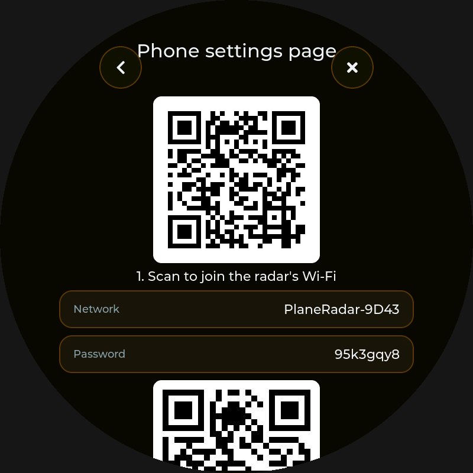

# Plane Radar P4 — User Guide

This guide covers every screen and setting on the device, plus flashing and
troubleshooting. For what changed in each version, see the
[changelog](../CHANGELOG.md).

**Contents**

- [First start](#first-start)
- [The radar screen](#the-radar-screen)
  - [What you're looking at](#what-youre-looking-at)
  - [Touch gestures](#touch-gestures)
  - [Buttons](#buttons)
  - [The aircraft info card](#the-aircraft-info-card)
  - [Flight history](#flight-history)
  - [Background maps](#background-maps)
  - [Clock and alarms](#clock-and-alarms)
- [Settings reference](#settings-reference)
  - [Wi-Fi](#wi-fi) · [Location](#location) · [Display](#display) ·
    [Sound](#sound) · [Traffic & data](#traffic--data) · [Filters](#filters) ·
    [Favorites](#favorites) · [Watchlist alerts](#watchlist-alerts) ·
    [Phone settings page](#phone-settings-page) · [About](#about)
- [Screenshots](#screenshots)
- [Alerts explained](#alerts-explained)
- [Flashing the firmware](#flashing-the-firmware)
- [Troubleshooting](#troubleshooting)

---

## First start

1. **Wi-Fi.** On first boot the device opens the Wi-Fi page and scans for
   networks. Tap yours and type the password on the on-screen keyboard (the
   eye button shows what you've typed). Open networks connect right away.
   For a hidden network, use **Hidden network...**.
2. **Location.** Next it shows the Location page. Pick one of:
   - **Pick on the map**: drag the map until the crosshair is on your house,
     then tap **Set home**.
   - **Enter coordinates**: latitude, then longitude, in decimal degrees.
     West and south are negative (use the ± key).
   - **Use an airport**: type a code like `KRDM`, `RDM`, `BDN` or `S39`.
3. Tap **X** to go to the radar. Traffic appears within a few seconds.

You can redo any of this later from **Settings** (the gear button).

---

## The radar screen

### What you're looking at

| Element | Meaning |
|---|---|
| **Home marker** (white ring with a dot) | Your home location. Range rings and the sweep are centered on it. |
| **Range rings** | Distance from home, labeled in your units (km, mi or nm). Spacing adapts to the zoom level. |
| **Compass bezel** | North is always up. N/E/S/W and every 30° are marked around the edge. |
| **Aircraft symbols** | Point the way the nose is facing. Shapes: light aircraft, jets, heavies, helicopters, ground vehicles. |
| **Colors** | With *Aircraft colors → By altitude*: orange (low) → green → blue → magenta (high). Otherwise the theme color. |
| **Labels** | Line 1: callsign (or registration). Line 2: altitude, a climb/descend arrow (over 400 ft/min) and the type code. Altitude is in feet below 18,000 ft, e.g. `4500`, and as a flight level above, e.g. `FL350`. `GND` = on the ground. |
| **Speed vector** (thin line ahead of an aircraft) | Where it will be in **one minute** at its current speed and track. |
| **Trail** | Where the aircraft has been over the last few minutes, colored by altitude at each point. |
| **Rim dots** | Aircraft beyond the edge of the screen, shown at the correct bearing. |
| **Red pulsing ring** | Emergency: squawk 7500 (hijack), 7600 (radio failure) or 7700 (general emergency). |
| **Gold ring + star** | One of your [favorites](#favorites). |
| **Runways and codes** | Airports from the built-in database. Large airports show below 250 km of zoom, medium below 70 km, small fields below 35 km. Faint thin runways are unpaved, or placed approximately (strips with no surveyed coordinates). Codes are ICAO (`KRDM`), but fields with only a local code use their IATA code if they have one (Prineville `S39` shows as `PRZ`). See **Airport code style**. |
| **Altitude key** (under the status pill) | The altitude color scale from 0 to 40,000 ft. Shown when **Aircraft colors** is **By altitude**; it fades out with the buttons. |
| **Status pill** (top) | Aircraft count, filtered count, zoom radius, and any problem (Wi-Fi, feed errors, stale data). Tap it: it opens Wi-Fi when offline, About when online. |

Between data updates (every 5 s by default) aircraft keep moving along their
track at their reported speed, so motion stays smooth. An aircraft the feed
stops reporting disappears after 45 seconds.

### Touch gestures

| Gesture | Action |
|---|---|
| **Drag** with one finger | Pan the map. Flick it and it keeps gliding. |
| **Pinch** with two fingers | Zoom in or out around the point between your fingers. |
| **Double-tap** | Zoom in 2× on that spot. |
| **Tap an aircraft** | Open its [info card](#the-aircraft-info-card). Tap empty map to close it. |
| **Long-press** the map | Asks whether to make that spot your home location. |

Zoom ranges from a 1 km to a 460 km radius. The radar fetches traffic for
whatever area you're looking at, up to the feeds' 250 nm limit.

### Buttons

| Button | Position | Action |
|---|---|---|
| ⚙ Gear | top right | Open Settings |
| 👁 Eye | right | Open the [Filters](#filters) page (same eye as in Settings). Lit while a filter is hiding aircraft. |
| 🖼 Picture | lower right, next to Home | Choose the [background map](#background-maps): Off, Dark streets, Topo, FAA sectional, Satellite or Street map |
| 🔊 Speaker | left | Mute or unmute all sounds (same as **Sound → Sound**) |
| ⏻ Power | left, below the speaker | **Sleep**: turns the screen off and mutes all sounds. One tap anywhere wakes it (that tap does nothing else). Traffic keeps updating while asleep. Alarms stay silent while asleep unless **Wake on alarm** is on (Clock & alarms). |
| 🕘 Clock | right, below the eye | Switch the bezel between compass headings and a [clock face](#clock-and-alarms) (lit = clock) |
| 📷 Camera | right, below the clock | Save a [screenshot](#screenshots) of the radar on the SD card |
| ⟳ Loop | top left | Turn the radar sweep animation on or off (lit = on) |
| ＋ / − | lower right / lower left | Tap: zoom in / out a little (1.25×), smoothly; quick taps add up. Hold: keeps zooming, gently speeding up, until you let go. |
| ⌂ Home | bottom | Fly back to home at your **Home zoom**. It's dimmed when you're already there. |

With **Auto-hide buttons** on (the default), the buttons and the status pill
fade out after 10 seconds without a touch. Touch anywhere to bring them back.
They stay visible while an info card is open, and while the status pill is
reporting a problem (offline, feed errors).

### The aircraft info card

| Field | Meaning |
|---|---|
| Callsign + type badge | Flight number (or registration) and ICAO type code, e.g. `B738`. **MIL** = military. |
| Route | Where the flight is from and going, e.g. *Dublin (DUB) > Lanzarote (ACE)*. Shown when the route is known. |
| Airline line | The airline (or the registered owner for private and military aircraft) and the exact model, e.g. *Ryanair - Boeing 737-8AS* |
| Next line | Registration, ICAO hex address, emitter category (e.g. `cat A3`), and the [flight history](#flight-history) status |
| ALT | Barometric altitude in feet (or "Ground") |
| V/S | Vertical speed in ft/min (+ climbing, − descending) |
| SPEED | Ground speed in knots |
| TRACK | Direction of travel in degrees |
| FROM HOME | Distance and bearing from your home |
| SQUAWK | Transponder code |

Card buttons:
- ★ **Star**: save or unsave as a [favorite](#favorites). Gold = saved.
- 🔇 **Mute**: silence this aircraft: no new-aircraft chime, proximity
  alert or watchlist alert for it from now on (lit = silenced). Emergency
  squawks still sound. Silencing a favorite takes it off the favorites, and
  starring a silenced aircraft un-silences it. Manage the list under
  **Sound → Silenced aircraft** (or the phone page's Favorites tab).
- ➤ **Follow**: keep this aircraft on screen. The map re-centers whenever it
  drifts away from the middle. Panning or pinching stops following.
- ✕ **Close**: close the card.

**Where the airline and route come from.** When you tap an aircraft, the radar
looks it up on [adsbdb.com](https://www.adsbdb.com), a free database of
airframes and callsign routes. Routes are matched by flight number from a
community-maintained list, so occasionally they are out of date (a flight
number reused for a different route) or missing, mostly for private,
military and charter flights. Results are remembered for the last 24 aircraft.
The card says *Looking up airline and route...* while it waits, and
*No airline or route info* if adsbdb knows nothing. Turn it off with
**Display → Airline and route on tap**.

### Flight history

When you tap an aircraft, the radar downloads its **flight history** and
draws it as a thicker line behind the aircraft, colored by altitude like the
trails. A small ring marks where the flight started (its takeoff, if the
feed saw it). Zoom out to see the whole route.

- The card's second line shows the progress: *loading history...*, then
  *history 1h 42m* (how much of the flight is shown), or *no history*.
- Only the current flight is shown. If the aircraft landed and took off again
  today, the earlier legs are left out. At most the last 14 hours are drawn.
- The history refreshes every 2 minutes while the card is open, so it stays
  joined to the live trail.
- The history comes from the globe map of the selected **ADS-B feed** (with
  the other two feeds as backups). These history files aren't an official
  API, so a feed may stop serving them; the card then says *no history* and
  the normal trail still works.
- Turn it off with **Display → Flight history on tap**.

### Background maps

**Display → Background map** puts a real map under the radar:

- **Dark streets**: roads, water and (optionally) place names on black, from
  CARTO's "Dark Matter" map. CARTO now requires a free API key (request one
  at [carto.com/basemaps](https://www.carto.com/basemaps/apikey/)); enter it
  under **Display → CARTO key**, or save it as the only line of a file
  `carto_key.txt` in the root of the SD card. **Without a key**, Dark streets
  shows OpenStreetMap's standard map instead, darkened and tinted (its place
  names are always on). A missing or wrong CARTO key shows up as tiles
  stamped "API KEY REQUIRED".
- **Topo**: contour lines, forests, roads and peaks, from OpenTopoMap.
- **FAA sectional** ("FAA" in Display settings): the FAA's VFR Sectional
  charts (airspace, airports, frequencies, terrain), from the FAA's own
  online chart service. US only. They're always shown in their own colors
  (**Tint** doesn't apply); use **Map brightness** to tone them down.
  Aircraft labels get a dark backing so they stay readable. Charts are
  printed at 1:500,000, so when you zoom in close they're simply enlarged,
  and when zoomed far out (beyond about 150 mi) the chart pieces are shrunk.
  **Not for navigation.**
- **Satellite**: aerial and satellite photos from Esri World Imagery, in their
  own colors (**Map brightness** tones them down). Aircraft labels get a dark
  backing.
- **Street map**: OpenStreetMap's standard map in its own colors, with
  **street names once you zoom in** to a few miles (at the closest zoom, 1 km,
  every street is named). Use this rather than Dark streets when you want to
  read the names.

With **Tint map to theme color** on (the default) the map is redrawn in the
theme's color, so it looks like part of the radar; topo is inverted so its
white background turns dark. **Map brightness** keeps it in the background.

Map pieces (tiles) are downloaded for the area on screen as you pan and zoom.
The closest ones load first, and a blurry larger-scale version stands in
until the sharp one arrives. While you drag or pinch, the last map picture
moves along with your fingers and is redrawn sharply when you let go.

Tiles are saved on the [SD card](#sd-card) if there is one, and kept in
memory otherwise. The map's credit line ("(c) OpenStreetMap contributors...")
is shown at the bottom while a map is on, as the map providers require. Like
the buttons, it fades out after 10 seconds and comes back with any touch.

The map services are free community services for light personal use, which
is how the radar uses them: it only downloads what you look at, and saves
it. They're not meant for bulk downloading, so there is no "download a
whole region" button.

### Clock and alarms

Tap the clock button to turn the radar into a clock. The compass headings
around the edge are replaced by the numbers 1–12 with minute marks, and hour,
minute and (optionally) seconds hands sweep from the middle, under the
aircraft. A date window sits at three o'clock. The radar keeps working as
usual. Tap the button again for the compass.

The time comes from the internet (NTP), so after power-up the clock needs
Wi-Fi; until then the face says *Waiting for the time...*. Set your time zone
in **Settings → Clock & alarms**. Daylight saving time is handled
automatically.

When an alarm goes off, a full-screen notice shows the time with **Snooze 9
min** and **Stop**. The screen wakes up if it was dimmed, and the alarm beeps
every 2 seconds at no less than 70 % volume, **even if sound is switched
off**. If you've put the screen to sleep with the power button, alarms only
ring if **Wake on alarm** is on. It stops by itself after 10 minutes.

---

## Settings reference

Open with the gear button (or the eye button for Filters).

- Changes show up right away, so you can see what they do.
- **<** goes back a level. On the main settings page it returns to the radar
  and **keeps** your changes.
- **X** returns to the radar and **discards** everything you changed since you
  opened settings: options, home location, filters, theme and removed
  favorites. It says *Changes discarded*. Two things can't be undone this way:
  Wi-Fi (joining or forgetting a network happens right away) and a restart you
  confirmed (screen rotation, erase settings).

### Wi-Fi

| Option | What it does |
|---|---|
| Status | Current network, IP address and signal strength (dBm, closer to 0 is better) |
| Saved networks | Up to five. ✓ marks the connected one, *first* the one tried first. Tap one to connect; the trash button forgets it. |
| Networks nearby | Tap a network to join it. Saved ones are marked *saved* and connect without asking for the password again. Bars are colored by signal; the eye icon marks secured networks. |
| Scan again | Refresh the list |
| Hidden network... | Type a network name (SSID) that isn't broadcast, then its password |

Joining a new network keeps the previous ones saved; with five saved, the
oldest is dropped. If the connection drops, the radar retries by itself. With
more than one network saved, it moves on to the next one after 20 seconds
without a connection (handy when the radar travels between home, a cabin and a
phone hotspot), and whichever connects becomes the one tried first.

Short messages show what's happening: *Connecting to HomeNet...*, *Connected to
HomeNet*, *Lost Wi-Fi (HomeNet) - reconnecting* and, if it can't connect,
why (*Wrong password*, *Network not found*, ...).

The saved networks are also in [settings.txt](#settingstxt-and-favoritestxt)
(`wifi_ssid`/`wifi_pass` for the first, `wifi2_ssid` ... `wifi5_pass` for the
others).

### Location

| Option | What it does | Default |
|---|---|---|
| Latitude / Longitude | Your current home point | Roberts Field (RDM), Redmond, Oregon |
| Pick on the map | Closes settings and shows a crosshair. Drag the map under it, then tap **Set home**. This also saves the current zoom as the Home zoom. | |
| Enter coordinates | Type latitude (−90 to 90), then longitude (−180 to 180) | |
| Use an airport | Jump home to an airport by ICAO (`KRDM`), IATA (`RDM`) or FAA code (`S39`, `BDN`) | |
| Home zoom (radius) | How far the view reaches when you press Home, from the center to the edge of the screen | 25 km |

Home is the center of the range rings and the sweep, and the reference for
proximity and favorite alerts.

### Display

| Option | What it does | Default |
|---|---|---|
| Theme | **Green** (classic phosphor), **Amber**, **Blue**, **Night** (dim red to preserve night vision; aircraft colors stay red), **Custom** (your own colors, see below) | Green |
| Custom colors | Only with the Custom theme: opens the [Custom colors](#custom-colors) page | |
| Brightness | Backlight level, 5–100 % | 80 % |
| Distance units | km, statute miles (mi) or nautical miles (nm), for rings, the zoom readout and distances | mi |
| Screen rotation (clockwise) | Turn the whole picture by 0°, 90°, 180° or 270°, e.g. when the board is mounted with its USB port on another side. 0° is the board standing upright (what was 180° before v1.10; boards upgrading keep their orientation and the menu value is converted). North stays at the top of the rotated screen and touch follows the rotation. Asks to restart, which applies it. If you skip the restart, it applies at the next power-up. | 0° |
| Auto-hide buttons after 10 s | Fade the radar buttons out when idle; touch to show them again | On |
| Labels | **Off**: no labels, except the selected aircraft, emergencies and favorites. **Callsign**: one line. **Full**: callsign + altitude/climb/type. | Full |
| Aircraft colors | **Theme**: one color. **By altitude**: color gradient by altitude. | By altitude |
| Aircraft size | Size of the aircraft symbols, 60–160 % | 100 % |
| Label size | **Small**, **Normal** or **Large** text for aircraft labels | Normal |
| Trails | Show where aircraft have been (the last few minutes) | On |
| Flight history on tap | Download and draw the whole current flight of the aircraft you tap. See [Flight history](#flight-history). | On |
| Airline and route on tap | Look up the airline, origin, destination and model of the aircraft you tap, see [the info card](#the-aircraft-info-card) | On |
| Speed vectors (1 min) | Line showing each aircraft's position one minute ahead | On |
| Range rings | Distance rings and crosshair around home | On |
| Runways | Draw airport runways | On |
| Airport codes | Label airports with their code | On |
| Background map | **Off**, **Dark streets**, **Topo** (terrain contours, forests and roads), **FAA** (VFR sectional charts), **Satellite** (photos) or **Street map** (street names when zoomed in). See [Background maps](#background-maps). | Off |
| Place names (street map) | Show town and road names on the dark street map | On |
| Tint map to theme color | Recolor the map in the theme's color (green, amber, blue, red at night). Topo is inverted so it stays dark. Off shows the map's own colors, dimmed. | On |
| Map brightness | How bright the map is behind the radar, 10–100 % | 60 % |
| SD card | Opens the [SD card](#sd-card) page | |
| Airport code style | **ICAO** (`KRDM`; fields with only a local code such as `S39` use their IATA code, `PRZ`) or **IATA** (`RDM`, wherever one exists) | ICAO |
| Radar sweep | The rotating beam animation | On |
| Sweep speed | Revolutions per minute, 4–60 | 15 rpm |
| Sweep trail | Length of the glowing trail behind the beam, 0–180°. **0 = clean bar** (just the beam line). | 70° |
| Smooth trail fade | Draws the trail in finer steps with a softer, longer fade (no visible bands). Uses slightly more processing. | Off |
| Echoes fade after the beam | Aircraft dim after the beam passes and brighten on the next pass, like a real radar scope. Selected aircraft, emergencies and favorites stay bright. | Off |
| Dim when idle | Lower the backlight after Never / 1 / 5 / 15 / 30 minutes without a touch. Touch to wake. | Never |
| Dimmed brightness | Backlight level while dimmed, 0–50 % | 10 % |
| Night mode | Do something different between two times of day (needs the time from the internet) | Off |
| At night | **Dim the screen**: use the night brightness. **Sleep**: put the radar to sleep, as the power button does (screen off, sounds muted). See below. | Dim the screen |
| Night is | **Set times**: between the two times below. **Sunset to sunrise**: from sunset to sunrise at your home location, worked out for each day (today's times are shown underneath). | Set times |
| Night starts / ends | The night window, in 15-minute steps; it can cross midnight (with **Set times**) | 10:00 PM / 7:00 AM |
| Night brightness (when dimming) | Backlight level at night, 1–100 % | 20 % |

**Sleeping at night.** With **At night** set to **Sleep**, the radar goes to
sleep when the night starts and wakes up by itself when it ends. A tap still
wakes it during the night; once it has been left alone for a minute it goes
back to sleep. Alarms follow **Wake on alarm** as with the power button, and
traffic (and the daily log) keep updating while it sleeps.

#### Custom colors

Pick **Custom** as the theme, then tap **Custom colors**. Four swatches at the
top preview the radar color, background, aircraft and labels as you move the
sliders. The whole screen switches to the new colors when you let go of a
slider.

| Option | What it does | Default |
|---|---|---|
| Radar color: hue / saturation | The main color: sweep, rings, compass, trails and buttons. Hue goes around the color wheel (0 red, 120 green, 200 blue). Saturation 0 is gray. | 175°, 80 % (teal) |
| Background brightness | 0 = black; higher values give a tinted background | 6 % |
| Rings and compass brightness | How bright the range rings and compass marks are | 45 % |
| Aircraft color: hue / saturation | Aircraft symbol color when **Aircraft colors** is set to **Theme**. Saturation 0 = white. | White |
| Label color: hue / saturation | Aircraft label text color. Saturation 0 = white. | White |
| Altitude colors: low / middle / high hue | The colors of the **By altitude** scale: at the ground, at 10,000 ft and at 40,000 ft, blended in between. The defaults (20°, 140°, 300°) give the standard orange → green → blue → magenta scale. The altitude key follows these colors. | 20°, 140°, 300° |
| Reset custom colors | Back to the defaults above | |

### Clock & alarms

| Option | What it does | Default |
|---|---|---|
| Time now | The current local time and date, or *Not set yet* before the clock has synced over Wi-Fi | |
| Time zone | Your zone, chosen from a list of 24 (US zones, Europe, Asia, Australia, ...). Daylight saving is automatic. | Pacific |
| Clock face on the radar | Same as the clock button | Off |
| 24-hour time | 19:45 instead of 7:45 PM, on the alarm screens and settings | Off |
| Seconds hand | Show the seconds hand on the clock face | On |
| Smooth seconds hand | The seconds hand sweeps continuously instead of ticking once a second (redraws the screen more often) | Off |
| Date window | The day and date at three o'clock | On |
| Hand colors | Hue and saturation for the hour and minute hands, and separately for the seconds hand. Saturation 0 = white. (The Night theme keeps them red.) | White hands, red seconds |
| Alarms 1–4 | Each shows its time and days. The switch turns it on or off; tap the row to edit it. | All off, 7:00 AM Mon–Fri |
| Wake on alarm (when asleep) | With the screen asleep (power button): **On** = alarms ring and wake the screen; **Off** = alarms pass silently and only a tap wakes it. Doesn't affect alarms while the screen is on. | Off |
| Cancel snooze | Shown while an alarm is snoozed, with the minutes left | |

**Editing an alarm:** **Hour** and **Minute** sliders (changing them switches
the alarm on), **Alarm on**, the days it repeats (tap **Mo**…**Su**), and
**Test this alarm**. With no days selected the alarm rings once and then
switches itself off.

### Sound

| Option | What it does | Default |
|---|---|---|
| Sound | Master switch for all sounds | On |
| Volume | Speaker volume, 0–100 %. A chime plays when you let go of the slider. | 60 % |
| Touches | Click on button presses | On |
| New aircraft | Soft chime when 1–3 new aircraft appear. It stays quiet for big batches, e.g. after you pan to a new area. | On |
| Each sweep (sonar ping) | Sonar ping once per sweep revolution | Off |
| Emergency squawks | Siren when an aircraft squawks 7500/7600/7700 or declares an emergency | On |
| Proximity alert | Three beeps when **any** airborne aircraft comes within the alert radius of home, below the altitude limit | **Off** |
| Alert radius | Proximity distance from home, 1–20 (your units) | 3 km |
| Below altitude | Only alert for aircraft below this altitude, 500–20,000 ft | 5,000 ft |
| Favorite detected | Fanfare when a saved aircraft comes into range | On |
| Favorite nearby | Two-tone chime when a saved aircraft comes within the nearby radius | On |
| Nearby radius | Distance from home for "Favorite nearby", 1–100 (your units) | 15 km |
| Silenced aircraft | Aircraft you muted from their info card, up to 32, with a button to unmute each | none |
| Test | Play each sound | |

See [Alerts explained](#alerts-explained) for exactly when each one fires.

### Traffic & data

| Option | What it does | Default |
|---|---|---|
| ADS-B feed | Where aircraft data comes from: **adsb.fi**, **airplanes.live** or **adsb.lol**. All three are free community networks with similar coverage. If the chosen one fails three times in a row, the radar switches to the next one (*adsb.fi isn't answering - using airplanes.live*) and tries the chosen one again every 10 minutes. About → Feed shows which one is in use. | adsb.fi |
| Update every | How often to fetch new positions, 2–30 s. Aircraft move smoothly in between either way. Please stay at 5 s or more for everyday use; these are free services. | 5 s |
| Filters... | Shortcut to the Filters page | |

### Filters

Filters decide which aircraft appear on the radar. **Favorites are always
shown**, whatever the filters, and their alerts still work. When filters are
hiding aircraft, the status pill shows how many, e.g. "3 aircraft (11
filtered)". Changes take effect at once.

| Option | What it shows / hides | Default |
|---|---|---|
| **Aircraft kinds** | One switch per kind, based on the category the aircraft broadcasts: | all on |
| · Light aircraft | Small piston aircraft (Cessna, Piper…) and ultralights | |
| · Small & business | Business jets and turboprops | |
| · Airliners | A320/737-size airliners | |
| · Heavies (757, widebody) | 757 and widebodies (777, 787, A350, 747…) | |
| · Fast jets | High-performance aircraft (mostly military fighters) | |
| · Helicopters | Rotorcraft | |
| · Gliders, balloons, drones | Gliders, balloons, UAVs, parachutists | |
| · Unknown category | Aircraft that don't broadcast a category. Quite a few don't; turn this off only to hide them. | |
| Military aircraft only | Hide everything not flagged as military in the feed's database | Off |
| Aircraft on the ground | Include taxiing and parked aircraft (shown in grey) | Off |
| Only types | Comma-separated ICAO type codes. A `*` at the end matches a prefix: `A32*` = the A320 family, `B7*` = Boeing 7-series. Empty = all types. | all |
| Hide below / Hide above | Altitude band, in 500 ft steps (up to 40,000 / 60,000 ft) | no limit |
| Slower than / Faster than | Ground-speed band in knots, e.g. hide anything slower than 100 kt to drop light traffic | no limit |
| Reset all filters | Back to showing everything (airborne) | |

Filters combine. For example, *Helicopters* only + *Hide above 3,000 ft* shows
low-flying helicopters.

### SD card

Map tiles you look at are saved on a microSD card (if one is inserted), so
they appear instantly next time and work **without internet** for those
areas. The card is optional; without one, the map still works and keeps the
most recent tiles in memory until the next restart.

| Option | What it does | Default |
|---|---|---|
| Card | Size and free space, *No card*, or why it couldn't be read | |
| Saved map tiles | How many tiles are saved and how much space they use | |
| Save map tiles to the card | Turn saving (and reading) tiles on the card on or off | On |
| Count saved tiles | Count again | |
| Delete saved map tiles | Removes the `tiles` folder's contents; maps download again as needed | |
| Remember airline and route lookups | Keeps what adsbdb.com said about each aircraft you tap in a `lookups` folder, so it shows at once next time, even offline. Routes are looked up again after a month, airframes after six months. | On |
| Delete saved lookups | Removes the `lookups` folder | |
| Look for a card again | For a card inserted while the radar is running | |
| Unmount (safe to remove) | Stops using the card so it can be taken out | |

Use a **FAT32**-formatted card (most cards up to 32 GB come that way; format
larger ones as FAT32 on a computer). The radar never formats a card. Tiles go
in a `tiles` folder, so the card can hold other files too. A whole city's
worth of tiles at a few zoom levels is typically a few tens of megabytes.

#### settings.txt and favorites.txt

With a card inserted, the radar keeps two text files in its root folder:

- **`settings.txt`**: every setting, including the Wi-Fi name and password,
  as `key = value` lines with a comment explaining each one.
- **`favorites.txt`**: your favorite aircraft, one per line.

They are written the first time the card is used and rewritten whenever you
change something on the screen. At startup (and when you tap **Look for a
card again**) the radar reads them back. So your setup survives anything that
erases the board, like a full `erase_flash`, and moving the card to a
second radar copies everything across.

You can edit both on a computer: take the card out (Unmount first, or power
off), edit, put it back, and restart. *Settings loaded from SD card* confirms
it worked. Lines you delete keep their current value, lines the radar doesn't
understand are skipped (the serial log lists them as `sd: settings.txt line
N: ...`), and the file is then rewritten in its standard layout.

```ini
[Display]
units = mi
theme = amber
rotation = 0          # 0, 90, 180 or 270 (takes a restart)

[Clock]
alarm1 = on 06:45 weekdays     # once, daily, weekdays, weekends, mon,wed,fri or mon-fri
```

In `favorites.txt`, each line is an ICAO hex code (6 characters), then
optionally a label and type. You can also type just a **tail number**:

```
a1b2c3   N123AB   B738
N456CD
```

When the radar starts, it looks up `N456CD` online, adds it, and replaces the
line with its hex code. A tail number it can't find is dropped (with a
*not found* notice). If there's no internet yet, the line stays until the next
start. The file is in charge: deleting a line there removes that favorite.

If you change settings on the screen while no card is inserted and then insert
one, the radar's settings win and are written to the card. *Factory reset*
deletes `settings.txt` but keeps `favorites.txt`.

### Favorites

Save an aircraft by tapping it and pressing ★ on its info card, up to 32.
You can also add one that isn't flying nearby: on the Favorites page tap
**Add by tail number** and type its registration (`N123AB`, `EI-DAC`) or its
ICAO hex address (`a1b2c3`). The radar looks it up on adsbdb.com and says
*N123AB added to favorites*, or *not found* if the database doesn't know it.
Favorites are tracked by the airframe's **ICAO address**, which never changes,
so a saved aircraft is still recognized under a different flight number.

On the radar, favorites get a gold ring, a star and an always-on gold label.
Off-screen, they show as a gold rim dot.

The Favorites page lists each saved aircraft with its type and ICAO address.
It also says whether it's **in range** right now and how far away it is, and
has a remove button.

Favorites are only "detected" inside the area the radar is fetching: roughly
what's on screen plus a margin, up to 250 nm. Zoom out to watch a wider area.

### Watchlist alerts

Announces interesting aircraft when they come within a distance of home,
with a notice on the screen ("Watchlist: RCH471 (C17, military), 23 mi") and
a sound of its own. Each aircraft is announced once per visit. Watched
aircraft are always shown on the radar, whatever the [filters](#filters).

| Option | What it does | Default |
|---|---|---|
| Watchlist alerts | Turns the whole watchlist on or off | On |
| Military aircraft | Any aircraft the feed marks as military | Off |
| Helicopters | Emitter category A7 | Off |
| Fast jets | Emitter category A6 (high performance) | Off |
| Types | ICAO type codes, e.g. `A388, B52, C17, F35`; `*` matches a prefix (`A38*` = any A380) | none |
| Callsigns | Callsigns or tail numbers, e.g. `RCH*, N123AB` (`RCH*` = US Air Force cargo flights) | none |
| Within | Distance from home | 25 mi |
| Play a sound | The watchlist sound (Sound settings has a switch and a test button too) | On |

Like favorites, aircraft are only seen inside the area the radar is fetching,
roughly what's on screen. To watch a wide area, zoom out.

### Phone settings page

Change settings from a phone or computer instead of the touch screen. That's
handy for Wi-Fi passwords and tail numbers. Open **Settings → Phone settings
page** on the radar and scan the QR code with your phone's camera. Or type
the address shown there, the radar's IP address with port 50080, e.g.
`http://192.168.1.42:50080`.

The page has tabs for:

- **Settings**: every setting, grouped like `settings.txt`. A change applies
  on the radar at once. Distances are set in km there, with miles shown next
  to them.
- **Watchlist**: the [watchlist](#watchlist-alerts).
- **Favorites**: add by tail number or hex code, rename, remove.
- **Wi-Fi**: the saved networks in the order they're tried, scan, add one
  (saved for later, or connect now), move up, forget.
- **Daily log**: today and the past week.
- **Screenshots**: take one, and view or download the saved ones.
- **Update**: install a firmware file (the one that ends in `-ota.bin`). The
  radar checks the file first. It refuses the full USB image and files for
  another board, shows the same progress screen as an update from GitHub, then
  restarts.

Anyone on your own network can open the page; it isn't reachable from the
internet. Turn it off with the **Phone settings page** switch when you don't
need it.

Why port 50080 and not a plain address: the radar's Wi-Fi chip (an ESP32-C6
next to the main processor) can run a network stack of its own, and then it
keeps incoming connections on ordinary ports such as 80 for itself. Only
ports 49152 to 61439 always reach the main processor.

**The radar's own Wi-Fi (hotspot).** If your phone can't reach the radar
through your router, tap **Start the radar's hotspot** on the same page. The
radar then also runs a small Wi-Fi network of its own (`PlaneRadar-XXXX`,
with a password), while staying connected to yours. Two QR codes appear:

1. The first joins your phone to that network: scan it with the camera and
   tap *Join*. If the phone says the network has no internet, choose to stay
   connected.
2. The second opens the page, at `http://192.168.4.1:50080`.

While the phone is on the radar's network it has no internet of its own; switch
back to your Wi-Fi when you're done. The hotspot turns off by itself 30 minutes
after the last phone has left, and with a restart.



**If the page doesn't open on the phone**, scroll down on the radar's Phone
settings page:

- **Server**: *Running and answering* means the radar asked its own page and
  got it, so the server works.
- **Phone visits**: counts every request that reached the radar from another
  device, and shows the last one's address.

If the server answers but *Phone visits* stays at *None yet* after you scan
the code, the phone can't reach the radar. Check that the phone is on the
same Wi-Fi network (not mobile data, not a guest network: guest networks keep
devices apart, and some routers have an "AP isolation" or "client isolation"
option that does the same), or use the radar's hotspot (above). If visits are counted but the page still
doesn't show, send the serial log; every request is logged as
`web: GET / from 192.168.1.23`.

| Option | What it does | Default |
|---|---|---|
| QR code | Opens the page on a phone | |
| Or open | The page's address | |
| Server / Phone visits | Whether the page is working and reached, see above | |
| Start the radar's hotspot | The radar's own Wi-Fi network for the phone, see above | Off |
| Phone settings page | Turn the page on or off | On |

### Daily log

What flew near home today: how many **different aircraft**, the **busiest**
moment (most at once), the **closest pass**, the **highest** and **fastest**
aircraft, how many were **military** or squawked an **emergency**, and which
**favorites** showed up. Only airborne aircraft within **Count aircraft
within** (default 25 mi) of home count, and only while the radar is showing
the area around home (it only receives traffic for the area on screen).

With an SD card, each day is saved as `log/YYYY-MM-DD.txt` (readable on a
computer), the count carries on after a restart, and **Earlier days** lists
the last week. The count needs the time from the internet to know when a day
starts.

### Updates

| Item | Meaning | Default |
|---|---|---|
| Installed version | The firmware running now | |
| Latest version | Result of the last check: *Up to date*, *vX.Y.Z available*, or why it couldn't check | |
| Check now | Looks up the latest release on GitHub | |
| Install vX.Y.Z | Appears when a newer version is available; see [Updating over Wi-Fi](#updating-over-wi-fi) | |
| Check for updates automatically | A minute after start and then hourly. Nothing installs without asking. | On |

### About

| Item | Meaning |
|---|---|
| Firmware | Installed version |
| Display | Panel resolution (800×800 = 3.4", 720×720 = 4") |
| Wi-Fi | IP address and signal strength |
| Feed | Aircraft count and seconds since the last successful update, or the last error |
| Free memory | Internal RAM and PSRAM free (useful for bug reports) |
| Running for | Time since the radar started |
| Last restart | Why it last started: power on, restarted by the radar, reset button, or a problem (crash, watchdog, power dip) |
| Starts | How many times it has started, and how many of those were unexpected (crashes, watchdogs, power dips) |
| On-screen stats | Small live numbers in the lower left, see below. Off by default. |
| Restart | Reboot the device |
| Factory reset | Erase Wi-Fi, location, settings and favorites, then reboot |

**On-screen stats**, line by line (times are per frame, averaged over the last second):

| Line | Meaning |
|---|---|
| `30 fps, frame 9.2 ms (max 14), 35% redrawn` | Frames drawn per second; time per frame, and the slowest one; how much of the screen each frame redraws (only what changed is redrawn) |
| `draw 6.1 + panel 3.1 ms (rotate 1.4)` | The frame split into drawing the picture and handing it to the screen (turning it for the screen's orientation, then copying it) |
| `radar 2.3 ms, background 12 ms (1)` | The radar's own drawing (sweep, aircraft, labels), and rebuilding its background layer (map, rings, trails) in the last second, with how many times |
| `CPU 23% net, 41% UI` | How busy each processor core is |
| `RAM ... PSRAM ...` | Free memory (and the lowest it has been) |
| `16 aircraft (decode 9 ms), -54 dBm` | Aircraft shown, time to decode the last traffic update, Wi-Fi signal |
| `up 2:13:05, UI pause 12 ms` | Time since start, and the longest the screen went without updating |

---

## Screenshots

The camera button on the radar (right, below the clock) saves a picture of
the screen, without the buttons, on the SD card. It's saved as
`screenshots/YYYY-MM-DD_HH-MM-SS.png`, a full-resolution PNG of about
150-300 KB. View and download them from the [phone settings
page](#phone-settings-page) (Screenshots tab), where you can also take one.
Screenshots need an SD card.

## Alerts explained

Each data update plays at most **one** sound, the most important one, in this
order:

1. **Emergency squawks**: an aircraft starts squawking 7500/7600/7700 or
   reports an emergency.
2. **Favorite nearby**: a favorite enters the Nearby radius around home. It
   plays once per approach; the aircraft has to leave the radius before it can
   trigger again.
3. **Favorite detected**: a favorite appears in the data. This also happens
   right after power-on, and again if it disappears for over 45 s and comes
   back.
4. **Proximity alert** (off by default): any airborne aircraft below the
   altitude limit enters the alert radius. Once per approach.
5. **New aircraft**: 1–3 aircraft appeared that weren't there before.

The **watchlist** sound comes right after emergencies (see
[Watchlist alerts](#watchlist-alerts)).

Favorite events also show an on-screen notice ("RCH471 is nearby") even when
their sound is off. The **Sound** master switch silences everything.

---

## Updating over Wi-Fi

From v1.13.0 on, the radar can update itself.

- **Update button on the radar** (v1.14.0 and later; the download arrow
  between Home and zoom-out). The radar checks GitHub a minute after it starts
  and then every hour (turn that off under **Settings > Updates**). Normally
  the button is grayed out; tap it to check right away. When an update is
  available it **lights up**. It fades with the other buttons; touch the
  screen to bring them back, then tap it to install.
- **Settings > Updates > Check now**, then **Install vX.Y.Z**. (Before
  v1.16.0 these were on the About page.)

Either way, you confirm before anything is downloaded.
It downloads about 6 MB from GitHub, shows the progress, and restarts into
the new version. This takes a few minutes; keep the power on.

- **Your settings and favorites are kept.**
- **It's safe to interrupt.** The new version is written next to the running
  one, which isn't touched until the download is complete and checked. If
  the power goes out or Wi-Fi drops mid-download, the radar keeps running the
  old version; just try again.
- **A bad update undoes itself.** A new version that crashes or resets in its
  first minute is rolled back to the previous one at the next start.
- **Emergency way back (v1.17.0 and later):** if a new version runs but is
  unusable (a black screen, for example), switch the power off and on three
  times in a row, each time within 20 seconds of it starting. The radar then
  goes back to the version installed before. It says so on the screen
  (*Went back to ...*), and About → Starts counts it.
- The radar picks the file for its own board, so it can't install the wrong
  one.

**Coming from v1.12.x or older:** update over USB once to v1.13.0 (see below).
Older versions can't update themselves, and v1.13.0 splits the flash into
two app slots. Your settings are kept: they sit at the same place as in
v1.12.x.

## Flashing the firmware

Each [release](https://github.com/ShadowStacker/P4-Radar/releases) has one
image per board:

| File | Board |
|---|---|
| `plane-radar-4in-720x720-chip-v1-<version>.bin` | ESP32-P4-WIFI6-Touch-LCD-4C |
| `plane-radar-3.4in-800x800-chip-v1-<version>.bin` | ESP32-P4-WIFI6-Touch-LCD-3.4C |

They're built for ESP32-P4 chip revision v0.x / v1.x, which is what these
boards have. (Releases up to v1.13.0 also had `chip-v3` images for revision
v3.x chips; those are no longer built.)

**Use the file without `-ota` in its name.** The `*-ota.bin` files next to
them are for [updates over Wi-Fi](#updating-over-wi-fi) only. They have no
bootloader, so flashing one over USB gives a black screen and the serial log
shows `invalid header`. Flashing the right file fixes it.

On a board with a v3.x chip the image doesn't boot (the serial log shows
`Illegal instruction` right after `entry 0x...`, or `Image requires chip rev`).
`python -m esptool --chip esp32p4 chip_id` shows the revision.

### With esptool (recommended)

```bash
pip install --upgrade esptool
python -m esptool --chip esp32p4 -p COM3 erase_flash          # optional; clears settings (not the SD card copy)
python -m esptool --chip esp32p4 -p COM3 -b 460800 write_flash 0x0 plane-radar-4in-720x720-chip-v1-v1.3.0.bin
```

Replace `COM3` with your port (`/dev/ttyACM0` on Linux,
`/dev/cu.usbmodem…` on macOS). Skip `erase_flash` to keep your settings and
favorites. (Versions before v1.12.0 kept settings where the update image
overwrote them, so every update reset them. From v1.12.0 on they're kept, and
an SD card holds a second copy; see [settings.txt](#settingstxt-and-favoritestxt).)

### With esptool-js (browser)

1. Open https://espressif.github.io/esptool-js/ in Chrome or Edge and click
   **Connect**.
2. **Change Flash Address from `0x1000` to `0x0`.** This is the most common
   mistake. At the wrong address the board logs `invalid header: 0xffffffff`
   and resets in a loop.
3. Choose the `.bin`, then click **Program** and wait for it to finish.
4. Press **RESET** on the board.

If the board isn't detected, hold **BOOT**, tap **RESET**, then release BOOT.

### Building from source

See the [README](../README.md#building-and-flashing). You need ESP-IDF v5.5.2
or newer.

---

## Troubleshooting

**The serial log helps with everything.** Open a terminal at **115200 baud**,
press RESET, and copy everything from `ESP-ROM:` onward. Each release has
`symbols-*.elf` files for decoding crash backtraces.

**Opening the serial port restarts the radar.** That's the board, not the
firmware: the USB-serial chip's DTR/RTS lines are wired to the reset and boot
pins (so esptool can flash without pressing buttons), and most terminals
switch them when they open the port. The log still shows everything after
that restart. Leave the terminal open, wait for the radar to start, then do
what you want to log. To connect without a restart, turn DTR and RTS off in
the terminal before opening the port (e.g. Tera Term, CoolTerm or
`python -m serial.tools.miniterm --dtr 0 --rts 0 COM5 115200`). Don't
open and close the port three times in a row within 20 seconds of each start,
or the radar goes back to the previous version (see [About](#about)).

| Symptom | Likely cause and fix |
|---|---|
| Black screen, USB keeps disconnecting | Wrong address or wrong chip image. `invalid header: 0xffffffff` → flash at `0x0`. `Illegal instruction` at `entry` → the board has a v3.x chip, which current releases don't support. |
| "PLANE RADAR – Loading..." then a reboot | A crash during start-up. Send the log; the `abort()` line plus backtrace pinpoints it. |
| Boot screen says "Wi-Fi module not responding" | The P4 can't talk to the ESP32-C6. The radar still runs, but offline. Power-cycle the board. If it persists, the C6's ESP-Hosted firmware may need updating. |
| Log says `major version mismatch — OTA coprocessor` | A recommendation to update the C6 firmware. Older C6 firmware still works with this version. |
| "Wrong password?" or "Network not found" in the status pill | Re-enter the password on the Wi-Fi page. The C6 supports 2.4 GHz networks. |
| "Rate limited - slow down polling" | The feed is asking for fewer requests. Raise **Update every**, or switch **ADS-B feed**. |
| "Loading traffic..." forever | Check the internet connection, or try another feed. |
| No aircraft, but everything else works | Check **Filters** (the status pill says "filtered"). Also zoom out; there may simply be no traffic nearby. |
| Airline or route is wrong | Routes come from adsbdb.com's community list by flight number, and can be stale. Corrections can be reported on [adsbdb's GitHub](https://github.com/mrjackwills/adsbdb/issues). |
| Small airports missing | They appear below about 35 km of zoom. Check **Runways** and **Airport codes** in Display. |
| Animation feels slow | The radar sweep is the most expensive animation: lower **Sweep trail** (0 = clean bar is cheapest), turn off Smooth trail fade, or turn the sweep off. Zoomed far out with hundreds of aircraft, symbols get smaller automatically. The serial log prints a `perf:` line every 30 s (frame rate and where the time goes); send it along when reporting slowness. |
| Picture is the wrong way round | Set **Display → Screen rotation**, then restart. |
| Menus or touch feel sluggish at times | Background work (map tiles, the flight history of a selected aircraft) now pauses while you touch the screen and while the menu is open. If it still happens, deselect the aircraft and try with the background map off to narrow it down. The serial log prints a `health:` line every 30 s: free memory, CPU load per core, the busiest tasks, and the longest the screen went without updating. Send a few of those lines from around the slowdown when reporting it. |
| Black screen right after flashing | Make sure you flashed the file **without** `-ota` in its name, at `0x0`. Hold BOOT, tap RESET, release BOOT, and flash again. If it's still black, the first lines of the serial log (115200 baud) say why. |
| Background map stays blank | It needs Wi-Fi the first time an area is viewed (or saved tiles on the SD card). The serial log shows `map: tile ... -> HTTP <code>` for tiles that failed. |
| SD card says "No card" | Insert it with the power off, or tap **Look for a card again**. It must be FAT32. |
| Clock shows "Waiting for the time..." | It hasn't reached an internet time server yet. Check Wi-Fi; the time is set within a few seconds of connecting. |
| Clock is off by whole hours | Choose your **Time zone** in Clock & alarms. |
| Freezes while rotated (v1.4.0–v1.5.0) | Fixed in v1.5.1; flash it. Your rotation setting is kept. |
| Touch is mirrored or rotated (picture is right) | Report it with your board model and rotation setting. |
| Card says "no history" | The feed doesn't have this aircraft's history (common for aircraft that just appeared, or TIS-B/MLAT-only targets), or its history files are unreachable. Try another **ADS-B feed**. |
